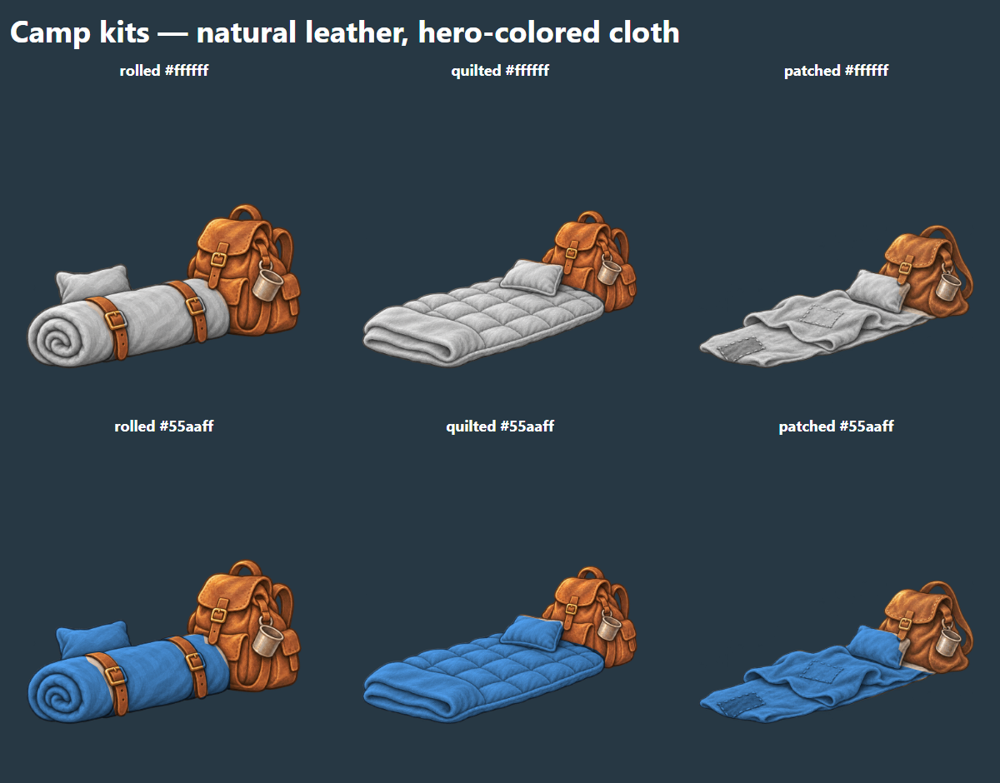

# Brief: camp art

**Status:** Phase 1 delivered (#615), with three hero-colored bedroll styles. The design is [docs/camp.md](../camp.md) (§3.1 backdrops, §4.1
frame stages, §8.3 lanes and stand points, §8.4 actions and moving parts). The prompts are in
[docs/camp-art-prompts.json](../camp-art-prompts.json); the paintings are made from them, then
checked by `npm run art:verify` and counted by `npm run art:inventory`.

## The contract: `assets/manifest.json` → `camp`

The manifest's `camp` section is the one place the layout lives. The art is painted for it, the
client walks figures over it, and `tools/art/verify.py` checks it. Change a lane and the backdrop
prompt's pixel figures change with it.

- **Coordinates are fractions of `backdropCanvas`** (1920 × 1080): x from the left, y from the
  top. A lane's `y` is the ground line where a figure's or piece's ground contact (the figure
  canvas origin, 512, 900) stands.
- **Backdrops** (`backdrops[]`, one per terrain family in `biomeFamilies`) carry the ground:
  two or three `lanes`, back to near (each lower on screen and no smaller in `scale` than the one
  behind), and the `crossings` where a figure may change lanes. `open_plains` is required: it is
  the fallback for every family not painted yet.
- **Frames** (`frames[]`, one per frame stage) carry the camp: `pieces` standing on a lane,
  `movingParts` laid over a piece, `standPoints`, and the `trailhead`. Frames are shared by every
  backdrop, so a frame's lanes and x positions must fit every backdrop's lanes.
- **Clear of the words.** No lane, and so no stand point, is below 78 percent of the height: the
  lobby panels cover the bottom 22 percent. The camp's pieces keep to the middle third; free
  wander spots (no action) stay outside it.
- **Every frame seats the full party**: one `rest` stand point for each seat 0 to 3.

## Formats

| Art | Path | Canvas | Format |
| --- | --- | --- | --- |
| Camp backdrop | `assets/camp/backdrops/<family>.webp` | 1920 × 1080 | WebP, opaque (the biome background format) |
| Piece | `assets/camp/frames/stage<N>/<piece>.png` | 1024 × 1024 | PNG, RGBA cutout, lowest opaque row at y 900 (±12), 8px clear margin |
| Moving part | `assets/camp/frames/stage<N>/<piece>-<part>.png` | 1024 × 1024 | PNG, RGBA, registered pixel for pixel over its piece, nothing below y 912 |

- **Style**: the storybook gouache of the biome backgrounds and the story props (the backdrop
  matches `assets/biomes/plains/bg.webp`; the pieces match `assets/story-props/camp-firepit.webp`).
  No text, no heroes drawn (the existing hero figures stand in the camp), never scary.
- **Backdrops are empty campsites**: a calm clearing with a plain, readable ground band where the
  lanes fall, the middle third the openest part of it, a quiet lower band, and the trail leaving
  at the trailhead's edge. Nothing a figure could seem to stand inside.
- **Pieces fill their canvas the way figures do**: whole object inside the margin, resting on
  y 900. The client sizes them on the stage from the piece's `heightCm` in the manifest (its
  true painted height, scaled like a figure's and by its lane), so a campfire stands at its real
  size beside a hero. Stage 1: campfire 60, bedroll 40 (its pack is the tallest part), trailhead
  post 120.
- **A moving part only where a stand point animates the piece** (§8.4), and made from the
  finished piece itself (cut from the same painting, its base feathered into the piece) so the
  two always stack. A piece nobody uses needs none.
- **One painting can serve many pieces**: the four stage-1 bedrolls share `bedroll.png`.

## Pending art

Missing camp art is owed, not a failure: `art:verify` warns "not yet delivered" and passes (also
under `--strict`, as it does for story plates and key art), `art:inventory` lists it under
**Camp art**, and the client draws its own stand-in until the painting lands. There are no
placeholder files: a file at a declared path counts as delivered, so nothing goes there until it
is the real painting. Any file under `assets/camp/` the manifest does not declare fails
`art:verify`.

## Phase 1 (#615)

The `open_plains` backdrop and the stage-1 frame: a small campfire, a neutral bedroll and pack
(the same painting at all four seats), the trailhead post, and the campfire's flame (motion
`flicker`). Five paintings in all.

## Hero-colored bedrolls: the implemented format

Three styles are declared in `manifest.camp.kitStyles`: `rolled`, `quilted`, and `patched`.
Each is one 1024 × 1024 RGBA painting under `assets/camp/kits/`, with neutral light cloth,
natural leather and metal, and the same y 900 ground contact as the neutral bedroll.
Prompts are in [camp-kit-art-prompts.json](../camp-kit-art-prompts.json).

`world/CampBedroll.tsx` draws the natural painting first. A second instance of that **same
image** is clipped to the registered cloth paths in `world/camp-kit-art.ts`, converted to
luminance, and multiplied by the hero's `appearance.accent` in sRGB. Outlines and folds retain
their shading; leather straps, buckles, packs and cups retain their natural colors. This
settles the earlier proposed two-PNG convention for these bedrolls: one painting and an SVG
cloth mask keep every pixel registered, without generating two layers independently.
Filter and clip IDs are unique per seat. Invalid accents use meadow teal, and a failed style
image falls back to the original neutral Phase 1 painting.

The hero's character ID determines a stable style, independent of party order or reconnects.
No new server state or kit picker is introduced. The lobby draws occupied seats only, back
bedrolls before the fire and near bedrolls after it. The future interactive camp renderer can
reuse `CampBedroll` and `Campfire`; walking and warming-up actions remain part of #614.

Art verification checks the variants' format, alpha, margin and ground contact; inventory
counts the five Phase 1 paintings and three kits once each. Runtime tests tie style paths to
the manifest, check tint math and fallback, and guard against filter collisions between seats.
The tent and tent-flap formats remain future work.

