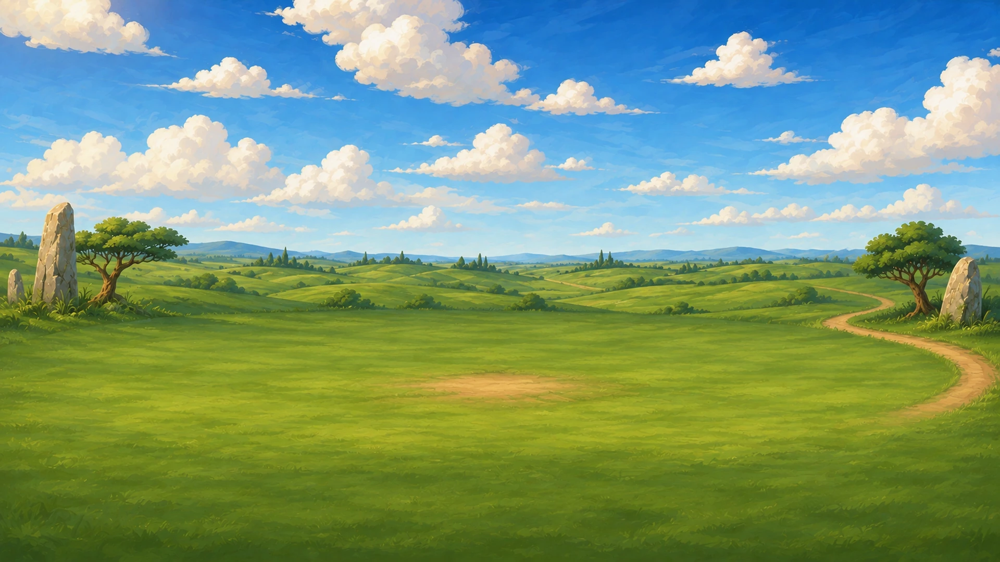
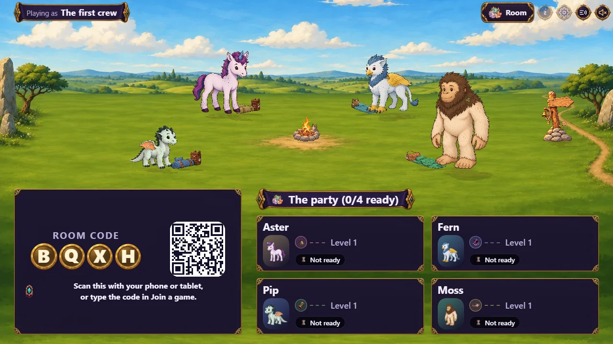

# Brief: camp art

**Status:** Phase 1 delivered (#615), with three hero-colored bedroll styles (#633). Phase 2
(#623) is declared and owed: 60 paintings, below. The design is [docs/camp.md](../camp.md) (§3.1 backdrops, §4.1
frame stages, §4.5 and §5.4 the hero's kit, §8.3 lanes and stand points, §8.4 actions and moving parts). The prompts are in
[docs/camp-art-prompts.json](../camp-art-prompts.json) (Phase 1),
[docs/camp-kit-art-prompts.json](../camp-kit-art-prompts.json) (#633's kits) and
[docs/camp-art-prompts-phase2.json](../camp-art-prompts-phase2.json) (Phase 2); the paintings are made from them, then
checked by `npm run art:verify` and counted by `npm run art:inventory`.

## The contract: `assets/manifest.json` → `camp`

The manifest's `camp` section is the one place the layout lives. The art is painted for it, the
client walks figures over it, and `tools/art/verify.py` checks it. Change a lane and the backdrop
prompt's pixel figures change with it.

- **Coordinates are fractions of `backdropCanvas`** (1920 × 1080): x from the left, y from the
  top. A lane's `y` is the ground line where a figure's or piece's ground contact (the figure
  canvas origin, 512, 900) stands.
- **Backdrops** (`backdrops[]`, one per terrain family in `biomeFamilies`) carry the ground:
  two or three `lanes`, back to near (each lower on screen and no smaller in `scale` than the one
  behind), and the `crossings` where a figure may change lanes. `open_plains` is required: it is
  the fallback for every family not painted yet.
- **Frames** (`frames[]`, one per frame stage) carry the camp: `pieces` standing on a lane,
  `movingParts` laid over a piece, `standPoints`, and the `trailhead`. Frames are shared by every
  backdrop, so a frame's lanes and x positions must fit every backdrop's lanes.
- **On the open ground.** Every lane, and so every stand point, lies in the open, nearly level
  grass band the backdrop promises, from 45 to 75 percent of the height (open_plains: lanes at
  52, 60 and 68 percent). The camp spreads across the clearing the way a real campsite
  does: the campfire at the center, the bedrolls two to each side of it, free wander spots (no
  action) out toward the edges, and every piece and stand point within 8 to 92 percent of the
  width, which a portrait phone keeps. The trailhead, where the party leaves, is the one
  exception.
- **Cover-fit and slid.** The client draws a backdrop across the whole width of the screen and
  slides it up or down so the lanes stand in the open window between the lobby's header and its
  panels (`packages/client/src/world/camp-framing.ts`). So a backdrop's top quarter is plain sky
  that may be trimmed, its bottom quarter plain, low-detail grass that may sit under the panels,
  the horizon about 35 to 40 percent of the height, and everything important inside the middle
  80 percent of the width, because portrait phones crop the sides.
- **Every frame seats the full party**: one `rest` stand point for each seat 0 to 3.

## Formats

| Art | Path | Canvas | Format |
| --- | --- | --- | --- |
| Camp backdrop | `assets/camp/backdrops/<family>.webp` | 1920 × 1080 | WebP, opaque (the biome background format) |
| Piece | `assets/camp/frames/stage<N>/<piece>.png` | 1024 × 1024 | PNG, RGBA cutout, lowest opaque row at y 900 (±12), 8px clear margin |
| Moving part | `assets/camp/frames/stage<N>/<piece>-<part>.png` | 1024 × 1024 | PNG, RGBA, registered pixel for pixel over its piece, nothing below y 912 |
| Kit (bedroll and pack) | `assets/camp/kits/<style>.png` | 1024 × 1024 | PNG, RGBA cutout like a piece; neutral grey cloth, tinted by the client (below) |
| Tent and its flap | `assets/camp/kits/tents/<style>.png`, `<style>-flap.png` | 1024 × 1024 | as a piece and its moving part; neutral grey cloth, tinted like a kit |
| Souvenir line | `assets/camp/kits/souvenir-line.png` | 1024 × 1024 | as a piece, with its pegs at the manifest's `hangPoints` |
| Crew piece and its moving part | `assets/camp/pieces/<piece>.png`, `<piece>-<part>.png` | 1024 × 1024 | as a piece and its moving part |
| Kit decoration | `assets/camp/decorations/<name>.png` | 512 × 512 | PNG, RGBA, 24px clear margin (the story-prop canvas), no ground contact |
| Camp icon | `packages/client/src/assets/painted/<id>.webp` | 256 × 256 | WebP, RGBA, 8px clear margin (the painted-icon canvas) |

- **Style**: the storybook gouache of the biome backgrounds and the story props (the backdrop
  matches `assets/biomes/plains/bg.webp`; the pieces match `assets/story-props/camp-firepit.webp`).
  No text, no heroes drawn (the existing hero figures stand in the camp), never scary.
- **Backdrops are empty campsites**: a calm clearing with a plain, readable ground band where the
  lanes fall, wide open across about the middle 80 percent of the width with the fire's worn
  patch at its center and no rocks, trees or stones inside it (those keep to the outer edges and
  the distance), plain sky above and a quiet lower band
  (both may be trimmed), and the trail leaving at the trailhead's edge. Nothing a figure could
  seem to stand inside.
- **Pieces fill their canvas the way figures do**: whole object inside the margin, resting on
  y 900. The client sizes them on the stage from the piece's `heightCm` in the manifest (its
  true painted height, scaled like a figure's and by its lane), so a campfire stands at its real
  size beside a hero. Stage 1: campfire 60, bedroll 40 (its pack is the tallest part), trailhead
  post 120.
- **A moving part only where a stand point animates the piece** (§8.4), and made from the
  finished piece itself (cut from the same painting, its base feathered into the piece) so the
  two always stack. A piece nobody uses needs none.
- **One painting can serve many pieces**: the four stage-1 bedrolls share `bedroll.png`.

## Pending art

Missing camp art is owed, not a failure: `art:verify` warns "not yet delivered" and passes (also
under `--strict`, as it does for story plates and key art), `art:inventory` lists it under
**Camp art**, and the client draws its own stand-in until the painting lands. There are no
placeholder files: a file at a declared path counts as delivered, so nothing goes there until it
is the real painting. Any file under `assets/camp/` the manifest does not declare fails
`art:verify`.

## Phase 1 (#615)

The `open_plains` backdrop and the stage-1 frame: a small campfire, a neutral bedroll and pack
(the same painting at all four seats), the trailhead post, and the campfire's flame (motion
`flicker`). Five paintings in all.

The backdrop was repainted for the revised #615 composition: the higher horizon, wide open
middle 80 percent, fire patch at y 648, edge scenery and trail, and quiet top/bottom quarters
for cover-fit cropping. The canonical prompt and the final composition-edit prompt are saved
in `camp-art-prompts.json`. The exported RGB WebP is 1920 × 1080, Lanczos resized, quality 90,
method 6, and 177 KB, below the 500 KB limit.

## Hero-colored bedrolls: the implemented format

Three styles are declared in `manifest.camp.kitStyles`: `rolled`, `quilted`, and `patched`.
Their packs have distinct silhouettes: the rolled blanket has a structured two-pocket
rucksack, the quilted bedroll has a round rope-drawstring pack, and the patched trail kit has
a low, wide flap satchel. Packs retain their natural material colors; only bedding is tinted.
Each is one 1024 × 1024 RGBA painting under `assets/camp/kits/`, with neutral light cloth,
natural leather and metal, and the same y 900 ground contact as the neutral bedroll.
Prompts are in [camp-kit-art-prompts.json](../camp-kit-art-prompts.json).

`world/CampBedroll.tsx` draws the natural painting first. A second instance of that **same
image** is clipped to the registered cloth paths in `world/camp-kit-art.ts`, converted to
luminance, and multiplied by the hero's `appearance.accent` in sRGB. Outlines and folds retain
their shading; leather straps, buckles, packs and cups retain their natural colors. This
settles the earlier proposed two-PNG convention for these bedrolls: one painting and an SVG
cloth mask keep every pixel registered, without generating two layers independently.
Filter and clip IDs are unique per seat. Invalid accents use meadow teal, and a failed style
image falls back to the original neutral Phase 1 painting.

The hero's character ID determines a stable style, independent of party order or reconnects.
No new server state or kit picker is introduced. The moving camp assigns a variant to each
occupied bedroll and uses `camp-kit-canvas.ts` to apply the same registered cloth mask as the
SVG component, caching the result per source painting, style and accent. Backpacks stay natural.
The still fallback draws the same kits with `CampBedroll` and a motionless `Campfire`.
The camp renderer's existing warm-up action flickers the delivered flame layer; reduced
motion keeps it still. Pieces and heroes share the renderer's existing lane depth ordering.

Art verification checks the variants' format, alpha, margin and ground contact; inventory
counts the five Phase 1 paintings and three kits once each. Runtime tests tie style paths to
the manifest, check tint math and fallback, and guard against filter collisions between seats.
Phase 2's tents follow this convention, not a second one (below).

## Phase 2 (#623): what is declared, and how it fits #633

Everything below is in `assets/manifest.json` → `camp` with a stable id, which `content/camp.json`
(#618) refers to. The manifest says what each painting is and where it stands; prices, rewards and
which chapter scene hands a find over are #618's. `art:verify` checks the declarations
(`check_camp_catalog`) and the format of any painting present; every missing one is a "not yet
delivered" warning and is owed under **Camp art** in `art:inventory` (8 of 68 delivered when this
was declared).

**A kit style is a tent, a bedroll and a pack together** (`HeroKit.style`, docs/camp.md §9). #633
painted the bedroll and pack of three styles; Phase 2 adds the tent of each, with the same id:

| Style | Bedroll and pack (#633) | Tent (Phase 2) |
| --- | --- | --- |
| `rolled` | rolled blanket, boxy two-pocket rucksack | trim A-frame ridge tent |
| `quilted` | quilted mat, round drawstring pack | puffy quilted dome |
| `patched` | patched mat, low flap satchel | low mended lean-to |

`tentStyles` also declares the three milestone tents, `sworn`, `radiant` and `mythic` (a
`manifest.tiers` id each; unlocked at levels 4, 7 and 10 by `rules.json` → `tierLevels`), which
have no bedroll of their own. Ascendant, Starborn and Legendary follow when their hero art does.

**Tinting is #633's, unchanged.** A tent is one painting with every tintable cloth surface in undyed
light neutral grey (value shading only) and poles, rope, leather and metal in natural colors.
After it is painted, its cloth region is traced and registered beside the kits' in
`world/camp-kit-art.ts`, and the client multiplies that region's luminance by the hero's
`appearance.accent` (`tint: "svg-cloth-mask"`, `paletteSlot: "accent"`). The door flap is cut from
the finished tent at the same position, so the tent's cloth region tints it too. There is no
separate tint layer to paint.

**The stage-2 frame** (`frames[1]`, open_plains lanes, all of verify's lane rules):

- **Tent spots** `tent_0` to `tent_3`, two each side of the cookfire on the back lane (x 0.16,
  0.33, 0.67, 0.84), each owned by its seat (`ownerSeat`) and drawn in that hero's style and color
  at 140 cm, scaled with its owner. The manifest's path is the `rolled` tent, the fallback, as the
  neutral bedroll is at stage 1. Each door's rest stand point is on the middle lane in front of it,
  and each spot's flap (`movingParts`, motion `sway`) is the hero's style's `flap`. At stage 2
  outdoors a seat shows its tent; the bedroll and pack stay the stage-1 and indoor kit (§3.2).
- **Souvenir lines** `souvenirs_0` to `souvenirs_3` on the middle lane beside each tent: one
  painting (`souvenirDisplay`), a short twine line with four empty pegs at its `hangPoints`, where
  the client hangs the hero's existing souvenir icons.
- **Shared hotspots** (`hotspots`, a new key: id, kind, lane, x, and an optional `default` crew
  piece): `cookfire` (middle 0.50, default `cookfire_pot`), `awning` (back 0.50, behind the fire),
  `lanterns` (near 0.14), `friends_corner` (near 0.40), `banner_pole` (near 0.84, by the trail,
  default `kept_crew_banner`) and `trophy_1`, `trophy_2` (near 0.28 and 0.58). A stand point's
  `hotspot` may now name a frame hotspot as well as a piece: two warmUp spots at the cookfire, a
  lookUp at the lanterns and the banner, a pet at the friends' corner and a shady spot under the
  awning. The client parser (`camp-layout.ts`) reads `hotspots`; the lobby still pitches stage 1.
- **The trailhead post** is stage 1's painting, unchanged.

**Crew pieces** (`crewPieces`: id, `hotspot` kind, `group`, path, heightCm, movingParts):

| Group | Pieces |
| --- | --- |
| frame | `cookfire_pot` |
| kept | `kept_crew_banner` (the crew's woven pennant, `CrewIdentity`) |
| find | `find_picnic_blanket` (first-steps-01), `find_wagon_lantern` (gemfall-01), `find_noodle_awning` (riftlight-exchange-rift) |
| starter-shop | `shop_lantern_string`, `shop_striped_awning`, `shop_log_bench`, `shop_pinwheel_pole` |
| stage2-shop | `shop_kettle_cookfire`, `shop_weathervane_pole`, `shop_patchwork_awning`, `shop_lantern_arch`, `shop_friends_hammock` |
| trophy | `trophy_gemfall`, `trophy_riftlight` |

Every banner-pole piece flies the same crew pennant (packages/client/src/assets/painted/crew.webp),
so placing one never hides the crew's banner. **Moving parts only where a stand point animates the
piece:** verify fails a piece at a hotspot with a warmUp, lookUp or peek stand point that has
none, and a tent spot without its flap. So the cookfires have flames, the banner poles pennants and
the lanterns a swing; awnings, the friends' corner and trophies have none. A crew piece's phone
picture is its own painting, cropped to what is painted.

**Kit decorations** (`decorations`, on the story-prop canvas): seven in the free catalog
(`deco_bunting`, `deco_lantern`, `deco_little_flag`, `deco_flower_pot`, `deco_shell_chime`,
`deco_picture_sign`, `deco_pinwheel`), three kit finds (`deco_clipboard_star` first-steps-01,
`deco_lamp_ribbon` gemfall-01, `deco_gull_feather` riftlight-exchange-rift), and twelve
class-distinction pieces, `deco_<class>_<apprentice|expert|master>`, each in its class's colors
(the class token inks in `ClassToken.css`). Decorations keep their natural colors; verify fails a
catalog missing any class and distinction.

**The Dash Cash icon** (`paintedIcons: ["dash_cash"]`): a teal paper camp ticket with a punched gold
star, at `packages/client/src/assets/painted/dash_cash.webp`. It is owed in the camp section rather
than `manifest.paintedIcons.ids`, where a missing icon fails verify; move it there when it lands.

## Hero-sized owned pieces

`ownerSeat` on a camp piece declares which hero it belongs to. Existing seat-linked rest
hotspots also infer that ownership. An owned piece's `heightCm` is its reference size for a
160 cm hero; both renderers scale it in proportion to its owner's displayed height. A 40 cm
kit therefore shrinks for a dragonling and grows for a bigfoot. The factor is applied after
the base piece's legibility floor, and includes shadows and moving parts without changing
ground contact. Shared pieces such as the fire and trailhead retain their authored size.
Empty seats use the reference size. Reassigning a seat or changing the hero's size updates
the piece without rerasterizing its art. The still renderer also accounts for the kit's
actual painted height, rather than treating its transparent canvas as the object.

## Grounding and light

The camp shares one upper-left daylight direction. Heroes and pieces have soft contact
shadows and a faint lower-right cast, drawn beneath their cutouts and scaled with their lane.
The fire adds a restrained warm pool on the ground. A light warm ambient tint ties the
cutouts to the late-afternoon background; these effects belong to the renderer, so the PNG
cutouts stay free of baked ground or cast shadows.

Bedrolls sit just inside their owners' rest positions instead of underneath the heroes.
The right-hand kits face inward, forming two pairs around the fire. Rest stand points and
walking routes stay unchanged. The still fallback uses the same grouping and soft shadows.

