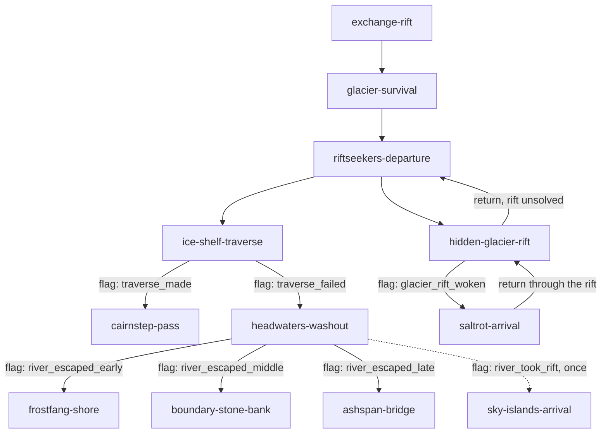

# Continental Rift — graph design

**Status:** topology draft; names below are proposed stable IDs, **not yet published save-contract IDs**. Do not build campaign JSON from this file without resolving listed TBDs and confirming schema.

## Opening slice

The river's multiple escape opportunities are **stages within one authored encounter**; this diagram models the eventual story nodes reached, not every internal dice roll. The two rifts are different rifts with different destinations ([mechanics.md](mechanics.md#the-first-two-rifts--agreed)).

### Places in the opening — agreed
| Node | Where (canon) |
| --- | --- |
| `ice-shelf-traverse` | The ice shelf above the Great River where it leaves the glacier, on the way to Frostfang. A traverse along the bank, not a river crossing. |
| `cairnstep-pass` | ***The Cairnstep***, a griffin-cairned pass in Frostfang Peaks (new canon, pending registration). Orin's lead. |
| `headwaters-washout` | The Great River's headwaters. Not "Glacierflow": canon uses that name only for the lower reaches in the Saltrot. |
| `frostfang-shore` | The east bank under Frostfang, near the lead. (Not "foothills": that word means the Red Sky Foothills.) |
| `boundary-stone-bank` | The Red Sky Foothills bank, among canon's boundary stones that are older than the dragonlings and carved with an eruption no one's count matches: a quiet early clue. |
| `ashspan-bridge` | The Northern River Bridge, named ***Ashspan Bridge*** (canon asks for a name before a campaign uses it; pending registration). |
| `sky-islands-arrival` | The Sky Islands, through the washout rift. |
| `saltrot-arrival` | The Sallow Wastelands (the Saltrot), through the hidden glacier rift. |

**Never the west bank below the glacier.** It is the Expanse, a protected mystery; no exit, rescue or rift lands there.

### Key entry/fail-forward logic
- Riftseekers provide a lead, but their advice is optional, imperfect and brief.
- Follow lead → the ice-shelf traverse. A failed roll opens the washout, **not an immediate setback/failure screen**. The traverse's scenes set one member of an `"ice_shelf": ["traverse_made", "traverse_failed"]` route set, and the two exits guard on those flags. Never guard on `outcome: setback`: a setback counts toward `setbackLimit` and pays half XP, so the chapter ends as `success` either way.
- Washout → rolls decide exit distance downstream; no failed-roll dead end. The exits guard on the `river_exit` route set ([node spec](nodes/headwaters-washout.md#consequences--world-state)).
- Deliberate glacier exploration → the hidden rift, bypassing normal geography to the Saltrot. A party that explores without solving the condition returns to `riftseekers-departure` by a `kind: "return"` edge (`revisit: "pass"` there, so it goes straight to the exit choice) and can still take the lead. The rift is persistent, so it is not `once`, and the Saltrot side has a return edge back to the glacier.
- Returning to Glacier later should be meaningful; dormant rift clue may be observed during the initial survival scene.
- No single regional storyline is required for access to the endgame (below).

## Convergence — agreed
**The key Pangea fragment from any 2 of the 3 strands unlocks the convergence.**
- **One key node per strand.** Completing its chapter always finds that strand's fragment ([story.md](story.md) lists canon's candidates).
- **Edges into the convergence guard on `completed: [key node A, key node B]`.** A list means every listed id, so this works in today's engine. (A `flag` guard takes one flag, which is why the guard reads completed key nodes.)
- **Each strand's last node carries two such edges,** one per other strand it can pair with: six edges in all, so the party heads for the convergence from whichever strand it finishes second.
- **A third strand is optional and rewarded:** the third fragment overpowers Corvane's final rift, so he starts the battle weakened ([story.md](story.md#finale-and-endings--agreed)).

### Size check
| Part | Authored | Played on one run |
| --- | --- | --- |
| Prologue: exchange, glacier, departure, the traverse / washout / hidden-rift branches | ~10 | 4–6 |
| Three strands, ~4 nodes each | ~12 | 8 (two strands) |
| Convergence + finale | 2 | 2 |
| **Total** | **~24** | **14–16** |

### How the prologue feeds the strands
- **Wandering Sky:** the washout rift; the Cairnstep (griffins trade weather news with the Sky Islands by flag signal).
- **Restless Coast:** the hidden glacier rift; Ashspan Bridge, downriver.
- **Forgotten Paths:** the boundary-stone bank; a return to the glacier.

## Regional story strands (narrative clusters, not node list)
- **Wandering Sky:** Sky Islands and cloud whales; disrupted navigational patterns; displacement encounters.
- **Restless Coast:** Sallow Wastelands, Saltrot guides, Bone Yard and displaced creatures.
- **Forgotten Paths:** Glacier memories, yetis, rift patterns, revisiting previously inaccessible routes.

## Graph design constraints
- Forward, sideways and return edges should all matter.
- Arrival may depend on prior flags, including region allies, discoveries and changed geography.
- Return visits may show new chapter variants, not always replay unchanged.
- Single-use rifts remove an edge after use; **one coordinated party traversal** counts as the one use.
- Each regional strand offers at least one viable onward route and some connection to another strand.
- A party taking non-Starweaver classes must be able to progress.
- The emperor should be discoverable **only near the end** despite route order.
- Balance optional branches and convergences without losing causal coherence.
- Avoid authoring the final graph until graph runtime, effects and edge constraints from issues #192–#203 are verified.

## Decisions still open
1. Each strand's node list and key node, one strand at a time.
2. Faction influence rules and return routes.
