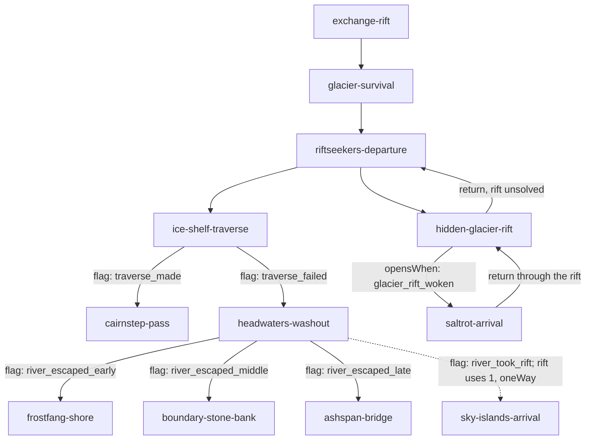

# Continental Rift — graph design

**Status:** topology draft; names below are proposed stable IDs, **not yet published save-contract IDs**. Do not build campaign JSON from this file without resolving listed TBDs and confirming schema.

## Opening slice

The river's multiple escape opportunities are **stages within one authored encounter**; this diagram models the eventual story nodes reached, not every internal dice roll. The two rifts are different rifts with different destinations ([mechanics.md](mechanics.md#the-first-two-rifts--agreed)).

### Places in the opening — agreed
| Node | Where (canon) |
| --- | --- |
| `ice-shelf-traverse` | The ice shelf above the Great River where it leaves the glacier, on the way to Frostfang. A traverse along the bank, not a river crossing. |
| `cairnstep-pass` | ***The Cairnstep***, a griffin-cairned pass in Frostfang Peaks (new canon, pending registration). Orin's lead. |
| `headwaters-washout` | The Great River's headwaters. Not "Glacierflow": canon uses that name only for the lower reaches in the Saltrot. |
| `frostfang-shore` | The east bank under Frostfang, near the lead. (Not "foothills": that word means the Red Sky Foothills.) |
| `boundary-stone-bank` | The Red Sky Foothills bank, among canon's boundary stones that are older than the dragonlings and carved with an eruption no one's count matches: a quiet early clue. |
| `ashspan-bridge` | The Northern River Bridge, named ***Ashspan Bridge*** (canon asks for a name before a campaign uses it; pending registration). |
| `sky-islands-arrival` | The Sky Islands, through the washout rift. |
| `saltrot-arrival` | The Sallow Wastelands (the Saltrot), through the hidden glacier rift. |

**Never the west bank below the glacier.** It is the Expanse, a protected mystery; no exit, rescue or rift lands there.

### Key entry/fail-forward logic
- Riftseekers provide a lead, but their advice is optional, imperfect and brief.
- Follow lead → the ice-shelf traverse. A failed roll opens the washout, **not an immediate setback/failure screen**. The traverse's scenes set one member of an `"ice_shelf": ["traverse_made", "traverse_failed"]` route set, and the two exits guard on those flags. Never guard on `outcome: setback`: a setback counts toward `setbackLimit` and pays half XP, so the chapter ends as `success` either way.
- Washout → rolls decide exit distance downstream; no failed-roll dead end. The exits guard on the `river_exit` route set ([node spec](nodes/headwaters-washout.md#consequences--world-state)).
- Deliberate glacier exploration → the hidden rift, bypassing normal geography to the Saltrot. A party that explores without solving the condition returns to `riftseekers-departure` by a `kind: "return"` edge (`revisit: "pass"` there, so it goes straight to the exit choice) and can still take the lead. The rift is persistent (`persistent: true`), and it is two-way only because it is authored as a **linked pair** of opposite edges ([mechanics.md](mechanics.md#how-rifts-are-authored--agreed)).
- Returning to Glacier later should be meaningful; dormant rift clue may be observed during the initial survival scene.
- No single regional storyline is required for access to the endgame (below).

## Convergence — agreed
**The key Pangea fragment from any 2 of the 3 strands unlocks the convergence.**
- **One key node per strand.** Completing its chapter always finds that strand's fragment ([story.md](story.md) lists canon's candidates).
- **Edges into the convergence guard on `completed: [key node A, key node B]`.** A list means every listed id, so this works in today's engine. (A `flag` guard takes one flag, which is why the guard reads completed key nodes.)
- **Each strand's last node carries two such edges,** one per other strand it can pair with: six edges in all, so the party heads for the convergence from whichever strand it finishes second.
- **A third strand is optional and rewarded:** the third fragment overpowers Corvane's final rift, so he starts the battle weakened ([story.md](story.md#finale-and-endings--agreed)).

### Size check
| Part | Authored | Played on one run |
| --- | --- | --- |
| Prologue: exchange, glacier, departure, the traverse / washout / hidden-rift branches | ~10 | 4–6 |
| Three strands, ~4 nodes each | ~12 | 6–8 (two strands) |
| Convergence + finale | 2 | 2 |
| **Total** | **~24** | **11–16** (11 is the shortest valid route; XP is sized against it, [story.md](story.md)) |

### How the prologue feeds the strands
- **Wandering Sky:** the washout rift; the Cairnstep (griffins trade weather news with the Sky Islands by flag signal).
- **Restless Coast:** the hidden glacier rift; Ashspan Bridge, downriver.
- **Forgotten Paths:** the boundary-stone bank; a return to the glacier.

## Regional story strands (narrative clusters, not node list)
- **Wandering Sky:** Sky Islands and cloud whales; disrupted navigational patterns; displacement encounters.
- **Restless Coast:** Sallow Wastelands, Saltrot guides, Bone Yard and displaced creatures.
- **Forgotten Paths:** Glacier memories, yetis, rift patterns, revisiting previously inaccessible routes.

## Strand: Forgotten Paths — agreed
Glacier, yetis and memory in ice. Entered from `boundary-stone-bank` or a return to the glacier.

| Node | What happens | Canon it uses |
| --- | --- | --- |
| `stone-counters` | The Red Sky Foothills dragonlings who keep the boundary stones find one has **moved overnight**: the first displacement seen up close. A **timed** rift (it visibly shrinks) teaches the first motion signal. | The boundary stones older than the dragonlings, carved with an eruption no one's count matches |
| `the-wrong-valley` | Back toward the glacier, the river briefly runs **down a different valley**: Corvane's pull restoring an old course. An environmental challenge to cross; the glacier is now a changed place to revisit. | The changing melt; memories surfacing out of order |
| `reading-room` (**key node**) | The yetis' memory ice shows **the river leaving by a different valley**: this strand's Pangea fragment. An elder yeti warns, "Do not shout near the old ice; you don't know what you might wake." Foreshadowing, no name. | Reading rooms; the different-valley memory; "what you might wake" |
| `wyrm-nest` (**strand end**) | A frost wyrm has nested where the next reading room was planned. A fight with more than one good outcome (#201): drive it off, or move it through a blue rift to a new home. The outcome is world state the **finale at the glacier** reads: the wyrm gone, or an ally. | The wyrm nesting where the next reading room was planned |

- **First strand entered:** Seren teaches Attune at `stone-counters` (a scene gated on not having it yet; every strand carries one), and Pip is there scouting the moved stones.
- **Sideways exits:** `stone-counters` ↔ downriver to `ashspan-bridge` (toward the Coast); `wyrm-nest` ↔ the Cairnstep (toward the Sky), on canon's yeti-and-griffin rescue partnership.
- **Each class has a moment:** Songkeeper in the singing halls; Thornguard holding the ice in the wrong valley; Duskrunner beating the timed rift; Starweaver reading the nest's rift.
- **Each strand teaches one motion signal:** Forgotten Paths teaches **timed**; Wandering Sky **linked** (island rifts pulse together); Restless Coast **unstable**.
- **Protected:** the memory shows a fragment, never a full history; the summer crevasse and the unnamed meltwater year stay untouched.

## Strand: Wandering Sky — agreed
Sky Islands, kitsune and cloud whales; teaches **linked**. Entered by the washout rift (one-way) or from the Cairnstep. `sky-islands-arrival` is this strand's first node (likewise `saltrot-arrival` for the Coast), which keeps the total at about 24.

| Node | What happens | Canon it uses |
| --- | --- | --- |
| `sky-islands-arrival` | The party lands on a drifting island **hanging in the wrong part of the sky**; kitsune temple keepers take them in. Two variants: through the rift (no way back), or flown over by the Cairnstep griffins repaying a pass-ledger debt. | Kitsune as the islands' people; griffins trading weather news with the islands by flag signal |
| `whale-road` | Cloud whales circle, confused, between **two rifts that pulse together** (teaches *linked*). A gentle problem, not a fight: guide the whales clear. **One rift of the pair opens onto the Coast**: the sideways exit. The pair is **green + blue**: a linked pair, `persistent: true`, `opensWhen: { flag: whales_guided }`, so it stays dormant until the whales are clear, and the Sky teaches green too. | Cloud whales as semi-sapient navigators, never enemies or mounts; whether the islands follow the whales stays unsettled |
| `the-island-due-back` (**key node**) | The kitsune have long recorded an island "due back", and it arrives, pulled by Corvane. Its old mooring stone is carved with **the land below as it once lay**: this strand's Pangea fragment. | The island that is "due back" |
| `squall-temple` (**strand end**) | The returning island drifts toward a temple island in a storm. A fight among displaced creatures with more than one good outcome (#201): push the island clear, or shelter the temple and let it settle. **Bone crawlers** pulled up from the Bone Yard swarm the rift's fresh magic. | Bone crawlers swarming fresh magic |

- **Lady Olivia appears here,** studying the dormant pair, and offers a shortcut: **help her force it open now**, before the whales are clear. It is a rift action `open` way ("Lady Olivia's way") offered while `whales_guided` is unset. Forcing it opens the pair at once, sets her trust flag, and scatters the whales (journey state `whales_scattered`, which `the-island-due-back` reads: the kitsune have lost their best sign of where the island is coming in). Refusing means guiding the whales the gentle way, which opens it on its own. Forcing only meets the rift's condition early; its rules never change. The trust flag feeds her epilogue, beside the Bram and Pip flags.
- **First strand entered:** Seren teaches Attune at `sky-islands-arrival`; Pip is here scouting.
- **Exits:** the linked rift at `whale-road` → the Coast; from `squall-temple` the griffins fly the party back down to the Cairnstep, toward Forgotten Paths.
- **Each class has a moment:** Starweaver reads the linked pulse; Songkeeper calms the whales; Duskrunner leaps between drifting islands; Thornguard braces the temple in the squall. Kitsune players get Beguile with the temple keepers; griffin players get Skyward.
- **Protected:** the creator-only secret that the islands were once sea floor stays untouched (the carving shows land, not sea); kitsune are never portrayed as all deceptive.

**Authored preview:** `whale-road` now continues to `the-island-due-back` and has a
return edge from it. The new key node uses pass revisits and an explicit development
pause before the unwritten temple continuation. Whale outcomes, rescue priorities,
evidence quality and the first outgoing message have distinct consequences. See the
[island review](island-continuity-review.md). This is preview topology only; the
production convergence and endgame guards are not yet authored.

## Strand: Restless Coast — agreed
The Sallow Wastelands (the Saltrot), Saltrot guides, the Bone Yard and displaced creatures; teaches **unstable**. Begins at `saltrot-arrival`, reached by the hidden glacier rift (persistent, two-way), the linked rift from `whale-road`, or downriver from Ashspan Bridge.

| Node | What happens | Canon it uses |
| --- | --- | --- |
| `saltrot-arrival` | The mudflats are piling up with **glacier silt** where it does not belong; players see the effect, the rift as its cause stays creator-only. A Saltrot guide takes them in: one of the **Skuppers** ([characters.md](characters.md#the-skuppers--agreed)). Three variants, one per way in. Downriver means **Old Ossley's ferry**: a flood year, and he is "going your way" again. | The unfamiliar glacier silt reaching the Saltrot; Saltrot guides; Ossley's flood-year ferry |
| `buried-bridge` (**key node**) | A displacement has uncovered the Saltrot's **buried bridge**, built across a river that is not there now: this strand's Pangea fragment. It echoes Forgotten Paths' memory of the river in a different valley, so the clues agree across strands. The **sealed door stays sealed**. | The buried bridge and the sealed door |
| `stuttering-flats` | An **unstable** rift drops out-of-place creatures onto the flats (teaches *unstable*). A **snowhorn goat** from the glacier is stranded in the mud; get it home before the rift closes. A rescue, not a fight. | Snowhorn goats of the glacier |
| `bone-yard` (**strand end**) | The displacements have carried **ruins** into the Bone Yard, and bone crawlers swarm their magic. A fight with more than one good outcome (#201). The Bone Yard's rule holds: anything taken comes back, so nothing is carried out. | Ruins carried into the Bone Yard; taken objects always return; bone crawlers |

- **Orin appears here,** studying the silt, the counterpart to Olivia's beat in the Sky. He works out "the glacier is draining somewhere through a rift" but never names Corvane. Sharing the chime's readings with him sets a flag that helps the party back Bram and Orin at the convergence.
- **First strand entered:** Seren teaches Attune at `saltrot-arrival`; Pip is here scouting.
- **Exits:** the glacier rift back to `hidden-glacier-rift`; the linked rift back to `whale-road`; Ossley's ferry upriver to Ashspan Bridge, toward Forgotten Paths.
- **Each class has a moment:** Thornguard shores up the buried bridge; Duskrunner beats the stuttering rift; Songkeeper soothes the goat; Starweaver reads the stutter. Bigfoot's Smash digs the bridge out; Unicorn's Mend helps the goat.
- **Protected:** the guides' secret that the flats drain mouth-last stays untouched; the colossal remains stay unidentified; Mermaid Cove's "unknown threat" is never made out to be Corvane.

## Return routes and revisits — agreed
**No strand is a trap:** every strand's arrival node has at least one way out to another strand. The one-way washout rift into the Sky is answered by the griffins down to the Cairnstep and the linked rift to the Coast. **Acceptance criterion, not yet checked:** once the nodes and edges are authored in `content/campaigns/riftlight.json`, `lintCampaignGraph` (`npm run content:validate`) and the playtest paths must pass with no softlocks; nothing has validated this graph yet.

| Return | Between |
| --- | --- |
| `kind: "return"` | `hidden-glacier-rift` → `riftseekers-departure` |
| The glacier rift (blue): a linked pair, `persistent` | `saltrot-arrival` ↔ `hidden-glacier-rift` |
| The Sky↔Coast rift (green + blue): a linked pair, `persistent`, `opensWhen: whales_guided` | `whale-road` ↔ `saltrot-arrival` |
| The griffins | `squall-temple` → `cairnstep-pass` |
| Ossley's ferry | `saltrot-arrival` ↔ `ashspan-bridge` |
| The road | `stone-counters` ↔ `ashspan-bridge` (both ways, so the late washout exit reaches Forgotten Paths) |
| The yeti-and-griffin partnership | `wyrm-nest` ↔ `cairnstep-pass` (both ways) |

| Revisit policy | Nodes |
| --- | --- |
| `"pass"` (straight to the exit choice) | Hubs: `riftseekers-departure`, `cairnstep-pass`, `ashspan-bridge`, `sky-islands-arrival`, `saltrot-arrival`; and every key node and strand end once done (the fragment and world state are already recorded) |
| `"replay"` with **variants** | The glacier: the changed melt, a reading room built or not, the wyrm gone or an ally, setting up the full-circle finale |

## Graph design constraints
- Forward, sideways and return edges should all matter.
- Arrival may depend on prior flags, including region allies, discoveries and changed geography.
- Return visits may show new chapter variants, not always replay unchanged.
- Single-use rifts remove an edge after use; **one coordinated party traversal** counts as the one use.
- Each regional strand offers at least one viable onward route and some connection to another strand.
- A party taking non-Starweaver classes must be able to progress.
- The emperor should be discoverable **only near the end** despite route order.
- Balance optional branches and convergences without losing causal coherence.
- The engine (#192–#203) has landed: check every node against `graph-campaigns.md` and with `lintCampaignGraph` (`npm run content:validate`) as it is authored.

## Decisions still open
None at the graph level; node-by-node specs come next.

## Complete story preview

All planned nodes and the six pairwise convergence edges now exist in the isolated preview.
All development pause nodes are removed. The next-tide upriver ferry is offered after
completing the Bone Yard; its guide introduces the checked route before it appears.
The full preview graph is linted and replayed, with all story routes leading onward.
See [the finale review](finale-review.md) for the completed search and the remaining
family-timing and XP-budget production gates. The original size table above is a design
estimate, not a measured count of paying nodes on every optional route.
