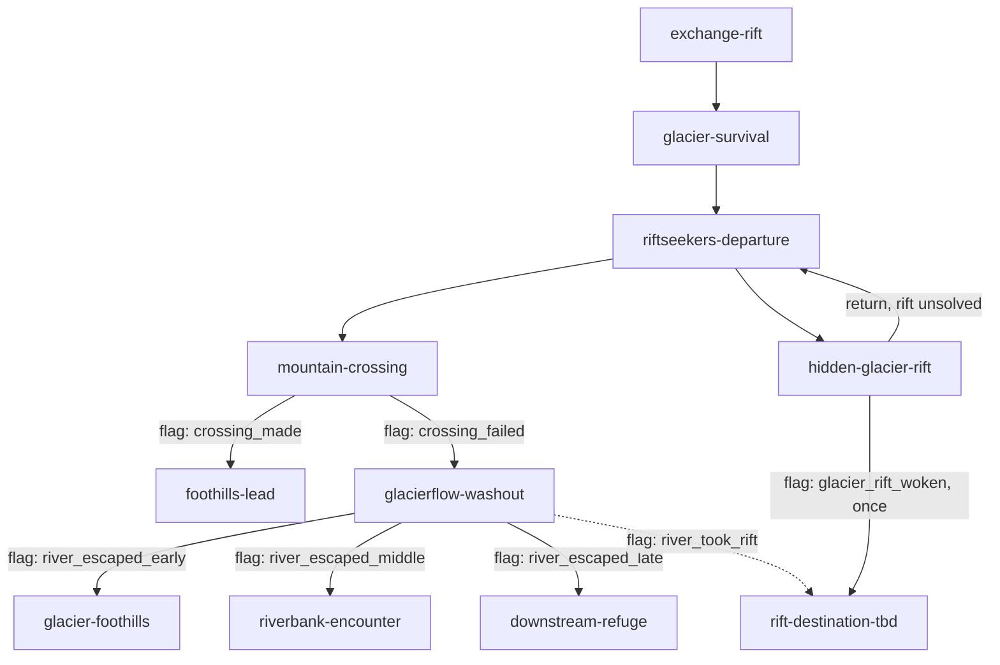

# Continental Rift — graph design

**Status:** topology draft; names below are proposed stable IDs, **not yet published save-contract IDs**. Do not build campaign JSON from this file without resolving listed TBDs and confirming schema.

## Opening slice

The river's multiple escape opportunities are **stages within one authored encounter**; this diagram models the eventual story nodes reached, not every internal dice roll. The hidden rift and river rift need not share a destination: `rift-destination-tbd` here is a placeholder, not an assertion they are the same rift.

### Key entry/fail-forward logic
- Riftseekers provide a lead, but their advice is optional, imperfect and brief.
- Follow lead → challenge at Glacierflow/mountain crossing. A failed roll opens washout, **not an immediate setback/failure screen**. The crossing's scenes set one member of a `"mountain_crossing": ["crossing_made", "crossing_failed"]` route set, and the two exits guard on those flags. Never guard on `outcome: setback`: a setback counts toward `setbackLimit` and pays half XP, so the chapter ends as `success` either way.
- Washout → rolls decide exit distance downstream; no failed-roll dead end. The exits guard on the `river_exit` route set ([node spec](nodes/glacierflow-washout.md#consequences--world-state)).
- Deliberate glacier exploration → conditional hidden rift, possibly bypassing normal geography. A party that explores without solving the condition returns to `riftseekers-departure` by a `kind: "return"` edge (`revisit: "pass"` there, so it goes straight to the exit choice) and can still take the mountain route. The rift edge is `once`.
- Returning to Glacier later should be meaningful; dormant rift clue may be observed during the initial survival scene.
- No single regional storyline should be required for access to the endgame; how this is satisfied remains an explicit design problem.

## Regional story strands (narrative clusters, not node list)
- **Wandering Sky:** Sky Islands and cloud whales; disrupted navigational patterns; displacement encounters.
- **Restless Coast:** Sallow Wastelands, Saltrot guides, Bone Yard and displaced creatures.
- **Forgotten Paths:** Glacier memories, yetis, rift patterns, revisiting previously inaccessible routes.

## Graph design constraints
- Forward, sideways and return edges should all matter.
- Arrival may depend on prior flags, including region allies, discoveries and changed geography.
- Return visits may show new chapter variants, not always replay unchanged.
- Single-use rifts remove an edge after use; **one coordinated party traversal** counts as the one use.
- Each regional strand offers at least one viable onward route and some connection to another strand.
- A party taking non-Starweaver classes must be able to progress.
- The emperor should be discoverable **only near the end** despite route order.
- Balance optional branches and convergences without losing causal coherence.
- Avoid authoring the final graph until graph runtime, effects and edge constraints from issues #192–#203 are verified.

## Decisions still open
1. Exact mountain destination/griffin lead against canon map.
2. River stage placement on the Great River; safe exit regions and dice thresholds.
3. Hidden glacier rift condition (resolved in-chapter as `glacier_rift_woken`), fixed Riftlight colors and destination.
4. If/where a rift appears during the river sequence; how the party can cross it safely.
5. Which locations and developments are mandatory for final convergence.
6. Endgame unlock flags, faction influence rules, return routes and endings.
