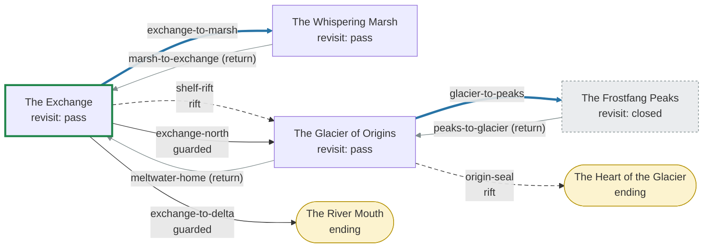

# Authoring a graph campaign

This is the how-to. [graph-campaigns.md](./graph-campaigns.md) is the contract — every field,
every rule, every check — and wins wherever the two disagree. This guide walks through writing a
nonlinear campaign from an empty file to a green build, using the **Continental Rift vertical
slice** (#203) as the worked example: a small campaign that uses every part of the graph engine
together, kept as a fixture so it never ships.

| | |
|---|---|
| The slice | [`packages/shared/src/fixtures/continental-rift.campaign.json`](../../packages/shared/src/fixtures/continental-rift.campaign.json) |
| Its chapters and board | [`packages/shared/src/fixtures/continental-rift/`](../../packages/shared/src/fixtures/continental-rift/) (`chapters/*.json`, `ice-shelf.map.json`) |
| Played end to end through the server | [`packages/server/src/handlers/continental-rift.test.ts`](../../packages/server/src/handlers/continental-rift.test.ts) |
| Held to the content gate | [`tools/content/continental-rift.test.ts`](../../tools/content/continental-rift.test.ts) |
| Gemfall, unchanged | [`packages/server/src/handlers/gemfall-compat.test.ts`](../../packages/server/src/handlers/gemfall-compat.test.ts) |

> **Nothing here ships.** A real graph campaign lives in `content/campaigns/<id>.json` with its
> chapters in `content/chapters/` and its boards in `content/maps/`, and is picked up by the loader,
> `content:validate`, the lobby and the journey CI gate automatically. The slice lives in
> `packages/shared/src/fixtures/` precisely so that none of that happens to it; its tests drop it into
> a scratch copy of `content/` to prove it *would* pass.

---

## 1. Decide: graph or ordered?

Write an **ordered** campaign (like Gemfall) when the story is a road, even a forking one: beats
1..n, a routed beat picked by a flag. It is simpler to author, to test and to read.

Write a **graph** campaign when the story has *geography that loops*: places the party can visit in
any order, go back to, and find changed; doors that open and close; more than one ending. The
Continental Rift is that: the Exchange and the Glacier of Origins at opposite corners of the realm,
a tear between them that can be used once, side trips on either side, and a river that carries the
consequences downstream.

A campaign's mode is part of its identity. Never add a `graph` to an existing ordered campaign (its
saved attempts would be stranded); a nonlinear Gemfall would be a **new campaign id**.

## 2. Sketch the places and the ways between them

On paper first. For each **place** (node): what chapter plays there, and what happens if the party
comes back. For each **way** (edge): where it goes, whether it is *onward* (`forward`), a *side
trip* (`sideways`) or *back* (`return`), and whether anything gates it.

The slice's sketch, in words:

- **The Exchange** (entry). A tear has opened over the arrivals shelf. Side trip: the **Whispering
  Marsh**. Onward: through the tear (once only) to the **Glacier of Origins**.
- **The Glacier**: a fight on a cracking ice shelf with a yeti reader to rescue. Side trip: the
  **Frostfang Peaks** (once). Back: down the Great River to the Exchange. Onward: a sealed blue door
  into the **Heart of the Glacier** (an ending).
- Back at the Exchange the river is in flood; the tear is used up; the long road north leads back
  to the glacier, and the flood itself can carry the party out to the **River Mouth** (the other
  ending).

Rules of thumb the tools will hold you to:

- **Every loop goes through a `return` edge.** A loop made only of forward/sideways edges is
  reported (`UNINTENTIONAL_CYCLE`).
- **Every reachable state can still reach an ending** — after a one-use door is spent, after a
  place is closed, for a table without a particular hero. `STRANDED`, `TRAPPED` and
  `CLASS_GATED_ONLY_PATH` are errors.
- **Ids are forever.** Node, edge, fact and buff ids are written into saved attempts. Pick good
  ones; renaming later is a migration.

## 3. Write the campaign file

Start with the skeleton — id, title, blurb, the chapter list, and a `graph` with an `entry`,
`nodes` and `edges`:

```jsonc
{
  "id": "continental-rift-slice",
  "title": "The Continental Rift (vertical slice)",
  "blurb": "…",
  "chapters": ["cr-exchange", "cr-exchange-flooded", "cr-marsh", "cr-glacier", "cr-peaks", "cr-heart", "cr-delta"],
  "graph": {
    "version": 1,
    "entry": "exchange",
    "nodes": {
      "exchange": { "chapter": "cr-exchange", "title": "The Exchange", "revisit": "pass" },
      "marsh":    { "chapter": "cr-marsh", "title": "The Whispering Marsh", "revisit": "pass" },
      "glacier":  { "chapter": "cr-glacier", "title": "The Glacier of Origins", "revisit": "pass" },
      "peaks":    { "chapter": "cr-peaks", "title": "The Frostfang Peaks", "revisit": "closed" },
      "heart":    { "chapter": "cr-heart", "title": "The Heart of the Glacier", "ending": { "title": "The River's First Song" } },
      "delta":    { "chapter": "cr-delta", "title": "The River Mouth", "ending": { "title": "Home on the Meltwater" } }
    },
    "edges": {
      "exchange-to-marsh": { "from": "exchange", "to": "marsh", "kind": "sideways", "label": "Take the Marsh Approach" },
      "marsh-to-exchange": { "from": "marsh", "to": "exchange", "kind": "return", "label": "Back to the Exchange" }
      // …
    }
  }
}
```

- `chapters` lists **every** chapter any node or variant plays, and nothing else.
- `revisit` says what coming back to a finished place does: `"replay"` (default — play it again),
  `"pass"` (a hub: straight to the choice of ways), `"closed"` (can't go back).
- A node with `ending` completes the attempt when its chapter finishes. Two endings is the minimum
  worth drawing a map for.
- `label` is what the button says — write it for an eight-year-old, and never name a place the
  party should not know about yet.

Run `npm run content:journey -- --campaign <your file>` after every few edits. It prints the outline,
the lint, and route coverage; nothing needs chapter files to exist yet.

## 4. Write the chapters

Each node plays an ordinary chapter (`schemas/chapter.schema.json`, the same as Gemfall's), with
three differences: `index` routes nothing (use it as a rough act number), `route` is refused, and a
scene's `endsCampaign` means nothing — only ending *nodes* end a graph campaign. One chapter is one
sitting; the journey only moves *between* chapters.

The slice's chapters are deliberately short placeholders — a story scene, a choice, an ending —
except for the two fights. They still pass every chapter check `content:validate` runs, including
the canon creature join (`"creature": "will_o_wisp"`) and the board checks.

## 5. Give the journey a memory

Two kinds, and the difference matters:

| | Journey **flags** | World **facts** |
|---|---|---|
| Declared in | `graph.flags` | `graph.facts` (typed: enum / counter / flag, bounded) |
| Written by | a chapter's own `setFlag` (read back when the chapter completes), or an edge effect | edge effects and node `onComplete` rules only |
| Seeded into chapter runs | yes | no — a chapter that differs by world state is a different chapter (a variant) |
| Use for | "the party did this thing in the chapter" | "the world is now like this" |

The slice uses both, and the bridge between them:

```json
"flags": ["reader_freed", "flood_seen"],
"facts": {
  "attunement":   { "domain": "consequence", "type": "counter", "min": 0, "max": 3, "initial": 0, "label": "Rift attunement", "visible": true },
  "great-river":  { "domain": "locale", "type": "enum", "values": ["steady", "surging"], "initial": "steady", "visible": true },
  "yeti-readers": { "domain": "alliance", "type": "enum", "values": ["strangers", "friends"], "initial": "strangers", "visible": true }
}
```

```json
"glacier": {
  "chapter": "cr-glacier", "revisit": "pass",
  "onComplete": [
    { "effects": [{ "type": "setFact", "fact": "great-river", "value": "surging" }] },
    { "when": { "flag": "reader_freed" }, "effects": [{ "type": "setFact", "fact": "yeti-readers", "value": "friends" }] }
  ]
}
```

The glacier chapter's fight sets the flag `reader_freed` if the party frees the reader; when the
chapter completes, the flag is read back into the journey and the completion rule turns it into
the world fact the rest of the map reads. **A chapter says what happened; the graph says what that
does to the world.**

## 6. Make places change when the party comes back

A **variant** plays a different chapter at the same place when its `when` holds — read on arrival,
first match wins:

```json
"exchange": {
  "chapter": "cr-exchange", "revisit": "pass",
  "variants": [
    { "chapter": "cr-exchange-flooded", "when": { "facts": { "great-river": "surging" }, "notFlag": "flood_seen" }, "revisit": "replay" }
  ],
  "onComplete": [{ "when": { "facts": { "great-river": "surging" } }, "effects": [{ "type": "setFlag", "flag": "flood_seen" }] }]
}
```

The Exchange is a hub (`pass`) — except once the river is in flood, when coming back *plays* the
flooded harbour (`revisit: "replay"` on the variant). The completion rule remembers it was seen, so
the next return is a hub again. The screens mark such an exit "It has changed" (`changed: true`)
without saying how.

## 7. Rifts: doors with a life of their own

An edge with a `rift` has a lifecycle. The slice's shelf rift is **single-use** and hides where it
leads until crossed:

```json
"shelf-rift": {
  "from": "exchange", "to": "glacier", "kind": "forward", "blocked": "shown",
  "label": "Step into the tear above the arrivals shelf",
  "effects": [{ "type": "grantBuff", "buff": "rift-spark" }],
  "rift": { "uses": 1, "reveal": "when-crossed", "actions": { "discover": [ … ] } }
}
```

- `uses: 1` — consumed by the crossing, for good. `blocked: "shown"` keeps it drawn ("It's all used
  up.") so the party understands why the way is gone; the server refuses it after.
- Anything single-use needs a way on after it is spent, or the lint reports `TRAPPED`/`STRANDED`
  with the path. Here: the long road north (`when: { "completed": "glacier" }`).
- `opensWhen`, `lasts`, `unstable`, `persistent`, `linkedTo`, `oneWay`, `redirects` and the five
  party actions are in [Rifts](./graph-campaigns.md#rifts-196) and
  [Rift actions](./graph-campaigns.md#rift-actions-197).

The sealed door into the heart is the other idiom: a rift asleep until someone has stood on the far
side (`"opensWhen": { "visited": "heart" }`), so from this side **only a party action opens it**.

## 8. Class ways — and a way for every table

A rift action can list **ways**, each with who can take it (`requires`) and what a table that cannot
is told (`hint`):

```json
"actions": {
  "open": [
    { "id": "attune", "requires": { "anyClass": ["starweaver"] }, "when": { "facts": { "attunement": { "min": 2 } } },
      "label": "Attune to the seal and open it", "hint": "A Starweaver who has studied the stars could open this.",
      "effects": [{ "type": "adjustFact", "fact": "attunement", "by": 1 }, { "type": "grantBuff", "buff": "starlight-ward" }] },
    { "id": "hum", "requires": { "anyClass": ["songkeeper"] }, "label": "Hum the ice's own note until the seal parts" },
    { "id": "readers", "when": { "facts": { "yeti-readers": "friends" } }, "label": "Ask the yeti readers to open the seal" }
  ]
}
```

- `when` is the journey's half (the lint walks it); `requires` is the table's half (the server
  checks the heroes seated *now*; a phone draws what its table can do, and a hint for what it
  can't).
- A class's **progression** is journey state: the Starweaver's `attunement` counter rises when they
  sense the shelf rift (+1) and when anyone studies the stars on the peaks (+1), and is read by the
  `attune` way. It is on the attempt row, so it survives the evening — and a Starweaver who stays
  home leaves it behind for the next.
- **No class is ever mandatory.** From every state, some ending must be reachable with ways that
  need nobody, or the lint errors with `CLASS_GATED_ONLY_PATH`. The slice's ungated ways are the
  yeti readers (earned in the fight) and, for a table that earns nothing, the river home.

## 9. Temporary buffs

Declare them under `graph.buffs`, grant them with `grantBuff` from an edge, a completion rule or a
rift action, and the next fight uses them — never a character's stats:

| Buff | Granted by | Used in |
|---|---|---|
| `rift-spark` (+1 attack rolls, one fight) | crossing the shelf rift | the glacier fight |
| `marsh-mettle` (+1 Guard, one fight) | completing the marsh | the glacier fight |
| `starlight-ward` (+1 Guard, one fight) | the Starweaver's `attune` way | the heart fight |

Amounts are bounded (guard ±3, damage ±2, move ±2, roll ±3); a negative amount is a cost.

## 10. Fights that happen *in* the rift

An encounter scene can declare an `environment` — a clock, hazard tiles, timed exits, a captive,
monsters that move. The slice's `cr-glacier` adapts the Drowned Ferry sandbox: a four-round collapse
clock, a line of rift frost, a crack in the glacier wall open until round 4, and a yeti reader to
free. The rescue's effect sets `reader_freed`; the branches `onEscape` / `onTimeout` lead to their own
endings. The fight never touches the journey directly: its flag is read back at completion and the
node's `onComplete` rule does the rest (§5).

## 11. Check it — the checklist

Before a graph campaign is reviewed:

- [ ] `npm run content:validate` — schema, every chapter (scene graph, canon creatures, boards,
      environments), the graph's names and the lint, with the chapters' real flag writes. **No
      errors; read every warning.**
- [ ] `npm run content:journey -- --campaign <id>` — the lint says `clean`; route coverage enters
      every node, traverses every edge, reaches every ending; `softlocks: none`; every used-up link
      says "an ending stays reachable".
- [ ] `npm run content:journey -- --campaign <id> --playtest` — `invariants: all held` and full
      coverage through the real runtime.
- [ ] `npm run content:journey -- --campaign <id> --format mermaid` — paste the diagram into the
      pull request.
- [ ] A table with **no** gated hero can finish: the journey CI gate
      (`tools/content/journey-tools.test.ts`) explores and replays it for every graph campaign in
      `content/campaigns` and every fixture.
- [ ] Played through the server across evenings, with and without the classes your ways need — the
      slice's `continental-rift.test.ts` is the template.
- [ ] Gemfall untouched: `gemfall-compat.test.ts` stays green without its goldens moving.

---

## The vertical slice, walked through

<!-- continental-rift-diagram -->


(Generated by `npm run content:journey -- --campaign continental-rift-slice --format mermaid`;
`tools/content/continental-rift.test.ts` fails if this copy goes stale.)

### What each part demonstrates

| Part | Epic #191 exit criterion | Issue |
|---|---|---|
| `shelf-rift`: the Exchange → the Glacier of Origins | Exchange → Glacier of Origins | #194, #196 |
| `exchange-to-marsh`, `glacier-to-peaks` (and their returns) | sideways travel to at least two regions | #194 |
| `shelf-rift` `uses: 1`, drawn used up and refused after | a single-use rift | #196 |
| `great-river: surging` (glacier `onComplete`) → `cr-exchange-flooded` on the way home | a revisit with changed state | #198 |
| `rift-spark` / `marsh-mettle` in the glacier fight, `starlight-ward` in the heart fight | temporary buff use | #200 |
| `shelf-rift` discover `sense`, `origin-seal` open `attune` (attunement ≥ 2) | class-conditional Starweaver interaction | #199 |
| `origin-seal` open `hum` (Songkeeper) and `readers` (anyone the readers owe); `exchange-to-delta` | a path for a party without a Starweaver | #199 |
| `cr-glacier`'s rescue → `reader_freed` → `yeti-readers: friends` | an environmental fight feeding a world fact | #201, #198 |
| `heart`, `delta` | two endings | #192 |
| `content:journey`, the CI gate, `content:validate` on a copy of the tree | inspection, playtest, lint | #193, #202 |

### Three tables, several evenings

`packages/server/src/handlers/continental-rift.test.ts` loads the slice through the **shipping
loader** (copied into a scratch content root with the real rules, items, abilities and bestiary) and
plays it with real handlers, a new room each evening, one household and one attempt row throughout:

**A Starweaver and a Duskrunner.**
*Monday* — the Exchange; the shelf rift's destination is hidden, until the Starweaver senses it
(`attunement` 1, destination revealed). Through the tear: the rift is consumed, the party holds the
Rift Spark. Into the glacier fight — the spark on both heroes, the environment on the board — a phone
drops and rejoins mid-fight, and the evening ends there. *Tuesday* — a new room resumes the same
visit (same chapter, same visit number, nothing counted; the buff seeded again from the journey). The
Starweaver's first swing rolls with +1. Out through the crack without the reader; the river surges.
Home down the meltwater, where the exit already says the Exchange has changed, and the flooded
harbour plays. *Wednesday* — a new room opens at the choice of ways: the used-up rift is drawn and
refused with nothing written; the long road north; the Frostfang Peaks (`attunement` 2); back to the
glacier, where `attune` is now offered — only to this table. The seal opens and the Starlight Ward
is granted; in the heart fight every wisp's swing must beat Guard + 1. The heart ending.

**A Thornguard and a Songkeeper.**
The Starweaver's `sense` is drawn as a hint and refused if sent anyway (nothing written). A side trip
to the marsh (Marsh Mettle). Through the rift blind. The glacier fight is played for real: both
heroes walk to the crack beside the reader and end their turns there, freeing the reader and
escaping; the completion rule makes the yeti readers friends. Next evening the table is offered the
Songkeeper's `hum` and the readers' favour — never `attune` — and the readers open the seal. The
heart ending.

**A Duskrunner alone.**
Opens nothing: the ice shelf collapses (a setback), the river surges anyway, the flooded Exchange,
and the flood carries the party to the River Mouth ending. The table that earns nothing still gets
home.

### Gemfall, unchanged

`gemfall-compat.test.ts` holds Gemfall to the build *before* the epic, not to itself: its sixteen
chapters and campaign file hash to their pre-epic digests; every one of its 48 chapter endings,
all three roads and all three pursuits across eight evenings, and the setback limit settle exactly
as the pre-epic build settled them (digests taken by running the same probe on that build); a
pre-#194-shaped attempt row carries on; a run saved mid-fight *by the pre-epic build* resumes and
plays out identically; the repositories hand legacy rows back unchanged; and the graph intents
refuse Gemfall with nothing written.
