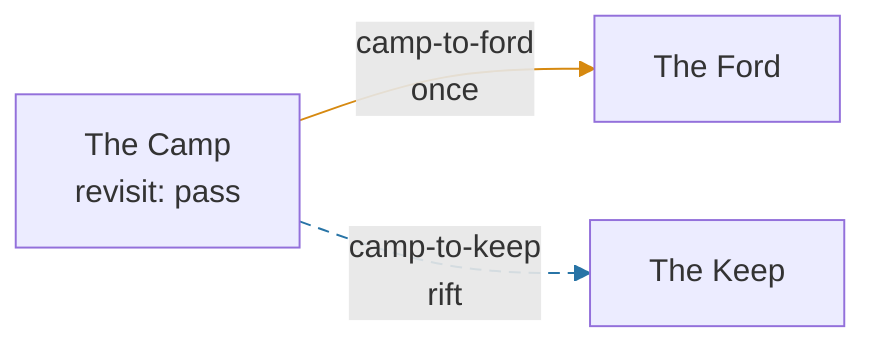

# Graph campaigns — the authoring contract

A **graph campaign** is a campaign whose next chapter is chosen by *where the party goes*,
not by a chapter number. It names places-in-the-story (**nodes**) and the ways between them
(**edges**), each with a stable id, and plays an ordinary chapter at each node. Parties can
branch, go sideways, come back to somewhere they have been and find it changed, and finish at
one of several endings.

This document is the contract for the declaration (#192, part of epic #191). The shape is
`CampaignGraph` in [`packages/shared/src/types/campaign-graph.ts`](../../packages/shared/src/types/campaign-graph.ts);
the rules that read it are [`packages/shared/src/campaign-graph.ts`](../../packages/shared/src/campaign-graph.ts);
the schema is `graph` in [`schemas/campaign.schema.json`](../../schemas/campaign.schema.json).
Where this document and the TypeScript disagree, the TypeScript wins and this is a bug.

> **Status.** The declaration, its schema, its parser and the load-time checks exist (#192), and
> so does the journey runtime (#194, [§6](#the-runtime-194)): a graph campaign can be started,
> played node by node, its exits chosen (`CHOOSE_EXIT`), and its journey is saved on the
> household's attempt. The navigation screen exists too (#195, [§6](#navigation-195)). A graph
> may declare [world state](#world-state-198) (#198): typed facts — a place displaced, a threat
> cleared, favours owed — that change what a place is on a revisit. No graph campaign ships; the
> only ones in the repo are the [Rift Sampler](#7-the-rift-sampler),
> [Ash Wyrm Sampler](#the-ash-wyrm-sampler) and [Rift Lifecycle](#the-rift-lifecycle-fixture)
> fixtures, which live outside `content/`. Edges can be [rifts](#rifts-196) (#196): links with
> lifecycles of their own — triggered, single-use, timed, unstable, persistent, linked — that the
> story and the party can [act on](#rift-actions-197) (#197): discover, open, close, steady, turn;
> and a `fallback` edge keeps a way on when a rift is gone.
> `npm run content:journey` draws a graph, reports its route coverage and drives the runtime along
> it ([tooling](#inspection-and-playtest-tooling-202), #202); a small fixture of its own
> (`journey-ci`) is the one CI plays. Rift energy can grant [temporary buffs](#temporary-buffs-200)
> (#200) — guard, damage, movement or roll bonuses (or burdens) that last a few turns or fights,
> never written to a character; the [Humming Spring](#the-humming-spring-fixture) fixture shows them.
>
> **Epic #191 is complete: all of #192–#203 landed.** Rift actions can be
> [class ways](#class-rift-interaction-199) (#199), fights can happen
> [in the rift](#environmental-combat-201) (#201), and the
> [Continental Rift vertical slice](#the-continental-rift-vertical-slice-203) (#203) puts every part
> together and is played end to end, across evenings, with and without a Starweaver — while
> Gemfall is held to the build before the epic. **To write a graph campaign, start with the
> [authoring guide](./graph-campaigns-authoring.md)**; this document is the contract it teaches.

---

## 1. Ordered or graph — and why Gemfall does not change

```ts
campaignMode(campaign) // "ordered" | "graph"
```

- **No `graph` → ordered.** Beats 1..n by chapter `index`, routed beats chosen by flag
  (`routes.ts`, [gemfall-authoring.md](./gemfall-authoring.md)). Every campaign authored before
  this existed, Gemfall and the reference campaign included. Nothing about how an ordered campaign
  loads, validates, saves or plays changes, and `campaign-graph.test.ts` / `loader.test.ts` hold
  the shipped campaigns to that (no `graph`, same tour, same refusals).
- **`graph` present → graph.** The edges choose. `index` routes nothing.

**A campaign's mode is part of its identity.** An attempt in flight on an ordered campaign
remembers a beat (`lastIndex`), not a node; giving that campaign a `graph` would strand it. So
"make Gemfall nonlinear" is a *new campaign id*, never an edit to `gemfall.json`.

Use a graph when the story has geography that loops — places visited in any order, revisited,
changed. Keep ordered when the story is a road, even a forking one: routed beats are simpler to
author, to test and to read.

---

## 2. The declaration

```jsonc
{
  "id": "rift-sampler",
  "title": "The Rift Sampler",
  "blurb": "…",
  "chapters": ["sampler-waystone", "sampler-orchard", "sampler-orchard-flooded", "…"],
  "graph": {
    "version": 1,
    "entry": "waystone",
    "flags": ["mill_wheel_turning", "found_the_lens"],
    "nodes": {
      "waystone": { "chapter": "sampler-waystone", "title": "The Waystone", "revisit": "pass" },
      "orchard": {
        "chapter": "sampler-orchard",
        "variants": [{ "chapter": "sampler-orchard-flooded", "when": { "flag": "mill_wheel_turning" } }]
      },
      "mill": { "chapter": "sampler-mill", "revisit": "closed" },
      "dawn-gate": { "chapter": "sampler-dawn-gate", "ending": { "title": "The Dawn Gate" } }
    },
    "edges": {
      "to-orchard": { "from": "waystone", "to": "orchard", "kind": "forward", "label": "Down to the orchard" },
      "orchard-to-mill": { "from": "orchard", "to": "mill", "kind": "sideways" },
      "mill-to-orchard": {
        "from": "mill", "to": "orchard", "kind": "return",
        "effects": [{ "type": "setFlag", "flag": "mill_wheel_turning" }, { "type": "unlock", "edge": "orchard-to-tower" }]
      },
      "orchard-to-tower": { "from": "orchard", "to": "tower", "kind": "forward", "locked": true, "blocked": "shown" }
    }
  }
}
```

| Field | Meaning |
|---|---|
| `version` | The declaration's version. This build reads `1` and **refuses any other** rather than guess. A later issue that changes a meaning below bumps it. |
| `entry` | The node a fresh attempt starts at. One entry, deliberately: "choose where to start" is a forward fork out of a prologue node. |
| `nodes` | Places, keyed by stable id. Key order is authored order. |
| `edges` | Ways between places, keyed by stable id — unique across the graph so an effect, a guard or a save can name one without naming its node. A node's exits are offered in authored edge order. |
| `flags` | Journey flags beyond `routeSets` members ([§5](#5-journey-flags)). |
| `facts` | World facts — typed, bounded, attempt-scoped ([World state](#world-state-198), #198). |
| `buffs` | Temporary buffs rift energy can grant — fight-only, bounded, never on a character ([Temporary buffs](#temporary-buffs-200), #200). |

Node and edge ids match `^[a-z0-9]+([-_][a-z0-9]+)*$`. **They are stable**: saved attempts name
them, so renaming one is a content migration, not a tidy-up.

### `chapters` in a graph campaign

`Campaign.chapters` keeps its meaning — every chapter file in the campaign — and gains one rule
in each direction: **every chapter a node (or variant) plays is listed, and every listed chapter is
played by some node.** The loader and the validator already read `chapters` to know which files
belong to which campaign; a second list would be a second answer.

Chapters of a graph campaign are authored exactly as any other chapter, with three differences:

- `index` is still required by the chapter schema but **routes nothing** — no 1..n check runs.
  Use it as a rough act number.
- `route` is **refused** (`content:validate`): choosing the next chapter is the edges' job.
- An ending's `endsCampaign` has **no meaning**. Only [ending nodes](#ending) end a graph
  campaign; an ending that is a different place is a different node.

---

## 3. Nodes

| Field | Meaning |
|---|---|
| `chapter` | The chapter played here. |
| `title` | The map label; absent means the chapter's title. |
| `revisit` | What entering a **completed** node does — below. Default `"replay"`. |
| `variants` | A different chapter for this place when something holds — below. |
| `onComplete` | Completion rules: effects applied when the node's chapter completes and their `when` holds ([World state](#writing-facts-edges-and-completion-rules), #198). |
| `ending` | `{ "title": … }` makes this an ending — below. |

### `revisit`

A node not yet completed is always entered and played, whatever this says. Once completed:

| Policy | Entering again… | For |
|---|---|---|
| `"replay"` (default) | plays the chapter again from its entry scene, as a new visit (variants consulted, so "again" may be a changed place) | most places |
| `"pass"` | begins a new visit that is **already done**: straight to the exit choice, no chapter | hubs and crossroads a return edge leads back to |
| `"closed"` | is impossible: every edge into it is unavailable (`"closed"`) | the burnt bridge, the collapsed cave |

`arrivalAt(graph, node, journey)` answers this before the party moves: `"new"`, `"replay"`,
`"pass"` or `"closed"`.

### `variants`

```json
"variants": [{ "chapter": "sampler-orchard-flooded", "when": { "flag": "mill_wheel_turning" } }]
```

Consulted on **every** entry that plays the node — a first visit too, because a place can change
before the party ever reaches it — in authored order. The first whose `when` holds is played;
none holding plays `chapter`. `when` is read on arrival, *after* the incoming edge's effects, so
the edge that floods the orchard is the edge whose arrival sees it flooded
(`chapterAtNode(graph, node, journey)`).

A variant is a whole chapter because biome — backdrop, palette, music — belongs to the file, the
same reason routed beats are files. A change of *words* within one place is the chapter's own
narration `variants` and needs nothing from the graph.

A variant may also say how the place is **re-entered** while it is the place (`"revisit": "replay"
| "pass"`, #198) — the restored village is walked through, the raging lair is fought again. See
[revisits that change](#revisits-that-change).

### Ending

```json
"dawn-gate": { "chapter": "sampler-dawn-gate", "ending": { "title": "The Dawn Gate" } }
```

Completing an ending node's chapter **completes the attempt** — commitment, spec §8.3, exactly as
finishing Gemfall's last beat — and records which ending was reached. An ending has no exits
(refused). A graph with no ending is refused: no attempt could ever complete. Failure is unchanged:
`setbackLimit` setbacks fail the attempt wherever the party is.

---

## 4. Edges

| Field | Meaning |
|---|---|
| `from`, `to` | Node ids. |
| `kind` | `"forward"`, `"sideways"` or `"return"` — below. |
| `label` | What the choice says; absent means the destination's title. |
| `when` | Available only while this holds ([guards](#guards-when)). |
| `effects` | Applied in order when taken, **before arrival**. |
| `locked: true` | Unavailable until an `unlock` effect opens it. |
| `once: true` | May be taken once per attempt; then it is **spent**. |
| `irreversible: true` | The author's claim that there is no way back to `from` afterwards. Not enforced at runtime: #193 checks the claim, #195 warns before the crossing. |
| `blocked` | How the exit is drawn while unavailable: `"hidden"` (default — the house rule, unmet requirements hide, architecture §5) or `"shown"` (the locked door is part of the place). |
| `rift` | Makes the edge a [rift](#rifts-196): a link with a lifecycle (triggered, single-use, timed, unstable, persistent, linked, one-way, hidden destination). Absent: an ordinary edge. |
| `fallback: true` | Available only while no other exit from `from` is ([Rift actions](#rift-actions-197)): the long way round when a rift is gone. |

### `kind`, and which cycles are allowed

Movement is identical for all three. The kind is the author's statement of intent, which the
tools hold the graph to (#193) and the screens present (#195):

- **`forward`** — onward in the story.
- **`sideways`** — a neighboring place at the same point in the story: a side trip.
- **`return`** — back to somewhere the story has been. **A cycle is intentional when it runs
  through a `return` edge.** A loop made only of forward edges is the story arriving where it has
  been without anybody meaning it to, and #193 reports it.

Return edges name their destination. There is no "go back to wherever you came from" target:
static destinations keep reachability a property of the file rather than of a party's history.

### When an exit is available

Exits are chosen only **between visits** — once the node's chapter has completed (or a `"pass"`
revisit began done). There is no leaving a node mid-chapter. An exit is available when, checked in
this order (the first failure is the one reported, `exitAvailability`):

1. **not locked** — authored `locked` and never unlocked, or closed by a `lock` effect → `"locked"`
2. **not spent** — a `once` edge already taken → `"spent"`
3. **not closed** — it leads into a `revisit: "closed"` node already completed → `"closed"`
4. **its `when` holds** → `"guard"`
5. **its rift, if it is one, can be crossed** → `"rift-dormant"`, `"rift-faded"`, `"rift-closed"`,
   `"rift-consumed"`, `"rift-expired"` or `"rift-collapsed"` ([Rifts](#rifts-196))
6. **a `fallback` edge: no other exit from its node is available** → `"fallback"` (#197)

`exitsFrom(graph, node, journey)` lists a node's exits in authored order with each one's
availability and whether it is drawn (`visible`: available, or blocked and `"shown"`).

### Effects

| Effect | Does |
|---|---|
| `{ "type": "setFlag", "flag": f, "value"?: bool }` | Sets a journey flag — the chapters' `setFlag`, same shape. A `routeSets` member is a fork: setting it clears the set's other members. |
| `{ "type": "unlock", "edge": e }` | Opens `e` (it is then available subject to its `when`). |
| `{ "type": "lock", "edge": e }` | Closes `e` for the rest of the attempt. |
| `{ "type": "setFact", "fact": f, "value": v }` | Sets world fact `f` to `v`, a value in its domain (#198). |
| `{ "type": "adjustFact", "fact": f, "by": n }` | Moves counter fact `f` by a non-zero integer, clamped to its bounds (#198). |
| `{ "type": "discoverRift" \| "openRift" \| "closeRift" \| "stabilizeRift", "edge": e }`, `{ "type": "redirectRift", "edge": e, "to": n }` | Acts on rift `e` ([Rift actions](#rift-actions-197), #197). On a final rift: nothing. |
| `{ "type": "grantBuff", "buff": b }` | Grants temporary buff `b` — or refreshes, stacks or ignores it if held ([Temporary buffs](#temporary-buffs-200), #200). |

The same effects are what a node's `onComplete` rules apply when its chapter completes
([World state](#writing-facts-edges-and-completion-rules)).

### Guards (`when`)

`GraphCondition`. Every field present must hold, an empty one always holds — the chapters'
`Condition` rule, so authors learn it once. Node and edge fields take one id or a list; **a list
means every listed id** (`"visited": ["orchard", "quarry"]` — both).

| Field | Holds when |
|---|---|
| `flag` / `notFlag` | the journey flag is / is not set |
| `visited` / `notVisited` | the node has / has never been **entered** this attempt |
| `completed` / `notCompleted` | the node's chapter has / has never **completed** this attempt |
| `traversed` / `notTraversed` | the edge has / has never been taken this attempt |
| `outcome` | the **subject** node's most recent completion was `"success"` / `"setback"`. On an edge the subject is `from` ("if the chapter you just finished was a setback"); on a variant it is the node itself ("if it went badly here last time"). Never completed matches neither. |
| `visit` | `{ "min"?, "max"? }`: the **subject**'s visit ordinal is within these (#198). On an edge, the visit being finished; on a variant, the visit being begun (`{ "min": 2 }` = every revisit); in `onComplete`, the visit completing. |
| `facts` | `{ factId: test, … }`: every listed world fact passes its test (#198) — [below](#reading-facts-guards-and-variants). |

**A guard reads the journey, never the party.** No items, coins or party size. A graph decision
has to come out the same on any evening for any phones, or a party resuming on Thursday sees
different doors than the one that stopped on Monday. "Only if somebody holds the key" belongs in
the chapter, as a choice that sets a journey flag. **There is no `or`**: two edges to the same
place, each with its own guard, say it — and say it in a way every tool can already draw.

---

## 5. Journey flags

The journey's memory is booleans, carried by **the ordered campaigns' carry rule, widened**:

- The journey flags are `graph.flags` **plus every `routeSets` member** (`journeyFlags`). Route
  sets keep their fork semantics, so they need not be repeated in `graph.flags`.
- Every journey flag is **seeded into each chapter run** of the attempt, so a chapter may gate on
  one it never sets (`content:validate` allows that, as it does for carried route flags).
- When a node's chapter completes, each journey flag's value in the run **becomes** its journey
  value (the run was seeded with it, so an untouched flag is unchanged). Any flag not declared
  dies at the chapter boundary, as it always has.
- Edge `setFlag` effects write them too.

This is how a chapter's choices reach the graph: the quarry chapter sets `found_the_lens`, and
the quarry's exit to the tower is guarded on it. Declared, rather than inferred, for the
`routeSets` reason — only a declared list can notice a guard reading a flag nothing will carry.

---

## World state (#198)

A graph campaign's world can change: the wyrm wakes and the mill village is displaced; the party
clears the wyrm and the village is restored; the river folk owe the party favours; a path to the
ford opens. **World facts** carry that, beside the journey flags, and a place's
[variants](#variants) read them — so coming back somewhere is a *changed* place, not the same scene
replayed. The shape is `WorldFact` in `types/campaign-graph.ts`; the arithmetic of one fact
(reading, testing, writing) is [`world-state.ts`](../../packages/shared/src/world-state.ts).

```jsonc
"facts": {
  "mill-village": { "domain": "locale", "type": "enum", "values": ["standing", "displaced", "restored"],
                    "initial": "standing", "label": "The mill village", "visible": true },
  "ash-wyrm":     { "domain": "threat", "type": "enum", "values": ["sleeping", "raging", "cleared"], "initial": "sleeping" },
  "river-folk":   { "domain": "alliance", "type": "counter", "min": 0, "max": 3, "initial": 0 },
  "ford-path":    { "domain": "route", "type": "flag" }
}
```

### Typed facts, not more flags — the decision

World state is **declared, typed and bounded**, not a second bag of booleans:

- **A place is one thing at a time.** `village_displaced` and `village_restored` as flags can both
  be true, and every guard reading them must rule out combinations nobody meant. An `enum` cannot
  be two things.
- **Bounded domains can be enumerated.** An enum has 2–12 values; a counter's `max - min` is at
  most 20 (`MAX_COUNTER_SPAN`); a flag is two values. So the [lint](#validation) still walks every
  state a party can reach, and "this variant is never played" or "this road never opens" stays a
  decided question rather than a guess. An unbounded number or a free string would make that search
  infinite.
- **The initial value is part of the declaration**, so "nothing stored" always means one thing —
  the world as the author wrote it — and a fact added after a party set out needs no migration.

Journey flags stay what they were: what a chapter sets and reads. A world fact is the **graph's**:
written by edges and completion rules, read by guards and variants. Facts are **not seeded into
chapter runs** — a chapter that should differ by world state is a different chapter, chosen by a
variant (the biome rule, [§3](#variants)); a fact a chapter's narration needs can be mirrored into
a journey flag by a completion rule.

| Field | Meaning |
|---|---|
| `domain` | `"locale"` \| `"threat"` \| `"alliance"` \| `"route"` \| `"consequence"` — what the fact is *about*, for the tools and screens (#195, #202). No rule reads it. |
| `type` | `"enum"` (`values`, `initial` ∈ values) \| `"counter"` (integers `min` < `max`, `min ≤ initial ≤ max`) \| `"flag"` (`initial` true/false, default false) |
| `label` | What the screens call it, for an 8-year-old. Default: the id. |
| `visible: true` | Shown to the players (`JourneyView.facts`). Absent: remembered, never sent to a phone — the surprise stays one. |

Fact ids and enum values match the node/edge id pattern and **are stable**: saves name them.

### Writing facts: edges and completion rules

Two effects, usable anywhere an effect is ([§4](#effects)):

- `{ "type": "setFact", "fact": f, "value": v }` — `v` must be in the fact's domain.
- `{ "type": "adjustFact", "fact": f, "by": n }` — counters only; clamped to `[min, max]`, so a
  fourth favour on a counter that stops at three is three.

**How a chapter writes a fact** — without the chapter schema learning anything: a node's
`onComplete` rules.

```json
"onComplete": [
  { "when": { "outcome": "setback", "facts": { "ash-wyrm": "sleeping" } },
    "effects": [{ "type": "setFact", "fact": "ash-wyrm", "value": "raging" },
                { "type": "setFact", "fact": "mill-village", "value": "displaced" }] },
  { "when": { "flag": "befriended_river_folk" },
    "effects": [{ "type": "adjustFact", "fact": "river-folk", "by": 1 },
                { "type": "setFlag", "flag": "befriended_river_folk", "value": false }] }
]
```

When the node's chapter completes, after the outcome is recorded and the journey flags are read
back, **every rule whose `when` holds applies its effects**, in authored order. All the `when`s are
judged against that same journey — rules do not see each other's effects — so order matters only
for two effects writing the same thing. `outcome` and `visit` in a rule are about this node and
this completion. The chapter reports what it always reports — its outcome, and the journey flags
its choices set — and the *graph* says what that does to the world. A `"pass"` arrival completes
nothing and runs no rules; a duplicate completion runs them never twice.

Why not let chapters write facts directly? A chapter-level effect would make the chapter schema
mean something different inside a graph campaign than inside an ordered one (where it would have
to be refused), and a namespaced-flag convention (`fact:ash-wyrm=raging`) would be stringly-typed
state the validator could not check. A completion rule keeps chapters exactly as they are in every
campaign, keeps every write to the world in the one file the lint reads, and is checked like any
other guard and effect.

### Reading facts: guards and variants

`GraphCondition.facts` tests facts by id; each test is

| Test | Holds when |
|---|---|
| `"displaced"` / `2` / `true` | the fact **is** this value (enum, counter, flag) |
| `{ "in": ["raging", "cleared"] }` | it is one of these (enum or counter) |
| `{ "not": "cleared" }` | it is anything but this (enum or counter) |
| `{ "min": 1, "max": 2 }` | a counter within these, inclusive (either may be absent) |

Every key of a test must hold, every fact listed must pass, and it ANDs with the other condition
fields as always. **A fact never written reads as its `initial`.** A value outside the fact's domain
is refused by `parseCampaignGraph` — a test for a state the fact can never be in is a typo.

### Revisits that change

"Changed encounters on revisit, without forcing identical replays" is variants, read on every
entry that plays the node, first match wins ([§3](#variants)) — now keyed on world facts and on the
**visit ordinal**:

```json
"variants": [
  { "chapter": "ws-village-restored",  "when": { "facts": { "mill-village": "restored" } }, "revisit": "pass" },
  { "chapter": "ws-village-displaced", "when": { "facts": { "mill-village": "displaced" } } },
  { "chapter": "ws-village-market",    "when": { "visit": { "min": 2 } } }
]
```

The mill village is the standing village the first time, a market day on any later visit while it
stands, the displaced camp once the wyrm wakes, and the restored village once it is cleared. A
variant's own **`revisit`** (`"replay"` or `"pass"`) overrides the node's while that variant is the
place: once the village is restored, coming back walks straight through to the exits rather than
replaying it — but a party that first arrives after the village was saved still plays the restored
chapter, because a first visit always plays. `"closed"` is not allowed on a variant: whether a
place can be entered is decided before the party crosses (`exitAvailability`), and a variant is
chosen on arrival. (A screen's `JourneyExitView.arrival` for an available exit is the simulated
crossing's own answer, after the edge's effects, so an edge that itself changes the world and
turns a `"replay"` into a `"pass"` is shown as the pass it will be; a blocked exit is shown what the
place is now.)

### Persistence and scope

`JourneyFacts.facts` stores the values **this attempt has written** — nothing for a fact never
written, so a fresh journey carries no `facts` key at all. It rides the same attempt row and
conditional commit as the rest of the journey (`CampaignProgressRecord.journey`), and needs no
version bump: absence keeps today's behaviour.

- **Reading through the declaration** (`readFact`): absent → `initial`; an enum value the
  declaration no longer lists, or a value of the wrong type → `initial`; a counter outside
  (narrowed) bounds → **clamped**; a stored `facts` that is not an object → nothing written.
- **Unknown ids are ignored, not dropped**: a fact the declaration no longer has (or a later
  build's) is never read and is carried along on the next write.
- **A journey saved before #198** has no `facts`, and reads as the world the author wrote.
- **Attempt-scoped, never global.** Facts live on one attempt's journey. Nothing writes the
  campaign declaration, the parsed graph `ContentStore` caches, canon, `content/world.json`, the
  field guide, another household's attempt, or this household's next attempt — which starts from
  the declared `initial` values again. The transitions are pure and return new records; the tests
  freeze the campaign and the parsed graph through a whole walk to hold them to it.
- **Ordered campaigns** have no graph, so no facts, no completion rules, nothing new.

### What the players see

`JourneyView.facts` (on `CampaignView.journey`): the facts declared `visible`, in authored order —
`{ id, domain, label, type, value }`. Present only when the graph declares a visible fact. #195 and
#202 draw from it; nothing there is needed to decide anything.

### The Ash Wyrm Sampler

[`packages/shared/src/fixtures/world-state.campaign.json`](../../packages/shared/src/fixtures/world-state.campaign.json)
— the world-state fixture, outside `content/` like the Rift Sampler, on placeholder chapter ids.

```
  [crossroads] (pass) ──to-village──▶ [village] ──village-to-crossroads (return)──▶ [crossroads]
       │  │  │                          standing → market day (visit ≥ 2) → displaced → restored (pass)
       │  │  └──to-lair (when wyrm not cleared)──▶ [lair] ──lair-to-crossroads (return)──▶ [crossroads]
       │  │                                          sleeping: setback wakes it (raging; village displaced;
       │  │                                          orchard scorched) · success finds the ford path
       │  │                                          raging: success clears it (village restored)
       │  └──to-high-pass (when wyrm cleared, shown)──▶ ((high-pass))
       └──to-ford (when ford path and river-folk ≥ 1; costs a favour)──▶ ((ford))
```

One fact per domain: `mill-village` (locale), `ash-wyrm` (threat), `river-folk` (alliance counter,
earned when the village chapter sets `befriended_river_folk`), `ford-path` (route, hidden),
`scorched-orchard` (consequence, visible, read by nothing). `world-state.test.ts` plays every face
of the village and both endings; `packages/server/src/handlers/world-state.test.ts` plays it
through the server.

---

## 6. Visits, completion, and resuming

This is the part every later issue leans on. The words mean exactly this:

- **A visit** begins when the journey **enters** a node: at the entry node when a fresh attempt
  starts, or by taking an edge. Entering always begins a new visit and increments
  `visits[node]` — first time, `"replay"`, or `"pass"` alike. The visit's ordinal is that count,
  and `(attemptId, node, visit)` names one visit exactly.
- **Visited** = at least one visit has begun (`visits[node] > 0`), finished or not.
- **A visit completes** when its chapter run settles (CHAPTER_COMPLETE) — at most once per visit.
  That increments `completions[node]`, records the run's `outcome` as the node's latest,
  reads the journey flags back from the run, and then applies the node's `onComplete` rules
  (#198). **Completed** = at least one visit completed.
  A `"pass"` revisit begins done without playing, and so does **not** add a completion.
- **The visit ends** when the party takes an exit (or the visit completed an ending).

**One-session node completion.** A node is exactly one chapter, and a chapter is authored to be
played in one sitting (`estimatedMinutes`). There is no partial completion and no node that spans
chapters: the journey changes at exactly three moments — *enter*, *complete*, *take an exit* —
and never mid-chapter.

**Resuming is not revisiting.** If the session ends —

| …while the visit is | the next session | counters |
|---|---|---|
| `"playing"` (chapter not yet completed) | resumes **the same visit**: the same node, the same resolved chapter (variants are not re-evaluated) | unchanged |
| `"choosing"` (completed or passed, no exit taken) | resumes at the **exit choice** — never a replay | unchanged |
| `"ended"` | the attempt is complete | — |

Whether a dropped chapter run picks up mid-scene or restarts from its entry is the run layer's
business, unchanged from ordered campaigns. Either way it is the same visit.

**Replay is a new visit.** Re-entering a completed node by any edge — return, sideways, forward —
is a new visit, counted separately, and (under `"replay"`) plays the chapter again. A second report
of the same visit's completion, or of the same exit from it, is a **repeat**, not progress: #194
makes both idempotent on the visit's identity.

**XP is paid once per chapter per attempt.** A chapter's `xpAward` (and objectives) pays on its
first completion in the attempt and not on a replay: a cycle is a story device, not an XP farm. A
variant is a different chapter, so a changed place pays once more. (`JourneyState.chaptersCompleted`
records which have paid.)

### Save/load compatibility

The journey is stored on the campaign attempt (`CampaignProgressRecord.journey`, #194) as
`JourneyState`, `version: 1`. **An ordered campaign's attempt has no journey state** — every row
written before graphs, and every Gemfall row forever — and reads exactly as before: nothing on the
ordered path reads the field. A **graph** campaign's attempt with no journey written yet reads as a
fresh start at the entry (`startJourney` is deterministic, so every reader agrees on it). No graph
campaign has ever been played, so there are no in-flight graph attempts to migrate. Content may
change under a journey: a counter or lock state for an id the declaration no longer has is
ignored, never an error; renaming an id is a migration — and a journey *standing at* a node the
declaration no longer has is refused (`"unknown-node"`) rather than guessed at.

### The runtime (#194)

[`packages/shared/src/journey.ts`](../../packages/shared/src/journey.ts) moves the journey; it is
pure (no clock, no randomness, no store) and every transition returns a new `JourneyState`, a
**duplicate** marker, or a **refusal** value — never a throw:

| | |
|---|---|
| `startJourney(graph, campaign?)` | the first visit to the entry, `"playing"` (variants resolved) |
| `readJourney(graph, raw)` | the stored value checked: `null` when absent; refused when unreadable, from a newer build (`"version"`) or standing at an unknown node |
| `resumeJourney(graph, raw, campaign?)` | `readJourney`, or `startJourney` when nothing is stored (`fresh: true`) |
| `completeVisit(graph, journey, { node, visit, chapterId, outcome, flags }, campaign?)` | the visit's chapter settled: `completions`/`outcomes`/flags/`chaptersCompleted`; `firstCompletion` (XP pays), `ended` (an ending) |
| `takeExit(graph, journey, { edge, visit }, campaign?)` | traversed + 1, `lastExit`, effects in order, then enter the destination; `arrival` is `"new"`/`"replay"`/`"pass"` |
| `currentPlayable(graph, journey)` | `{ kind: "play", node, visit, chapter }` \| `{ kind: "choose", node, visit, exits }` \| `{ kind: "ended", node, visit, ending }` |
| `journeyView(graph, journey, titleOf?)` | `JourneyView`, the screens' read model (below) |
| `migrateJourney(raw)` | the migration ladder — one rung today (the hook a `JOURNEY_VERSION` 2 fills) |

`campaign` supplies `routeSets`: a route set member is a fork in a graph campaign too, so an edge's
`setFlag` clears the set's other members, and reading flags back from a run keeps the ordered
rule — the newly set member wins; two new ones is a content bug and the set is left as it was.
Journey flags are stored true-only.

**Idempotence.** Every report names its visit, and `(attemptId, node, visit)` is the key — the
attempt id is the row's, `(node, visit)` the report's:

| Report | Answer |
|---|---|
| completion of the current visit while `"playing"` | applied |
| completion of the current visit already done, or of any earlier visit (`visit ≤ visits[node]`) | **duplicate**: the journey unchanged, nothing counted or paid |
| completion of a visit the journey never had | refused `"stale-visit"` |
| completion naming another chapter than the visit resolved | refused `"wrong-chapter"` |
| the exit recorded as `lastExit` (same `node`, `visit`, `edge`) | **duplicate**, wherever the journey has got to since |
| an exit from another node / another visit / while `"playing"` / after `"ended"` | refused `"not-here"` / `"stale-visit"` / `"still-playing"` / `"ended"` |
| an unavailable exit | refused `"unavailable"` with `reason` (`ExitBlock`) |
| an edge id the graph does not have | refused `"unknown-edge"` |

**On the server.** `ContentStore.graph(campaignId)` is `chapterAt`'s by-node sibling: the parsed
graph, or `null` for an ordered campaign — the branch every caller takes first.

- **CONTINUE_CAMPAIGN** resumes the journey (`attemptJourney`: the active attempt's journey, or a
  fresh start for no attempt or a finished one) and starts the playing visit's chapter. A party
  that is choosing is refused until it chooses.
- **START_CHAPTER** of a graph campaign must name exactly that chapter. The chapter run is seeded
  with the journey's flags, and stamped with `RunState.journeyVisit = { node, visit }` beside
  `campaignAttemptId`. A start that creates the attempt writes it holding its fresh journey.
- **Settlement** (chapter completion) calls `completeVisit` with the run's stamp, its outcome and
  its flags, inside the same conditional commit as every campaign write. A run of a finished or
  different attempt, without a stamp, or whose visit is a duplicate or stale, settles nothing and
  is shown no XP. A replay (`firstCompletion: false`) records the visit and folds the bag but pays
  no XP. Setbacks count and the setback limit fails the attempt wherever the party is; completing
  an ending completes it (`commitCampaign`). `lastIndex` and `routeFlags` are not maintained for a
  graph campaign — the journey is the whole of where the party got to.
- **`CHOOSE_EXIT { edgeId, visit, campaignId? }`** (campaign defaults to the run's) calls
  `takeExit` and writes the attempt. Legal only between chapters (lobby, creation, completion
  screen). A duplicate answers `{ ok: true }` at the current seq and writes nothing. It moves the
  journey only; CONTINUE then plays where it leads (or, at a `"pass"`, the party is at a choice
  again).

**Concurrency.** Every journey write rides the run's `repo.commit` with
`campaignProgressExpectedVersion` — the attempt row's optimistic lock that already serialized the
setback counter across rooms. Two rooms completing one visit, or two phones taking different exits
from it, both read version *v*; exactly one write lands, the other's commit fails (`STALE_SEQ`),
and whatever it retries meets the moved journey — a duplicate, or a stale visit.

**`CampaignView.journey`** (`JourneyView`, for graph campaigns only): `node`, `title`, `visit`
(what `CHOOSE_EXIT.visit` echoes), `status`, `chapter`, `exits` (while choosing: the *visible*
exits in authored order — `edge`, `to`, `kind`, `label`, `available`, `reason?`, `arrival`,
`irreversible?`), `reachedEnding` once an attempt has completed at an ending, and `facts` — the
visible [world facts](#what-the-players-see) (#198), when the graph declares any. `next` is null
while choosing. For a completed attempt, `journey` shows the ending reached and `next` the fresh
start a replay would begin.

### Navigation (#195)

The phones draw `CampaignView.journey` as `JourneyPanel` (`packages/client/src/screens/JourneyPanel.tsx`),
mounted in the lobby **instead of** the "Begin" button and the "Chapter N" line, and only when the
lobby's campaign carries a `journey` - an ordered campaign never does, so its lobby, completion
screen and Begin button are exactly what they were. The shared screen says one line about where the
party stands (`journeyLine`); the choosing happens on the phones.

What the view adds for it, all optional so later views can add more beside them:

| Field | Meaning |
|---|---|
| `JourneyView.places` | Every node the party has **entered**, in authored order: `node`, `title`, `visits`, `completed`, `here?`. An unexplored place is never listed. |
| `JourneyExitView.once` | The edge is `once`: one crossing per attempt. |
| `JourneyExitView.changed` | On an available exit to a place already finished — replayed, or walked through under a variant's `revisit: "pass"` (#198) — the chapter the crossing would resolve there (after the edge's own effects) is one the party has never played. A flag, never which variant. |
| `JourneyView.facts` | The visible [world facts](#what-the-players-see) (#198), when the graph declares any. `JourneyPanel` does not draw them yet. |
| `JourneyExitView.label` | An **unexplored** destination with no edge `label` shows the node's `title`, else "Somewhere new" - never its chapter's title, which names the story beat. |

How a way is drawn: an available way is a button, with chips for *Onward / Side trip / Head back*
and *Unexplored / Been here / It has changed*; a blocked-but-`"shown"` way is plain words with a
kid-friendly reason (`exitBlockedLine` - it says it is shut or finished, never what would open it);
hidden blocked ways are absent, as ever. An `irreversible` or `once` way asks first ("You won't be
able to come back this way." / "You can only go this way one time.") and sends nothing until "Yes,
go". One tap on a way sends `CHOOSE_EXIT` then `CONTINUE_CAMPAIGN` - two intents that are each safe
to repeat - except into a `"pass"` place, which has nothing to play and so is a choice again. If the
second intent is refused or lost the party simply stands at its next stop with a "Go to ..." button,
the same place a returning session finds it.

**Versioning.** `JourneyState.version` is the stored record's (`JOURNEY_VERSION = 1`), separate in
meaning from the declaration's. A later change to what a saved journey means bumps it and adds a
rung to `migrateJourney`; a row from a newer build is refused (CONTINUE, START_CHAPTER and
CHOOSE_EXIT refuse; settlement settles nothing and logs) and never overwritten.

---

## Rifts (#196)

A **rift** is an edge with a life of its own: it may wait to open, be used up, run out of time,
flicker, collapse, or hide where it leads. It is declared as an optional `rift` on the edge, every
property optional and composable; an edge without one is exactly the edge of [§4](#4-edges). The
shape is `GraphRift`/`RiftState` in `types/campaign-graph.ts`; the read rules are `riftState`/
`riftBlock` in `campaign-graph.ts`; the moves are
[`packages/shared/src/rifts.ts`](../../packages/shared/src/rifts.ts). Opt-in like everything
else here: no `rift`, no change — and adding the field did not bump `CampaignGraph.version`.

```jsonc
"camp-to-isle": {
  "from": "camp", "to": "isle", "kind": "forward", "label": "Step into the shimmer", "blocked": "shown",
  "rift": { "uses": 1, "lasts": { "unit": "visits", "count": 4 }, "reveal": "when-crossed" }
},
"shore-to-ruins": {
  "from": "shore", "to": "ruins", "kind": "forward",
  "rift": { "opensWhen": { "flag": "tide_out" }, "oneWay": true }
}
```

| Property | Name in the issue | Meaning |
|---|---|---|
| `opensWhen: GraphCondition` | triggered | `"dormant"` until it holds, then `"open"`. Judged like an edge guard, subject = the edge's `from` (a linked pair: the `from` of its smaller id, so both mouths agree). Unless `persistent`, an open triggered rift can be **crossed only while it still holds** (`"rift-dormant"` otherwise); its lifecycle stays `"open"`. |
| `persistent: true` | persistent | Once open, open for good: `opensWhen` no longer gates it, and no action closes it. Refused together with `uses`, `lasts` or `unstable` (they would end it). |
| `uses: n` | single-use (`1`) | `"consumed"` after n crossings. |
| `lasts: { unit, count }` | timed | `"expired"` once `count` ticks of `unit` have passed since it opened. |
| `unstable: { flicker?: { open, shut }, collapsesAfter? }` | unstable | `flicker`: there on `open` visits to `from`, gone for `shut`, repeating — visit ordinal v is open when `(v − 1) mod (open + shut) < open` (`"rift-faded"` otherwise). `collapsesAfter: n`: `"collapsed"` after n crossings. No randomness: the rhythm reads the visit ordinal, so a resumed visit gives the same answer. |
| `linkedTo: edgeId` | linked | Its partner rift. The two are **one rift with two mouths**: one shared state (stored under both ids), so a crossing of either counts for both, and closing, consuming, expiring or collapsing one does the same to the other. Must be mutual, and must declare the same lifecycle (`opensWhen`, `persistent`, `uses`, `lasts`, `unstable`). A pair of opposite edges is a two-way rift. |
| `oneWay: true` | one-way | The promise that **no rift leads straight back**. Movement on any edge is one-way already; this is the claim, refused with a partner that is its own way back and checked against every rift edge `to → from` (`RIFT_ONE_WAY_HAS_WAY_BACK`), and shown on the screen. (Whether there is any way back at all is `irreversible`'s claim.) |
| `reveal` | destination reveal | `"always"` (default), `"when-open"` (hidden while dormant) or `"when-crossed"` (hidden until the party has crossed it, by either mouth of a pair). |

`{}` is a rift with no rules: open from the start, forever, and drawn as a rift.

### The lifecycle

```
  dormant ──(opensWhen holds, or openRift)──▶ open
     │                                         ├─(crossings reach uses)───────────▶ consumed  ┐
     │                                         ├─(age reaches lasts.count)────────▶ expired   ├ final
     │                                         ├─(crossings reach collapsesAfter)─▶ collapsed ┘
     └───────────(closeRift)──────────▶ closed ◀──(closeRift; not if persistent)──┘
                                         └──(openRift)──▶ open
```

- The lifecycle only moves forward. **`consumed`, `expired` and `collapsed` are final**: no
  condition, no clock, no content change and no explicit open brings one back — a used-up rift that
  returns is a different edge. A stored final status is never overwritten (closing one is a no-op).
- **`closed`** is a stop, not an end: only an explicit `openRift` (#197's action) reopens it.
  Nothing derived does.
- Absent state reads **as declared**: open, or dormant with `opensWhen`. A stored record that is
  not one (a corrupted row, a status from a later build) reads `"closed"` — the one thing a misread
  rift must never do is open by accident.
- Both `uses` and `collapsesAfter` reached by the same crossing: `consumed`.

### Clocks

There is no wall clock in a journey, and no turn clock between chapters. A timed rift counts the
moments the journey already has:

| `unit` | One tick | Reads as |
|---|---|---|
| `"visits"` | every exit taken and arrived through (a pass-through counts — it is a move) | "for four moves" |
| `"chapters"` | every chapter completed (a pass-through plays none) | the **session clock**: a chapter is one sitting, so "for two evenings" |

The age counts from the moment the rift **opened** (for an untriggered rift, the start of the
attempt). The parser refuses any other unit. Turn-by-turn timing inside an encounter is #201's
[rift clock](#environmental-combat-201), which deliberately does **not** call `tickRifts`: a fight
never moves the journey; a flag its ending sets does, through the node's `onComplete` rules.

### When a rift moves, and what a crossing is

Only inside the journey's three transitions, in a fixed order, so the server, the phones and the
lint search walk a rift through the same states:

| Transition | Rift steps |
|---|---|
| start | enter the entry → `settleRifts` |
| complete a visit | `tickRifts("chapters")` on the journey the chapter played under → the completion (counters, outcome, flags) → `settleRifts` |
| take an exit | `crossRift` → `tickRifts("visits")` → traversed/`lastExit`/effects → enter → `settleRifts` |

Ticking *before* the transition's own changes means a rift opened by this move or chapter starts at
age 0; crossing *before* ticking means a timed rift can be taken on its last move. `settleRifts`
writes back what the journey now implies (a triggered rift opening, a timed one expiring) and
nothing for a rift still as declared, so a graph with no rifts never grows a `rifts` key.

**A crossing is the `CHOOSE_EXIT` that commits** — one party-wide move. The whole party crosses
with the exit; there is no per-hero crossing and no half-crossed party, because the journey has no
such state: the rift's count, the exit and the arrival are one `takeExit`, written in the attempt's
one conditional commit. So:

- a double tap, or a retry after a lost response, is `takeExit`'s **duplicate** (its `lastExit`
  check runs before availability) — never a second crossing, and never refused as "consumed";
- two phones crossing at once: exactly one write lands; the other's retry is the duplicate;
- a session that resumes after the write finds the rift as the crossing left it; one that resumes
  before it finds it untouched. There is nothing in between to resume.

### Stored state

`JourneyFacts.rifts?: Record<EdgeId, RiftState>`, `RiftState = { status, crossings?, age?,
revealed?, latched? }` — stored inside `CampaignProgressRecord.journey`, so it rides the same
versioned write. `JOURNEY_VERSION` stays 1: an absent `rifts` reads as declared, which is what
every journey written before rifts means. A record for an edge that is no longer a rift is ignored;
an edge that becomes a rift under a save starts as declared; a stored final status survives a
declaration that loosened.

### On the screen

`JourneyExitView` gains (#195 draws them):

- `rift?: JourneyRiftView` — `{ status, usesLeft?, expiresIn?: { unit, count }, collapsesIn?,
  oneWay?, unstable?, persistent?, linked? }`; `reason` already says why it cannot be crossed now.
- `hiddenDestination?: true` — the destination is not revealed: **`to` is `""`**, `label` is the
  authored label (write one that does not name the place) or `"Into the rift"`, `arrival` is
  `"new"` (all the party knows), and `changed` is never set. `journeyView` does not even simulate
  the crossing (#195's arrival/`changed` reading) for such an exit: what it would find is exactly
  what the view may not say. Nothing in the view names the place.

### For #197 (rift actions)

`rifts.ts` exposes the explicit transitions, each `(graph, journey, edgeId) → { ok: true, changed,
journey } | { ok: false, code: "not-a-rift" | "final" | "persistent", message }`:

| | |
|---|---|
| `openRift` | dormant or closed → open, **latched** (its `opensWhen` stops gating it). A timed rift opened from dormant starts at age 0; reopened from closed it keeps its age and count. Final → refused. |
| `closeRift` | dormant or open → closed. Already closed or final → unchanged. Open and `persistent` → refused. |
| `revealRift` | reveals the destination, whatever `reveal` says. |

#197 builds on these, adding `stabilizeRift`, `redirectRift` and `discoverRift` beside them, the
authored effects that take all five, and the party's `RIFT_ACTION`: [Rift actions](#rift-actions-197).

### Checks

| Check | Where |
|---|---|
| counts are whole numbers ≥ 1, `unit` is `visits`/`chapters`, `unstable` is not empty, `reveal` is known, `opensWhen` names resolve, `persistent` not with `uses`/`lasts`/`unstable`, `linkedTo` exists, is a rift, links back, declares the same lifecycle, and is not a `oneWay` rift's own way back | schema and `parseCampaignGraph` |
| `RIFT_ONE_WAY_HAS_WAY_BACK` — a one-way rift with a rift edge straight back | lint (error) |
| `RIFT_ONCE_AND_USES` ⚠ — `once` and `rift.uses` on one edge | lint (warning) |
| `RIFT_REVEAL_MOOT` ⚠ — `reveal: "when-open"` on a rift open from the start | lint (warning) |
| contradictory `opensWhen` → `GUARD_CONTRADICTION`; a single-use, timed, collapsing or flickering rift as the only way on → `STRANDED`/`TRAPPED` with the path | the softlock search, which tracks rift state |

### The Rift Lifecycle fixture

[`packages/shared/src/fixtures/rift-lifecycle.campaign.json`](../../packages/shared/src/fixtures/rift-lifecycle.campaign.json)
shows every property, on placeholder chapters (not content, never loaded), and walks clean:

| Edge | From → to | Rift |
|---|---|---|
| `camp-to-shore` / `shore-to-camp` | camp (pass, entry) ⇄ shore | — (plain forward / return) |
| `camp-to-isle` | camp → isle | `uses: 1`, `lasts: 4 visits`, `reveal: "when-crossed"` — single-use + timed + hidden |
| `shore-to-ruins` | shore → ruins | `opensWhen: { flag: tide_out }`, `oneWay` — triggered + one-way |
| `camp-to-ruins` ⇄ `ruins-to-camp` | camp ⇄ ruins | linked pair, `uses: 2`, `opensWhen: { visited: ruins }` — a two-way gate that wakes once the ruins are found |
| `ruins-to-spire` | ruins → spire | `unstable: { flicker: 1 on / 1 off, collapsesAfter: 1 }` |
| `isle-to-spire` | isle → spire | `opensWhen: { completed: ruins }`, `persistent` |
| `isle-to-camp`, `ruins-to-shore` | back | — (plain returns) |
| `spire-to-dawn` | spire → dawn (ending) | — (`irreversible`) |

`rifts.test.ts` plays it: the shimmer's destination hidden until crossed and its four moves
counting down, the tide-rift there only while the tide is out, the twin gate waking when the ruins
are found and sharing two crossings between its mouths, the stair flickering by visit and
collapsing behind the party, the lantern bridge staying lit — and every property alone and
combined on a three-place map.

---

## Rift actions (#197)

A rift moves by itself ([Rifts](#rifts-196)); this is what the **story** and the **party** can do
to one on purpose: find it, open it, close it, steady it, turn it toward somewhere else. Five
actions, one meaning each wherever they come from — an authored effect or a party's button. The
moves are in [`rifts.ts`](../../packages/shared/src/rifts.ts); when each may happen is
[`rift-actions.ts`](../../packages/shared/src/rift-actions.ts); the party's transition is
`takeRiftAction` in `journey.ts`. Opt-in like everything else: no action declared and no rift effect
written, no change — and no field bumped `CampaignGraph.version` or `JOURNEY_VERSION`.

| Action | Effect | Does |
|---|---|---|
| discover | `{ "type": "discoverRift", "edge": e }` | The party learns the rift is there and where it leads: it is **drawn even while blocked** (whatever `blocked` says) and its destination is **revealed** (whatever `reveal` says). Any status — finding a used-up rift is still finding it. |
| open | `{ "type": "openRift", "edge": e }` | `openRift`: dormant or closed → open, latched. |
| close | `{ "type": "closeRift", "edge": e }` | `closeRift`: dormant or open → closed. Not an open `persistent` rift. |
| stabilize | `{ "type": "stabilizeRift", "edge": e }` | Steadied for good (`RiftState.stable`): no more flicker, never collapses, its `lasts` clock stops where it stands, and once open its `opensWhen` no longer gates crossing it. **`uses` still counts** — steadying a doorway does not make room for more travellers. One bit, set once: bounded, idempotent. Kept through a close and a reopen. |
| redirect | `{ "type": "redirectRift", "edge": e, "to": n }` | The rift now leads to `n`: one of its declared `redirects`, or its own `to` to turn it back (`RiftState.to`). Does not reveal: a hidden destination stays hidden. |

**Final statuses stay final.** Nothing reopens, steadies or turns a consumed, expired or collapsed
rift. The two sides answer "cannot" differently, on purpose:

- **An effect never refuses.** It is one step of a move that is happening anyway (a crossing, a
  completed chapter); refusing would mean undoing the move or stranding it half-done. An effect that
  cannot apply — a final rift, closing an open persistent one — does nothing, and the lint warns
  when that is all it ever does (`RIFT_EFFECT_ON_FINAL`).
- **A party action is offered only when it would change something**: its rule's `when` holds and the
  move would neither be refused nor be a no-op. A button never does nothing, and a stale retry is
  refused rather than applied twice.

### Declaring them

```jsonc
"ferry-rift": {
  "from": "harbor", "to": "isle", "kind": "forward", "blocked": "shown",
  "rift": {
    "uses": 1,
    "opensWhen": { "facts": { "beacon": "lit" } },
    "redirects": ["cove"],                                   // where else it can be turned
    "actions": { "redirect": { "when": { "flag": "read_the_chart" } } }
  }
},
"harbor-row": { "from": "harbor", "to": "isle", "kind": "forward", "fallback": true }
```

| Field | Meaning |
|---|---|
| `rift.redirects: NodeId[]` | Every other destination the rift can be turned to, **declared in advance**: the parser checks the names, the lint walks every one, and a redirect to anywhere else is refused at load (an effect) or at runtime (`"bad-destination"`). Not the rift's own `to`, not its `from`, no repeats, and **not on a linked rift** — two mouths share one state, and a destination is one mouth's. |
| `rift.actions: { discover?, open?, close?, stabilize?, redirect? }` | What the party may do to this rift while choosing at its `from`. Each is a `RiftActionRule` `{ when?, label?, effects? }`: offered while `when` holds (subject: the rift's `from`, like an edge guard); `label` is the button's words (absent: "Steady the rift: …" with the exit's own spoiler-safe label); `effects` apply after the action, in order, like an edge's. `redirect` needs `redirects`. |
| `fallback: true` (any edge) | **The long way round**: available only while **no other exit** from its node is available (`ExitBlock` `"fallback"` otherwise), judged after every other check, so it can still be guarded, locked or `once`. The path home a used-up, collapsed or shut rift would otherwise strand the party without — and no guard could say it, because a guard cannot read a rift. |

**Who can take an action is #199's** — [Class rift interaction](#class-rift-interaction-199): a
kind may list several ways, each with a `requires` the server checks against the seated party,
beside the deterministic `when` the lint walks.

### The story acting on a rift — encounters and scenes

The chapter schema did not change. An encounter or a story scene acts on a rift the way it acts on
the world (#198): the chapter reports its outcome or sets a journey flag, and the node's
**`onComplete` rules** apply rift effects — they share the `GraphEffect` union, so every effect
above works there:

```json
"lighthouse": { "chapter": "actions-lighthouse", "revisit": "closed",
  "onComplete": [
    { "effects": [{ "type": "setFact", "fact": "beacon", "value": "lit" }] },
    { "when": { "outcome": "setback" }, "effects": [{ "type": "redirectRift", "edge": "ferry-rift", "to": "cove" }] }
  ] }
```

Effects apply **in order** with the effects around them: a `setFlag` before an `openRift` is seen by
it. A rift effect may name any rift, not only one leaving the node.

### The party acting on a rift — `RIFT_ACTION`

`{ type: "RIFT_ACTION", action, edgeId, visit, to?, campaignId? }` — CHOOSE_EXIT's sibling, resolved
by the server against the household's journey (`takeRiftAction`), never by the engine, and legal at
the same moments (lobby, creation, completion screen) while the party is **choosing** at the rift's
`from`. The action happens, then its rule's effects, then `settleRifts` (a flag it set may wake
another rift). **No clock ticks** — an action is neither a move nor a chapter — and the party stays
where it is, on the same visit, choosing again.

| Report | Answer |
|---|---|
| the action recorded as `lastAction` (same `node`, `visit`, `action`, `edge`, `to`) | **duplicate**, wherever the journey has got to since: `{ ok: true }` at the current seq, no write, no second effect |
| an edge the graph does not have | refused `"unknown-edge"` (`NOT_FOUND`) |
| not a rift / from another node / another visit / while `"playing"` / after `"ended"` | refused `"not-a-rift"` / `"not-here"` / `"stale-visit"` / `"still-playing"` / `"ended"` |
| no such rule, its `when` fails, or a redirect of a rift whose destination is hidden | refused `"not-offered"` |
| a redirect to an undeclared destination | refused `"bad-destination"` |
| would change nothing (final, persistent, already so) | refused `"no-change"` |

**Transactional.** The rift's change, the rule's effects and `lastAction` are one new `JourneyState`,
written in the action's one conditional commit (`campaignProgressExpectedVersion`) — exactly as a
crossing's count, its effects and the arrival are one `takeExit`. Two phones acting at once: one
write lands, the other's retry is the duplicate. A phone that dropped, or another player's device,
reads the attempt row and sees the rift as the server has it; there is no half-applied action to
find.

**Traversal.** A redirected rift's destination is read **before** the crossing (`riftDestination`),
so the party goes where it led when they chose it. `exitsFrom`/`JourneyExitView.to` and the
`"closed"` check use the current destination.

### What the players see

`JourneyView.riftActions?: { action, edge, label, to?, irreversible? }[]` — while choosing, only the
actions **offered now**, in exit order then discover/open/stabilize/redirect/close. A redirect is
offered only for a rift whose destination the party already knows (offering "turn it toward the
Orchard" on a hidden rift would be a spoiler by elimination), once per destination it could turn to,
labelled with the destination's map title (or "somewhere new"). A discover's default label is "Search
for a hidden way" — the rift it finds is not drawn yet. `irreversible` marks a close nothing in the
campaign can undo (no `openRift` effect, no `open` action on either mouth); the phone asks first
("Once it's shut, it won't open again."). `JourneyRiftView.stable` marks a steadied rift (and drops
`unstable`, `expiresIn`, `collapsesIn`).

`JourneyView.stuck?: true` — choosing at a non-ending with no exit available and no action offered.
The lint makes it unreachable for validated content (it is `STRANDED`), so only content changing
under a save can get there; the phone says so plainly instead of drawing an empty choice.

`JourneyPanel` draws the actions as buttons under the ways on ("Things you can try", icon + words),
and every rift block reason has its own kid-friendly line (`exitBlockedLine`: "It hasn't woken up
yet.", "It's all used up.", "There's another way open right now.", …).

### No softlocks after an irreversible crossing

Two guarantees, one for the file and one for the table:

- **The lint proves it.** The softlock search takes a party's rift actions as transitions out of a
  choosing state (`riftActionsFrom`, the runtime's own list), applies rift effects wherever they are
  written, tracks what actions change (steadied, found, revealed, turned), and counts a redirectable
  rift as a way to each declared destination for reachability, dead ends and cycles. `STRANDED` now
  means *no exit and no action*. So "the single-use ferry is gone and the lighthouse is closed" is
  `STRANDED` at the harbor — unless a `fallback` edge, or an action, keeps a way on.
- **The runtime says so.** If a journey ever stands somewhere with nothing to do, the view's `stuck`
  says it, rather than a silent empty list.

### Checks

| Check | Where |
|---|---|
| A rift effect names a rift; `redirectRift.to` is the rift's `to` or one of its `redirects` (an invalid destination refused at load); `redirects` are real, distinct nodes, not `to` or `from`, and not on a linked rift; `actions` keys are the five; each rule's `when` and `effects` resolve like any guard and effect; `redirect` needs `redirects` | schema and `parseCampaignGraph` |
| `RIFT_ACTION_NEVER_OFFERED` ⚠ — a declared action the party is never offered where it stands | lint (warning) |
| `RIFT_EFFECT_ON_FINAL` ⚠ — a rift effect that every time it runs meets a used-up, expired or collapsed rift (or closes an open persistent one) | lint (warning) |
| A single-use or collapsing rift whose loss strands the party; an action that is the only way on | the softlock search (`STRANDED`/`TRAPPED`), actions included |

### The Ferry Rift fixture

[`packages/shared/src/fixtures/rift-actions.campaign.json`](../../packages/shared/src/fixtures/rift-actions.campaign.json)
— placeholder chapters, not content — walks clean and passes the journey CI gate:

| Edge / node | Shows |
|---|---|
| `lighthouse` (closed) `onComplete` | the encounter acting on a rift: lighting the beacon (a world fact) wakes the ferry; a setback **redirects** it to the cove |
| `ferry-rift` harbor → isle | **one-use crossing** (`uses: 1`), **triggered** by a fact (`opensWhen` beacon lit), drawn as a **consumed exit** once crossed, `redirects: ["cove"]` with a party **redirect** action once the chart is read |
| `harbor-row` harbor → isle | the **fallback**: offered only when the used-up ferry and the closed lighthouse leave the harbor nothing else |
| `storm-stair` isle → dawn | flickers 1 on / 1 off; the party **stabilizes** it |
| `cove-door` cove → dawn | hidden (blocked hidden, revealed when crossed) and asleep: the party **discovers** it and **opens** it (triggered by an action) |
| `cove` | reached **only** by the turned ferry — no edge's `to` names it |

`rift-actions.test.ts` plays it in shared (and every action alone on a small map, and the lint's
new readings); `packages/server/src/handlers/rift-actions.test.ts` plays it through the server: the
double-clicked crossing, the retried action, two phones at once, another player's device joining
after, an invalid destination and an unknown rift refused with nothing written, and the fallback.

---

## Class rift interaction (#199)

A rift action (#197) says *what* can be done to a rift and *when in the story*; this is **who at the
table can do it**. The Starweaver attunes the seal open; the Thornguard forces it, and the veil
tears; the Songkeeper sings it calm; the Duskrunner finds another way round; the hero carrying the
Mosslight Jar holds it up; and a party with none of them asks the hermit they befriended. One goal,
reached a different way by each table — and **no class is ever mandatory**. Opt-in like everything
else: a rift with no `requires` anywhere behaves exactly as under #197, and nothing bumped
`CampaignGraph.version` or `JOURNEY_VERSION`.

### Declaring it: several ways, each with who can

```jsonc
"veil-rift": {
  "from": "rift-gate", "to": "far-shore", "kind": "forward", "blocked": "shown",
  "rift": {
    "opensWhen": { "visited": "far-shore" },          // sealed from this side: only an action opens it
    "reveal": "when-crossed",
    "redirects": ["starfall"],
    "actions": {
      "discover": [{ "id": "sense", "requires": { "anyClass": ["starweaver"] },
                     "effects": [{ "type": "adjustFact", "fact": "attunement", "by": 1 }] }],
      "open": [
        { "id": "attune",  "requires": { "anyClass": ["starweaver"] }, "when": { "facts": { "attunement": { "min": 2 } } },
          "hint": "A Starweaver who has studied the stars could open this.",
          "effects": [{ "type": "adjustFact", "fact": "attunement", "by": 1 }] },
        { "id": "force",   "requires": { "anyClass": ["thornguard"] },
          "effects": [{ "type": "setFact", "fact": "veil", "value": "torn" }] },
        { "id": "calm",    "requires": { "anyClass": ["songkeeper"] } },
        { "id": "lantern", "requires": { "anyItem": ["mosslight_jar"] }, "hint": "Something that glows like moss might wake this seal." },
        { "id": "hermit",  "when": { "facts": { "hermit": "friend" } } }   // anyone's: the way the lint needs
      ],
      "redirect": { "id": "weave", "requires": { "anyClass": ["starweaver"] }, "when": { "facts": { "attunement": { "min": 3 } } } }
    }
  }
}
```

| Field | Meaning |
|---|---|
| `actions.<kind>: RiftActionRule \| RiftActionRule[]` | One rule (#197), or a **list of ways** to take the same action. The rift's change is the same whichever way takes it; what differs is who can, what it says, and what else it does. Ways are offered in authored order. |
| `RiftActionRule.id` | Which way — required on every rule of a list, distinct within it (graph id pattern). `RIFT_ACTION.way` names it and `JourneyState.lastAction.way` stores it. A kind's lone rule may have one (it is then recorded) or not. |
| `RiftActionRule.requires: PartyRequirement` | Who at the table can take it: `{ anyClass?: ClassId[], anyItem?: ItemId[] }` — every field present must hold, any one member of a list will do. Classes are the four `ClassId`s (`PARTY_CLASS_IDS`); items are `content/items.json` ids, carried in an inventory or as a quest item. Absent: anyone. |
| `RiftActionRule.hint` | What a table that **cannot** take this way is shown, instead of nothing — "A Starweaver could…". Absent, a way the table cannot take is not drawn at all (like a chapter choice whose `requiresSpecies` nobody matches). Needs `requires`; must not name a hidden destination. |

### The two halves, and why `requires` is not a guard

**`when` is the journey's; `requires` is the table's.** Every graph guard reads the journey only, so
the lint can prove a campaign completable and every phone agrees. A party is not like that: the
table changes between evenings, a child joins, a hero stays home, and the journey is the household's
across all of them. So `requires` is never part of a condition. It is judged in exactly two places,
with one function (`partyMeets`):

- **the server** (`RIFT_ACTION`, `handlers/action.ts`), against the heroes **seated in the room now**
  (`state.party`, resolved characters: class, inventory, quest items, via `riftPartyOf`) — refusing
  `"party-cannot"` with nothing written, after every journey check (a stale screen hears "already so",
  not "you can't");
- **the phone**, which draws the view's actions for its own table (`riftActionsForParty`).

### Progression: earned in the journey, kept with it

What a class *earns* — the Starweaver's sense → attune → weave — is **journey state**, not a
character's: a world fact (#198), here the counter `attunement` (0..3, `consequence` domain,
`visible`). Effects raise it (the sense action, the star tower's `onComplete`, the attunement
itself); `when` reads it (`{ "facts": { "attunement": { "min": 2 } } }`). So a requirement is
"(a Starweaver is seated) **and** (the journey has come this far)", the two halves each where they
belong; the lint tracks the fact like any other; and it is stored on the attempt row with the rest of
the journey — there on the next evening, on another device, whoever comes. A Starweaver who goes home
leaves the attunement behind: their ways become hints, and the next Starweaver to sit down picks up
where they left off.

A cost is an effect too: the Thornguard's shove sets `veil: torn`, and the far shore's variant plays
the harder chapter. A tactical cost is a #200 burden — a buff with a negative amount — granted by
the way's own `grantBuff` effect: the shove also leaves the party with `seal-strain` (Guard −1 for
the next fight, gone at a rest). The journey never names a hero, so a burden on `"one"` is still
chosen when the fight begins, whoever forced the seal.

### No class is mandatory: `CLASS_GATED_ONLY_PATH`

The lint cannot know who will be seated, so it explores with **every** way taken (`requires` treated
as met — the coverage and the CI gate are of what the journey allows), marks each transition that
needs someone (`succ[].needs`), and then asks the strong question of the same explored graph:

> from **every** state a party can reach — by any ways, gated ones included — can some ending still
> be reached using only ways that need nobody (exits, completions, rift actions with no `requires`)?

A state that can be won with the right hero but not without one is `CLASS_GATED_ONLY_PATH` (error),
reported once per node at the shortest such state, with the gated ways that were its only way on.
That covers the table that never had the class (the entry is a state like any other) **and** the
table that lost it half-way (the Starweaver wove the rift toward Starfall Glade and went home; if
only a Starweaver can leave the glade, the glade is reported). Item requirements are gated the same
way — a table may not carry the jar any more than it may have a Starweaver. The fix is always the
same: give the action a way with no `requires` (an ally the story earns, a fact a chapter sets), or
keep an exit that leads on without it. **A gated way is a better road, never the only one.**

`exploreCampaignGraph(graph, { party })` explores as one table instead (ways it cannot take are not
taken), and the playtest takes the same `party` and passes it to `takeRiftAction`, as the server
does. The CI gate uses both: every fixture with a gated way is explored as a table with no heroes and
nothing carried, must reach an ending with no softlock, and that table's way to it is replayed
through the runtime.

### What the players see

The view is built when the journey moves — and when a room opens, **before anyone has sat down** —
and the table changes after that. So the server's `JourneyView.riftActions` carries **every way the
journey offers**, each with `way`, `needs` (its `requires`) and `hint`; it does **not** judge the
party (`journeyView`'s `party` parameter exists for tests and tools; the server leaves it out). The
phone judges with the seated party, using the shared `riftActionsForParty`:

- a way this table can take is a button, with a chip naming whose talent it is ("Starweaver",
  "Mosslight Jar" — icon and word);
- a way it cannot take is drawn **only if** it has a `hint`, as words (never a dead button), with a
  "Needs: Starweaver" chip; otherwise it is not drawn;
- `stuck` counts only ways someone can take (a hint is not something to do).

The cost of this choice is that a hint-less gated way's label reaches a phone that does not draw
it. Labels are spoiler-safe by rule (they may not name a hidden destination), so that is accepted.

### Checks

| Check | Where |
|---|---|
| A list of ways is non-empty; every way in it has an `id`, distinct; `requires` is `anyClass` (known classes) and/or `anyItem` (ids), each a non-empty list without repeats; a `hint` needs `requires` | schema and `parseCampaignGraph` |
| `anyItem` names an item in `content/items.json` | `content:validate` |
| `CLASS_GATED_ONLY_PATH` — winnable only with a particular hero or item | lint (error), so `content:validate` and the server loader |
| `RIFT_ACTION_NEVER_OFFERED` ⚠ per way (`/rift/actions/open/2`) | lint (warning) |
| A table with nobody gated reaches an ending, through the runtime | the journey CI gate |

### The Sealed Rift fixture

[`packages/shared/src/fixtures/rift-classes.campaign.json`](../../packages/shared/src/fixtures/rift-classes.campaign.json)
— placeholder chapters, not content — one mandatory goal (through the sealed rift to the far shore,
then the dawn), lint-clean and through the CI gate:

| Way | Who | Shows |
|---|---|---|
| `veil-rift` discover `sense` | Starweaver | progression: attunement +1, and the destination revealed |
| `observatory` (closed) `onComplete` | anyone plays it | the campaign-earned half: attunement +1 |
| `veil-rift` open `attune` (attunement ≥ 2) | Starweaver | opens it, attunement +1; its `hint` shows when the Starweaver is gone |
| `veil-rift` redirect `weave` (attunement ≥ 3) | Starweaver | manipulation: turns the rift toward Starfall Glade, which only this way reaches |
| `veil-rift` open `force` | Thornguard | a cost: `veil: torn`, so the far shore plays `rc-far-shore-torn`; and a burden, the `seal-strain` buff (Guard −1, one fight) |
| `veil-rift` open `calm` | Songkeeper | the plain alternative |
| `shadow-path` discover `scout` | Duskrunner | a hidden rift found, and the finding opens it (`openRift` in its effects) |
| `veil-rift` open `lantern` | anyone carrying a Mosslight Jar | the item fallback, with a hint |
| `veil-rift` open `hermit` (hermit is a friend) | anyone | the NPC fallback: the ungated way the lint requires; befriended at `hermit-hut` (`alliance` fact) |

`class-rifts.test.ts` plays it in shared (each composition to the ending; the Starweaver who leaves
half-way; the lint refusing the map without the hermit, and refusing a weave into a glade only a
Starweaver can leave); `packages/server/src/handlers/class-rifts.test.ts` plays it through the
server: a mixed table, a table refused what nobody seated can do with nothing written, the
Duskrunner's path, a table with no Starweaver befriending the hermit, and the Starweaver's attunement
outliving the evening, the device and the hero.

---

## Temporary buffs (#200)

Rift energy can leave the party stronger **for a while**: steadier (Guard), harder-hitting,
quicker, luckier — or, as the price of a boon, weaker in one of those ways. A graph declares its
buffs (`graph.buffs`), an effect grants one (`grantBuff`), the attempt's journey holds it, and the
next fights use it up. The shapes are [`types/buffs.ts`](../../packages/shared/src/types/buffs.ts);
the arithmetic is [`buffs.ts`](../../packages/shared/src/buffs.ts). Opt-in like everything here: a
graph without `buffs`, and every ordered campaign, behaves exactly as before — adding the field bumped
nothing.

```jsonc
"buffs": {
  "rift-shield": { "label": "Rift Shield", "kind": "guard", "amount": 1,
                   "duration": { "scope": "encounters", "count": 2 }, "expiresOn": ["defeat"] },
  "rift-surge":  { "label": "Rift Surge", "kind": "damage", "amount": 1, "target": "one",
                   "duration": { "scope": "turns", "count": 2 }, "stack": "add", "maxStacks": 2, "cap": 2 },
  "rift-fury":   { "label": "Rift Fury", "kind": "roll", "amount": 2, "duration": { "scope": "encounter" },
                   "stack": "ignore", "expiresOn": ["travel", "setback"] },
  "rift-fray":   { "label": "Frayed Nerves", "kind": "guard", "amount": -1, "duration": { "scope": "encounter" },
                   "stack": "ignore", "expiresOn": ["travel", "setback"] }
}
…
"spring-to-den": { "from": "spring", "to": "den", "kind": "forward", "label": "Step through the rift",
                   "effects": [{ "type": "grantBuff", "buff": "rift-fury" }, { "type": "grantBuff", "buff": "rift-fray" }] }
```

### Not a stat, not an item — the decision

A hero's stats live on the stored `Character` and only grow by XP; items and trinkets are folded
into the character by `resolveCharacter`, in every campaign. A buff rides **neither** path. It is an
overlay on a fight's combatants (`EncounterState.buffs`), read where the number it changes is used,
and never written back — so a buff cannot become permanent stat creep, cannot follow the hero into
Gemfall, and cannot change how any campaign's items resolve. A character row after a buffed chapter
is byte-for-byte the row before it, except for what the chapter paid.

### The declaration

| Field | Meaning |
|---|---|
| `label` | What the screens call it, for an 8-year-old. |
| `kind` | What it changes, each a number the fight already has: `"guard"` — the hero's Guard, the number an attack on them must reach; `"damage"` — what the hero's **Attack** takes off when it hits (not roll-less ability damage, not thrown items); `"move"` — the steps the hero starts each turn with; `"roll"` — the modifier on the hero's **attack** rolls. Checks outside fights are untouched, unless the buff opts in with `appliesTo: "check"` ([Story-check buffs](#story-check-buffs-222)). |
| `amount` | Per stack, a non-zero whole number within the kind's limit (`BUFF_LIMITS`: guard 3, damage 2, move 2, roll 3). **Negative is a burden.** |
| `target` | `"party"` (default) — every hero; `"one"` — the hero holding the story turn (`RunState.storyTurn`'s seat) when the fight begins. |
| `duration` | `{ "scope": "turns", "count": n }` — the holder's first *n* turns of the next fight (and no longer than it); `{ "scope": "encounter" }` — the whole next fight; `{ "scope": "encounters", "count": n }` — the next *n* fights; `{ "scope": "uses", "count": n }` — a story-check buff's only clock: the next *n* checks it is spent on (#222). *n* is 1–5. |
| `stack` | A second grant of a held buff: `"refresh"` (default) — its duration starts again; `"add"` — one more stack, up to `maxStacks` (2–5, default 3), and its duration starts again; `"ignore"` — nothing. |
| `cap` | The most this buff adds (or takes away) however it stacks, 1 up to the kind's limit, and at least one stack's amount. |
| `expiresOn` | What ends it early: `"defeat"` (a fight lost), `"setback"` (a chapter ending in one), `"rest"` (reaching a Rest scene), `"travel"` (taking any exit), `"chapter"` (the next chapter played ending, however it ends — #222). |
| `appliesTo` | `"roll"` buffs only (#222): `"attack"` (default) — attack rolls, as before; `"check"` — one story check instead, never an attack. |
| `spend` | `appliesTo: "check"` only (#222): `"auto"` (default) — spent on the party's next check; `"choose"` — the roller is asked first. |

**Bounded on purpose.** A level is worth a point; a buff that out-weighed one would be stat creep by
another name. However many buffs of one kind a hero has, their total is held to the kind's limit, up
and down. A burden never makes a hero stuck (steps ≥ 1), made of paper (Guard ≥ 1), or hitting for
nothing (a hit does ≥ 1).

**Tradeoffs** are two grants on one effect list: the boon and the burden that pays for it (the Rift
Fury and Frayed Nerves above). Both are shown; the burden is marked *Cost*. A tradeoff that costs
the *world* instead is a `setFact` / `adjustFact` beside the grant.

### Granting

`{ "type": "grantBuff", "buff": id }` is a `GraphEffect` like any other: on an edge (applied as the
party crosses, after travel has ended what travel ends — so the crossing's own grant survives it),
in a node's `onComplete` rule (after the run's buffs are read back — below), and in a
[rift action](#rift-actions-197) rule's `effects` (#197: the party touches the humming stone and is
steadied — granted on the visit it acts at, a repeated `RIFT_ACTION` granting nothing twice). **A guard never reads a buff**: buffs change fights, not where the party can go,
so the lint's search has nothing to track and a graph's reachability is the same with or without
them.

### Where a buff lives, and when it moves

| | Held as | Moves when |
|---|---|---|
| between chapters | `JourneyState.buffs: ActiveBuff[]` — `{ id, stacks, encountersLeft, grantedAt? }`, counters only | granted by an effect; ended by `"travel"` as an exit is taken; replaced by the run's on completion |
| in a chapter run | `RunState.buffs: RunBuff[]` — the same, each declaration resolved (label, kind, amount, target, turns, cap, expiresOn) so the engine and phones need no graph | **seeded** from the journey at chapter start (`EngineContext.campaignBuffs`, `seedRunBuffs`), like the journey flags; spent by each fight; ended by a Rest scene (`"rest"`) or a setback ending (`"setback"`) |
| in a fight | `EncounterState.buffs: CombatBuff[]` — one entry per hero it is on, `{ id, label, kind, heroId, amount, turnsLeft? }` | built when the fight begins (`combatBuffsFor`); a `"turns"` buff loses one as its holder's turn ends (not as an encore ends, and a monster's turn never counts) |

**Spending is one deterministic rule.** When a fight ends — won, lost, or left by a playtest jump —
every buff the run holds is one fight nearer spent: a `"turns"` or `"encounter"` buff is gone, an
`"encounters"` one has one fewer (`spendRunBuffs`). A lost fight also ends every `"defeat"` buff.
What happened inside the fight does not matter. A chapter with no fight costs nothing.

**Read back on completion.** `completeVisit`'s report carries the run's `buffs`; what the run still
holds **becomes** what the journey holds (the flags' carry rule), and then the node's `onComplete`
rules grant on top of it. A run with no `buffs` at all (started before #200) leaves the journey's
buffs as they were.

### Save, resume, and repeats

- **Mid-fight.** The fight's buffs are part of `RunState.encounter`, persisted every seq: a phone
  that reloads mid-fight resumes the fight's own buffs, turns left and all.
- **A visit started again** (a second room, a restarted chapter) is seeded from the **journey**,
  never from what another run spent — seeding replaces, it never appends, so nothing is doubled
  and nothing is lost.
- **A duplicate completion** is `completeVisit`'s duplicate: the journey unchanged, nothing read
  back, nothing granted, nothing spent.
- **Stored state** reads through the declaration (`storedBuffs` / `seedRunBuffs`): a record that is
  not a buff is dropped (a misread buff must never grow), a stack count past the declaration's is
  held to it, an id the declaration no longer has is carried and does nothing.
  `JOURNEY_VERSION` stays 1: an absent `buffs` is "none", which is what every journey saved before
  #200 means, and the key is written only while the party holds one.
- **Attempt-scoped.** A buff dies with the attempt; the next attempt starts with none.

### What the players see

`JourneyView.buffs` (on `CampaignView.journey`, while the party holds any): `{ id, label, kind,
amount, stacks, target, remaining: { encounters, turns? }, expiresOn? }`, `amount` with stacks and
caps applied. The journey panel lists them ("Rift powers you carry"); in a fight, the combat panel
lists the ones on this phone's hero, with turns left ("Your rift powers"). Each line is the glyph,
the name, a signed amount in words ("+1 Guard", "−1 Guard") and how long it lasts; a burden also
says *Cost* — never colour alone. Neither appears in an ordered campaign: there is nothing to show.

### Checks

| Check | Where |
|---|---|
| each declaration well-formed (kind, amount within its kind's limit, target, duration and count, stack, `maxStacks` only with `"add"`, `cap` sane, expiries known) and every `grantBuff` names a declared buff | schema and `parseCampaignGraph` |
| a story-check buff (#222) is a `"roll"` buff lasting `"uses"`, for the party; `"uses"` and `spend` only with `appliesTo: "check"`; a burden is never `"choose"`; `firstCrossing` only in an edge's own effects | schema and `parseCampaignGraph` |
| `BUFF_NEVER_GRANTED` ⚠ — a declared buff no effect grants | lint (warning) |
| a stored `buffs` that is not a list → `impossible`; an unreadable or unknown entry, or one past its declaration → ignored (warning) | `checkJourneySave` (#202) |

### The Humming Spring fixture

[`packages/shared/src/fixtures/rift-buffs.campaign.json`](../../packages/shared/src/fixtures/rift-buffs.campaign.json)
— a camp (pass hub), a humming spring whose completion grants the Rift Shield and Rift Surge, a den
reached either the long way or by stepping through the rift (which grants Rift Fury *and* Frayed
Nerves), and a dawn ending; the road to the spring grants Fleet Step. One buff of each kind and
duration scope, every stacking mode, both targets, every expiry, and a tradeoff. `buffs.test.ts`
holds it to the parser, the journey, the engine and the fight; `packages/server/src/handlers/buffs.test.ts`
plays it through the server; the #202 gate walks it like every fixture. Gemfall's numbers are pinned
by `ordered-campaigns.test.ts`, which hashes resolved trinket-holding heroes and two seeded Gemfall
fights against a digest taken before buffs existed.

### Story-check buffs (#222)

A `"roll"` buff can opt in to a chapter **Check** (d20 + stat vs TN) instead of attacks — the
Riftspark the Continental Rift design agreed ([mechanics.md](continental-rift/mechanics.md)): +2 on
one check, held by the party, offered to whoever is about to roll, gone once used or when the next
chapter played ends, at most one held, and granted only by a rift's **first** crossing.

```jsonc
"riftspark": { "label": "Riftspark", "kind": "roll", "amount": 2, "appliesTo": "check", "spend": "choose",
               "duration": { "scope": "uses", "count": 1 }, "stack": "ignore", "expiresOn": ["chapter"] }
…
"camp-to-falls": { …, "effects": [{ "type": "grantBuff", "buff": "riftspark", "firstCrossing": true }],
                   "rift": { "linkedTo": "falls-to-camp" } }
```

- **Opt-in per buff.** Without `appliesTo` (or with `"attack"`) a roll buff is exactly the attack
  buff it always was. There is no `"both"`: an attack is counted in fights and a check in uses, and
  no one clock says how long a buff on both lasts.
- **Counted in uses, never in fights.** A check buff is never put on a fight's combatants
  (`combatBuffsFor` skips it) and a fight never spends it (`spendRunBuffs` keeps it — unless it ends on
  `"defeat"` and the fight was lost). `ActiveBuff.usesLeft` is its clock; `encountersLeft` stays 1.
- **One per roll.** When a check's prompt opens, the run's first `"auto"` check buff — or, failing
  that, its first `"choose"` one — is put on the prompt (`Prompt.buff`, `checkBuffOffer`). `"auto"`
  is spent on that roll. `"choose"` shows the roller *"Use Riftspark (+2)?"* with **Use it and roll!**
  and **Save it and roll**: the first sends `ROLL { spendBuff: id }`, the second a plain `ROLL`. A
  `spendBuff` naming a buff no longer on offer (a stale tap) is a plain roll, without the bonus and
  without spending anything else. In a whole-party check each roller is offered what is left; the
  first to spend it has it.
- **On the dice.** The amount is flat (`DiceRoll.buff`, already in `total`), so a buffed roll draws
  exactly the die it would have drawn without, and the dice card's sum adds up.
- **`"chapter"` expiry.** Any chapter ending ends it (`completeChapter`), before the run's buffs are
  read back — so a spark granted on the way in lasts the chapter it leads to and no longer. A visit
  that plays no chapter (a `"pass"` revisit) ends nothing.
- **`firstCrossing`** on a `grantBuff` in an edge's own `effects` grants only on that edge's first
  crossing this attempt — for a rift, its first by **either** mouth of a linked pair — so a two-way
  rift cannot be farmed. With `stack: "ignore"`, a new crossing while one is held grants nothing.
- **Fixture:** [`rift-spark.campaign.json`](../../packages/shared/src/fixtures/rift-spark.campaign.json),
  held by `check-buffs.test.ts`. No ordered campaign holds a buff, so every Gemfall check rolls as
  before (`ordered-campaigns.test.ts`'s digest is unchanged).

### For #201 and #199

- **#201 (environmental combat)** reaches into the same fight: the seam is `EncounterState.buffs`
  read through `buffBonus(state.buffs, actorId, kind)` wherever Guard, the attack roll, Attack's
  damage and turn steps are computed (`encounter.ts`). An environmental modifier that changes one
  of those numbers can be a node-level list of `CombatBuff`-shaped entries merged into the setup's
  `buffs` (the clamps then hold the total), or a parallel overlay read at the same four places; the
  turn tick lives in `endTurn` (`tickCombatBuffs`).
- **#199 (class rift interaction)**: a class action that empowers the party grants a buff through
  the same `grantBuff` effect. Targeting stays journey-deterministic because the journey never names
  a hero — `"one"` is chosen when the fight begins.

---

## Environmental combat (#201)

A fight can happen **in** a rift rather than beside one: the tear closes on a visible clock, the
ground burns, a way out opens for two rounds and shuts, somebody is caught on the far side, and the
rift spits a monster next to the exit. An encounter scene declares this as an optional
`environment` (`EncounterEnvironment` in [`types/chapter.ts`](../../packages/shared/src/types/chapter.ts),
`encounterEnvironment` in `schemas/chapter.schema.json`); the rules are
[`environment.ts`](../../packages/shared/src/environment.ts) and `endTurnWithEvents` in
[`encounter.ts`](../../packages/shared/src/encounter.ts). **Opt-in per scene**: a scene without
`environment` — every scene before #201, and every one of Gemfall's sixteen chapters and The Hollow
Crown's — fights exactly as it always did (the #200 digest of seeded Gemfall fights in
`ordered-campaigns.test.ts` is unchanged, and the same file asserts no shipped ordered encounter
declares one). Chapters are campaign-agnostic files, so an environment is legal in any chapter; it
is authored for graph campaigns, and no shipped chapter has one. Adding the fields bumped nothing.

```jsonc
"fight_rift": {
  "type": "encounter", "map": "rift_ferry", "enemies": [ … ],
  "environment": {
    "clock":   { "rounds": 4, "label": "The rift closes", "onExpire": "collapse" },
    "hazards": [{ "id": "rift-fire", "kind": "fire", "label": "Rift fire",
                  "tiles": [{ "x": 3, "y": 2 }, { "x": 3, "y": 3 }], "damage": 2 }],
    "exits":   [{ "id": "north-tear", "label": "The tear in the air",
                  "tiles": [{ "x": 4, "y": 0 }, { "x": 5, "y": 0 }], "opensRound": 2, "closesRound": 4 }],
    "rescue":  { "name": "Pip the ferry-sprite", "at": { "x": 1, "y": 7 },
                 "effects": [{ "type": "setFlag", "flag": "pip_rescued" }] },
    "relocate": [{ "round": 3, "enemy": "shade#2", "to": { "x": 6, "y": 1 } }]
  },
  "onVictory": { "goto": "scene_held" },
  "onDefeat":  { "goto": "scene_swept" },
  "onEscape":  { "goto": "scene_through", "variants": [{ "when": { "notFlag": "pip_rescued" }, "text": "Behind you, Pip's lantern winks out." }] },
  "onTimeout": { "goto": "scene_collapse" }
}
```

| Part | Meaning |
|---|---|
| `clock: { rounds, label, onExpire, surge? }` | The **visible timer**, in rounds (one full turn order — the marker coming back round), 1–12. When round `rounds + 1` would start: `"collapse"` ends the fight (`onTimeout`); `"surge"` lets it go on, and every round that starts past the clock costs every hero still on the board `surge` hearts (1–3, default 1). The phone says "The rift closes in 3 rounds", "… at the end of this round!", "… — now!". |
| `hazards: [{ id, kind, label, tiles, damage, fromRound?, untilRound? }]` | Ground that hurts. A figure — **hero or monster** — that **ends its turn** on an active hazard tile takes `damage` (1–5). Walking across is free. `kind` (`fire` / `thorns` / `rift`) picks the glyph and nothing else. Not a hit: Brace does not redirect it, a ward does not shave it, but a hero it drops is knocked down by the ordinary rule. |
| `exits: [{ id, label, tiles, opensRound?, closesRound? }]` | Timed ways out. A hero still standing who **ends a turn** on an open exit tile steps through: off the board, out of the turn order, nobody's target (`Combatant.escaped`). A monster never leaves. When every hero still standing is through, the fight ends in an **escape** (`onEscape`). |
| `rescue: { name, at, byRound?, effects? }` | Somebody to save. The captive's tile is walled for the fight. A hero who **ends a turn** beside them (eight directions) frees them and the tile opens. Not freed by the end of `byRound` (default: the clock's last round; without either, never) — lost. `effects` apply **when the fight ends, if they were freed**, before the branch's own. |
| `relocate: [{ round, enemy, to }]` | At the start of `round` (≥ 2), enemy `enemy` — a derived id, `<spec id>#<n>` — is moved to `to`, if it still stands and the tile is free; otherwise nothing happens. |

### When the place acts — turn ends and round starts, nothing else

Every rule fires at exactly one of two moments, inside `endTurnWithEvents` (which `endTurn` now
calls; the engine uses it so the events reach the table):

1. **A turn ending** (a real turn — not an Encore action): the captive is freed → a hazard bites →
   an exit takes the hero. In that order, so one stop can free Pip *and* go, and a hazard that
   drops a hero keeps them from leaving.
2. **Each round starting**: the clock runs out (a `riftClock` beat) → the captive's deadline passes
   → a surge hurts → relocations. If a surge drops the hero the clock had just reached, the turn
   passes on like any knockdown.

Never during a move or an action. `moveTo`, `performAction`, `legalMoves` and `legalActions` — the
one legality gate the phones and the server share — are unchanged, so an environment only adds
consequences *between* the decisions the base game already offers. That is the line "don't rewrite
base combat" is drawn on, and it is one a child can plan around: *walk across the fire, don't stop
on it*. The base loop changed in three places only, each reading a field that is absent on every
fight without an environment: an escaped figure is skipped by the turn cursor (`currentActor`,
`settleCursor`, Encore), and is not a target (`legalTargetsFor`, the `allies` scope).

Beats (`EncounterEvent`): `hazard`, `escaped`, `freed`, `captiveLost`, `relocated`, `riftClock`,
`surge` — followed by ordinary `damage` / `down` for the hurt. A fight without an environment emits
none of them, ever.

### Four ways out

`encounterOutcome` gains two answers, only on a fight with an environment:

| Outcome | When | Branch |
|---|---|---|
| `"victory"` | every monster is down | `onVictory` |
| `"escaped"` | at least one hero went through an exit, and every other hero is through or down | `onEscape` |
| `"defeat"` | every hero is down, none got out | `onDefeat` |
| `"timedOut"` | a `"collapse"` clock ran out with the fight still on | `onTimeout` |

Checked in that order. **An escape outranks a wipe**: the heroes who got out pull the fallen
through after them — nobody is ever left lying on the board (§7.3). Only the captive can be left
behind. The checker requires `onEscape` exactly when there are exits and `onTimeout` exactly when
the clock collapses; at runtime a missing one falls back to `onDefeat` (`outcomeBranch`), so a
hand-built scene can never strand a run. Damage is carried out of the fight as always. For buffs
(#200), an escape or a timeout is **not a defeat**: buffs that end on defeat survive a retreat.

### Tactical costs

The point is choices with prices, all visible before they are paid:

- **Leave now or save Pip.** Going straight for the tear leaves the captive behind — their `effects`
  never apply (the sandbox's `pip_rescued` stays unset; the branch's variants say so).
- **Fight or flee.** Holding the landing pays `onVictory`; a timely retreat is a different ending,
  not a loss — but it is a *different* ending.
- **Stopping on the fire** costs hearts; so does staying past a surge clock, every round.
- **The clock is the one thing that always moves.** A `"collapse"` clock that runs out takes the
  choice away (`onTimeout`), and loses the captive with it.
- **The rift rearranges the board**: a relocation can drop a monster beside the way out.

### Consequences in the graph — flags, then `onComplete`

The encounter never touches the journey. A chapter reports its results the way it always has: run
flags, read back into the journey on completion if the graph declares them, then the node's
**`onComplete` rules** turn them into world facts, rift effects and buffs ([World state](#world-state-198),
[Rift actions](#rift-actions-197), [Temporary buffs](#temporary-buffs-200)):

```jsonc
"flags": ["pip_rescued", "ferry_collapsed"],   // graph.flags: carried into the journey
"ferry": { "chapter": "rift-skirmish", "onComplete": [
  { "when": { "flag": "pip_rescued" },     "effects": [{ "type": "setFact", "fact": "ferry_sprite", "value": "saved" }] },
  { "when": { "flag": "ferry_collapsed" }, "effects": [{ "type": "closeRift", "edge": "ferry-rift" }] }
] }
```

with `"onTimeout": { "goto": "scene_collapse", "effects": [{ "type": "setFlag", "flag": "ferry_collapsed" }] }`
in the chapter. Two decisions follow from that:

- **No automatic `encounter:<id>:escaped` flags.** Which ending a fight took is already said by
  the branch it took, and a branch's `effects` (or the rescue's) set exactly the flag the author
  names — one way to say "the party did the thing", the rule `ChapterObjective` already lives by.
  (A colon-shaped name could not be declared as a journey flag anyway.) The rescue flag can also be
  a chapter **objective**, which the sandbox uses.
- **No `riftClock.rift` link to a journey rift, and no `tickRifts` from inside a fight.** The
  journey moves only in its own transitions — a completed visit is one write — so a fight that
  closed a journey rift mid-chapter would break one-session completion (a resumed or abandoned run
  would have moved the journey anyway). The route is the flag above: the timeout's branch sets it,
  completion reads it back, the node's rule closes, collapses or redirects the rift. `tickRifts`'s
  units stay `visits` and `chapters`.

### Persistence

`EncounterState.environment` is `{ spec, expired, rescue? }` — a **copy of the authored
environment** plus what has happened to it — and `Combatant.escaped?: true`. Both ride in
`RunState.encounter` and survive a JSON round trip, so a phone that reloads mid-fight resumes the
same clock, the same open exits and the same captive; the phones draw from it without loading the
chapter. A fight persisted before #201 has neither key and plays as before.

### What the players see

The combat panel (`CombatPanel.tsx`, words in `environment-copy.ts`) shows, above the board, a list
"The rift" — one line per part, each with a glyph: the clock (hourglass, bold in its last round),
each exit ("The tear is open: end your turn on it to escape. It closes after this round!"), the
rescue ("Free Pip: end your turn next to them. 2 rounds left."), each hazard ("Rift fire: stopping
on it costs 2 hearts."). On the grid, each marked square carries its glyph — flame, thorn or spark
for a hazard, an arrow for an exit, a heart filling the captive's square — with a dashed border for
a hazard and a doubled one for an exit, drawn faint while not yet active; a walkable square's
button names the mark ("Move to column 5, row 1: The tear in the air, open: stop here to
escape"). The legend lists the marks present. The beat log puts every environmental beat into
words. Nothing is told apart by colour alone. Nothing appears in a fight without an environment.

### Checks

| Check | Where |
|---|---|
| Shape: parts, kinds, counts in range (clock 1–12 rounds, damage 1–5, surge 1–3), tiles on the 10×8 board, relocation `<id>#<n>` from round 2 | `schemas/chapter.schema.json` |
| `checkEncounterEnvironment(scene, map?)`: `onEscape` iff exits, `onTimeout` iff a collapse clock; windows that can happen (an exit opening, a deadline or a relocation after a collapse; closing before opening); ids unique; tiles on open ground, off party spawns (exits, hazards), the captive off every spawn; exits, hazards and the captive never sharing a tile; a relocation naming a real enemy; with the map, every exit and the captive reachable from the party | `validateChapter` (map-free rules, `BAD_ENVIRONMENT`), `content:validate` and the server loader (with the map) |
| The new branches are scene-graph edges: their targets exist, are reachable, reach an ending; their effects' flags count as set, their narration and variants are linted | `chapter-graph.ts`, `validate.mjs`, `condition-lint.ts`, the loader, `continuity.mjs`, `route-paths.mjs` |

### The Drowned Ferry sandbox

[`packages/shared/src/fixtures/rift-skirmish.chapter.json`](../../packages/shared/src/fixtures/rift-skirmish.chapter.json)
and its board [`rift-skirmish.map.json`](../../packages/shared/src/fixtures/rift-skirmish.map.json)
(map id `rift_ferry`) — not content: outside `content/`, listed by no campaign, never shipped. One
fight with a four-round collapse clock, a line of rift fire, a tear open in rounds 2–4, Pip to free
(an objective worth bonus XP), and a shade relocated beside the tear in round 3. Four endings.
`encounter-environment.test.ts` checks it and plays it through the engine on rigged dice: **victory**
(both shades beaten), **rescue + escape** (one hero frees Pip, both reach the tear: `pip_rescued`
set, objective paid), **escape without rescue** (the cost: Pip left behind) and **timeout** (Pip
lost, `onTimeout`) — then feeds the rescue and timeout runs' flags and outcomes through
`completeVisit` on a two-node graph whose `onComplete` rules turn them into world facts (Pip
`saved` / the landing `collapsed`). `tools/content/encounter-environment.test.mjs` holds the schema and
`content:validate` to it.

### Done after #201: the shared screen

The TV board now draws the place fighting back too, from the same `environmentView` the phones
read, so the two can never disagree about which exit is open in round 3:

- **The overlay** ([`world/environment-overlay.ts`](../../packages/client/src/world/environment-overlay.ts)
  decides, pure; `board.ts` only strokes it, in procedural shapes over any biome's tiles — no art
  files). One layer over the floor and under the reach. A **hazard** square gets a dashed border
  and its kind's shape across it — three flames, a thorned stem, a spark — tinted while it burns,
  faint and untinted while "not yet", and nothing once it has burnt out (`EnvironmentHazardView.gone`,
  new and optional; the phone grid drops that square too, and its line now says the hazard "has
  died down" rather than "not yet"). An **exit** gets the phones' doubled border and two chevrons pointing out:
  bright while open, faint while not yet open, faint and crossed out once shut for good. The
  **captive's** square gets a dark plate (it no longer reads as one more wall), a heart behind
  bars while waiting, the heart free with a spark once freed, a broken outline once lost. A dark
  disc in a square's corner counts rounds: until an exit opens, until it shuts, until the captive
  is lost. Static — nothing on the overlay animates.
- **The clock and the words** are DOM over the board, top left
  ([`screens/RiftStatus.tsx`](../../packages/client/src/screens/RiftStatus.tsx)): the clock as one
  big figure (rounds left, then "!" in the last round with a doubled border, then "0" on a filled
  pill once the rift has acted) beside the phones' sentence, then each exit's and the captive's
  line. Every word comes from `environment-copy.ts`; the beat sentences moved there
  (`environmentBeatLine`) so the phone's beat log and the TV say them once. The last-round pulse
  stops under reduced motion.
- **Beats.** A round's environmental beats are captioned under the clock for a read, then fade
  (up to three lines, names not "You"). On the board, a hero who steps through an exit fades out on
  the `escaped` beat and leaves with the patch, as a beaten monster does; a `relocated` monster
  slides to where the rift put it (and later walks in the same round route from there); "Free!" or
  "Lost" rises over the captive's square. The camera holds the figure a hazard, an escape, a
  relocation or a rescue names (`attention.ts`).
- **Zero change without an environment.** No layer is built and `RiftStatus` is not mounted for a
  fight without one; `board-environment.test.ts` pins a SHA-256 digest of every node the board draws
  for Gemfall's wolf fight (gemfall-02 on `roadside`), taken on the board before the overlay existed.

### Deferred (not in #201)

- ~~**Enemy AI** does not know about hazards, exits or the captive~~ — **done** (follow-up to #201,
  [`enemy-ai.ts`](../../packages/shared/src/enemy-ai.ts), "In a place that fights back"). The engine
  hands `planEnemyTurn` the environment (`EnemyTurn.environment: { spec, round, rescue }`) only when
  the fight has one; a turn without it runs the unchanged base sentence ("walk at the nearest hero
  you can reach and hit them"), held to a frozen copy of the pre-change planner over a seeded corpus
  (`enemy-ai-environment.test.ts`) as well as by the Gemfall digests. With an environment, three
  more sentences apply, the base one always first (a monster with somebody to hit hits them):
  1. **It does not stop in the fire.** Only where it *ends its turn* is judged, in the round the
     turn is played (the moment a hazard bites); walking across is free. Swinging: the same hero
     from a tile not burning if it can, else any hero it can hit from such a tile, else — every
     tile it could swing from burns — it steps in and swings from the one that burns least. Walking
     without arriving: the safe tile that gets it closest to where it was going; if no safe tile
     gets it any closer (fire wider than its stride), the least-burning tile that does — it would
     rather burn than wait at the edge forever; if nothing gets it closer, it stays, unless it is
     standing in fire.
  2. **The one nearest the way out watches it.** While an exit is open or opens next round
     (`EXIT_LOOKAHEAD = 1`), the monster nearest it (straight line; ties by reading order, then id)
     — only that one — stands *beside* it when it has nobody to hit this turn: on the tile nearest
     the heroes among those it can reach this turn (else it walks toward that one), never on an
     exit tile, never on a burning one, never where it would leave no standing hero a walk to one
     of the exit's tiles. Once there it holds until somebody comes within reach.
  3. **The next one watches the captive.** While the captive waits, the nearest monster not
     watching an exit stands beside them by the same rules, never taking the last side a hero
     could reach them from. The captive is terrain, never a target.

  Who watches what is computed from the board alone (posts in authored order, exits first), so
  every monster reads the same answer — no coordination, no randomness, no hit points. Still
  deferred: monsters that *use* the place (driving heroes into fire, relocating on purpose), a
  per-creature `behavior` for environments, and anything reading the clock.
- **Hazard effects other than damage** (slow, root, push), **several captives**, captives that can
  be attacked, and objectives other than a rescue.
- **Environment keyed on world state.** Use a node *variant* whose `when` reads the fact — the
  variant is a different chapter, so the changed place carries its own environment. A modifier
  `when: GraphCondition` on the environment itself would need the journey inside a run, which runs
  do not carry (facts are not seeded into chapter runs).
- **Environmental number overlays** (a node-wide −1 Guard in the storm): would ride the #200 seam
  (`buffBonus`) as setup buffs; not needed by anything here.
- **The chapter-complete screen** does not list which ending the fight took; the branch's
  narration says it.

---

## Inspection and playtest tooling (#202)

Validation (#193) says whether a graph *can* be walked; this is what you use to *look* at one, to
find the route you meant to be there, and to prove the runtime keeps its promises along it.

```
npm run content:journey -- --campaign rift-sampler                  # outline + lint + route coverage
npm run content:journey -- --campaign rift-sampler --format mermaid # also dot, json (stdout is only the diagram)
npm run content:journey -- --campaign rift-sampler --playtest       # replay + 25 seeded random walks
npm run content:journey -- --campaign rift-sampler --walk random --seed 7 --runs 100
npm run content:journey -- --campaign rift-sampler --path to-orchard,orchard-to-mill:setback
npm run content:journey -- --campaign rift-sampler --save saved-journey.json
npm run content:journey -- --all                                    # every graph campaign
```

`--campaign` takes a path or an id (fixtures in `packages/shared/src/fixtures/*.campaign.json`
first, then `content/campaigns`); fixtures need no chapter files. An ordered campaign is skipped
with a line saying so, and `content:graph` (the chapter viewer) is not touched. Exit status is 1
for a lint error, a broken invariant or a broken save, 2 for a usage error.

### The diagram

Nodes are boxes (entry bold green, endings stadium-shaped and gold, `closed` places greyed and
dashed, `pass` hubs say so); edges are labelled with their id and tags (`once`, `irreversible`,
`locked`, `guarded`, `rift`). Forward edges are solid, **sideways** thick blue, **return** grey and
labelled `(return)`, **`once`** amber, **`irreversible`** thick red, and every **rift** dashed.
Mermaid renders in a GitHub comment; DOT feeds `dot -Tsvg`. Output is deterministic (authored
order), so a diff of two renderings is a diff of two campaigns.



### Route coverage

Read straight off the explorer behind the lint (`exploreCampaignGraph`, which `lintCampaignGraph`
runs): the same search, so the report and `content:validate` cannot disagree about what is
reachable. It reports

- **nodes** entered, edges traversable and endings reachable by *some* playthrough, with the
  shortest path to each (the path says which chapter results it relies on: `(success, +found_the_lens)`);
- **unreachable** nodes (no chain of edges) and **never entered** ones (edges lead there, but each
  is shut whenever the party could use it);
- **used-up links**: every `once` edge and rift that can be spent, how many reachable states it is
  spent in, the shortest way to spend it, and whether an ending is still reachable from *all* of
  them;
- **softlocks**: `stranded` (a state with no open exit at a non-ending) and `trapped` (exits remain
  but no ending can ever be reached), each with the path, or "no playthrough reaches an ending".

### Playtest

Drives the real transitions — `startJourney`, `completeVisit`, `takeExit` — and checks, after every
step: the journey is JSON-identical after a round trip and `readJourney` accepts it; `checkJourneySave`
finds nothing wrong; no counter goes backwards; the current visit is the latest counted; a final rift
stays final; a `choosing` visit at a non-ending has an open exit and an `ended` journey is at an
ending (or an offered rift action, #197); and every completion, exit and rift action reported
*twice* is a no-op the second time. Rift actions are steps too: the replay asks the runtime for the
explorer's own (`step.action`), and the random walks try one now and then. Strategies:

- `--walk random --seed N --runs K` — seeded, deterministic, prefers doors not yet taken;
- `--path a,b:setback,c` — scripted (chapters succeed and set every flag they can unless an entry
  says `:setback`); an exit the runtime would refuse is reported (`SCRIPT_BLOCKED`, with why);
- `--walk replay` — the explorer's shortest path to every ending, every edge and every used-up
  link, replayed through the runtime. After each step the runtime must be where the explorer said
  (node, flags, lock overrides, world facts, completions, every rift's lifecycle:
  `EXPLORER_DIVERGES`), and a used-up link must be *refused* with the reason the explorer gave
  (`SPENT_LINK_NOT_REFUSED`). That is the check that the lint is faithful to the runtime.
- `--playtest` is `--walk all` with the defaults.

A failing walk prints its trail, which `--path` replays by hand.

### `checkJourneySave`

`checkJourneySave(graph, raw)` (`tools/content/journey-save.ts`) classifies a stored journey, using
`readJourney` for the load decision so the two cannot disagree. Verdicts: `ok`; `unreadable`;
`future-version` (written by a newer build); `unknown-node` (a renamed id, a migration); `dangling`
(loads, but names edges or rifts the graph does not have — the runtime ignores them); `impossible`
(loads, but no legal sequence of transitions could have written it: an ended journey at a non-ending,
a `choosing` visit that never completed, a `once` edge taken twice, a chapter the node does not play,
a rift record with no valid status, ...). Flags and world facts the graph does not declare, or values
outside a fact's domain, are warnings (ignored or coerced by design) and leave the verdict `ok`.

### The CI gate

`tools/content/journey-tools.test.ts` (run by `npm test`) lints, explores and plays every graph
fixture and every graph campaign under `content/campaigns` — so the first shipped graph campaign
arrives already covered — and requires: no lint error, a complete search, every node, edge and ending
covered, no softlock, no broken invariant, nothing unreachable. `journey-ci.campaign.json` is the
small fixture with a sideways move, a revisited hub, a changing place, a single-use road and a
single-use rift; broken graphs built in the test prove unreachable nodes and softlocks are reported
with their paths. Gemfall and the Hollow Crown are asserted ordered and skipped.

This does **not** repeat #167: the continuity sweep (`content:continuity`) checks the prose of
every campaign for names some way in never showed the party, a graph campaign by its places and
ways (`analyseGraphCampaign`). What a graph adds is whether it can be walked at all, which is
checked here.

---

## The Continental Rift vertical slice (#203)

The epic's integration gate: one small graph campaign that uses everything above **together**, and
the proof that it plays end to end while Gemfall plays exactly as it did before any of it.

- **The slice** — [`packages/shared/src/fixtures/continental-rift.campaign.json`](../../packages/shared/src/fixtures/continental-rift.campaign.json)
  (`continental-rift-slice`), with real, short, playable chapters and a board in
  [`fixtures/continental-rift/`](../../packages/shared/src/fixtures/continental-rift/). Six places
  (the Exchange, the Whispering Marsh, the Glacier of Origins, the Frostfang Peaks, and two endings),
  nine ways, three world facts, three buffs, a single-use rift with a Starweaver's `sense`, a sealed
  rift with Starweaver / Songkeeper / ally ways, and an environmental fight whose rescue becomes a
  world fact. Not content: nothing ships it, and no lobby can offer it.
- **Played** — [`packages/server/src/handlers/continental-rift.test.ts`](../../packages/server/src/handlers/continental-rift.test.ts)
  loads it through the shipping loader (a scratch content root) and plays it with real handlers
  across several evenings — new rooms, one attempt row, a chapter resumed mid-fight, a phone dropped
  and rejoined — for a table with a Starweaver, one without, and one that opens nothing; each reaches
  an ending.
- **Gated** — [`tools/content/continental-rift.test.ts`](../../tools/content/continental-rift.test.ts):
  schemas; `content:validate` on a copy of the real tree with the slice dropped into `content/` (no
  failure, no warning); the lint with the slice's own chapters (no finding); every table composition
  explored and replayed; `content:journey --playtest` clean; the guide's diagram current. The journey
  CI gate walks it like every fixture.
- **Gemfall** — [`packages/server/src/handlers/gemfall-compat.test.ts`](../../packages/server/src/handlers/gemfall-compat.test.ts)
  compares Gemfall with the build *before* the epic (57c63ba8): file digests, all 48 chapter endings,
  every road and pursuit across eight evenings, the setback limit, an oldest-shape attempt row, a run
  saved mid-fight by the old build resuming identically, legacy rows through both repositories, and
  the graph intents refused.

The walkthrough — the diagram, which part demonstrates which exit criterion, and the three tables'
evenings — is in the [authoring guide](./graph-campaigns-authoring.md#the-vertical-slice-walked-through).

---

## 7. The Rift Sampler

[`packages/shared/src/fixtures/rift-sampler.campaign.json`](../../packages/shared/src/fixtures/rift-sampler.campaign.json)
is the illustrative fixture: every part of the declaration once, on placeholder chapter ids. It is
**not content** — it lives outside `content/`, so neither the loader nor `content:validate` ever
sees it, and nothing ships it. `campaign-graph.test.ts` holds it to the parser and
`tools/content/campaign-graph-schema.test.mjs` to the schema.

```
                        ┌──────────── orchard-to-waystone (return) ────────────┐
                        ▼                                                      │
  [waystone] ──to-orchard──▶ [orchard] ──orchard-to-mill (sideways)──▶ [mill] (closed)
   pass │                     ▲   │  ▲                                  │
        │                     │   │  └──── mill-to-orchard (return) ────┘
        │                     │   │        sets mill_wheel_turning, unlocks orchard-to-tower
        │                     │   └── orchard-to-tower (locked, shown) ──▶ [tower] ──▶ ((dawn-gate))
        │                     │                                             ▲   irreversible
        └─to-quarry (once)──▶ [quarry] ── quarry-to-tower (when found_the_lens) ┘
                              │   └── quarry-to-home (when outcome: setback) ──▶ ((long-road-home))
                              └── quarry-to-waystone (return) ──▶ [waystone]
```

- **Branch**: the waystone forks to the orchard and the quarry.
- **Sideways + return cycle**: orchard → mill → orchard. Starting the mill wheel floods the orchard
  (its `variants`) and opens the tower door; the mill is `closed` once done.
- **Hub**: the waystone is `pass` — returning walks through to the exits.
- **Guarded edges**: the quarry's climb needs the lens its chapter may find; the long road home
  opens only after a quarry setback.
- **Locked edge shown**: the tower door is visible from the start and opened by the mill.
- **Once**: the quarry road can be taken once.
- **Two endings**: the Dawn Gate and the Long Road Home.

---

## 8. What is checked where

| Check | Where |
|---|---|
| Shape — fields, kinds, policies, `version: 1`, id patterns, no unknown keys | `schemas/campaign.schema.json` (`content:validate`, editors) |
| Every name resolves — entry, edge ends, guard and effect targets, flags declared, node/variant chapters listed, every listed chapter played, no exit from an ending, at least one ending, rift declarations ([Rifts](#rifts-196)) | `parseCampaignGraph` — run by `content:validate` **and** at server startup (the loader refuses the content set) |
| World facts (#198) — each declaration well-formed (enum values and initial, counter bounds and span, flag initial, domain); every fact a guard, effect or completion rule names is declared; every tested or written value is in its fact's domain; `adjustFact` only on counters; `visit` bounds positive; no variant `revisit` on a `closed` node | `parseCampaignGraph`, as above |
| No chapter of a graph campaign declares `route` | `content:validate` |
| The graph can be walked — reachability, dead ends, softlocks, unintentional cycles, `irreversible` claims, dead locked edges, contradictory guards, repeated ids, rift claims and rift softlocks | `lintCampaignGraph` (`campaign-graph-lint.ts`) — run by `content:validate` (errors fail, warnings print) **and** at server startup (errors only). See [Validation](#validation). |

`parseCampaignGraph` returns `{ graph, problems }`; `graph` is non-null only when there are no
problems, and is normalized: defaults filled (`revisit`, `blocked`), `nodeOrder`/`edgeOrder`,
`exits`/`entrances` per node in authored edge order, `endings`, sorted `flags`, and `facts` /
`factOrder` (`{}` / `[]` when the graph declares none).

### Validation

Once every name resolves, `lintCampaignGraph(graph, options)` asks whether the graph can be
*walked*. Every finding has a stable `code`, a JSON-pointer `path`, a `message` naming the node or
edge, and a `hint` saying what to change. **Errors** fail `content:validate` and refuse the content
set at server startup; **warnings** (marked ⚠) only print in `content:validate`. Ordered campaigns
never reach it — Gemfall's validator output is unchanged.

**Static checks** read the edges and ignore guards ("possibly reachable"):

| Code | Error when |
|---|---|
| `UNREACHABLE_NODE` | no chain of edges leads to the node from `entry` |
| `NO_ENDING_REACHABLE` | no ending can be reached from `entry` |
| `DEAD_END` | a reachable non-ending node has no exits at all |
| `CANNOT_FINISH` | a reachable node has exits, but none of its routes ever reaches an ending |
| `UNINTENTIONAL_CYCLE` | a loop uses only `forward`/`sideways` edges (a self-loop counts). The message shows the loop and the edge to mark `"kind": "return"`. Loops through a `return` edge are fine |
| `LOCKED_EDGE_NEVER_UNLOCKED` | an edge is `locked: true` and no edge (or completion rule) has an `unlock` effect for it |
| `GUARD_CONTRADICTION` | one guard cannot hold: `flag` and `notFlag` the same flag, `visited`/`notVisited`, `completed`/`notCompleted`, `traversed`/`notTraversed` the same id, `completed` with `notVisited`, `outcome` with `notCompleted`/`notVisited` of the same node, a fact test no value of the fact passes (`{ "in": ["a"], "not": "a" }`), `visit` with `min` above `max` |
| `GUARD_FLAG_NEVER_SET` ⚠ | a guard needs a flag no edge effect, completion rule and no chapter on the graph sets true |
| `FACT_VALUE_NEVER_SET` ⚠ | a world fact's state that is not its `initial` and that no `setFact` ever writes (one finding per enum value; for a counter, nothing ever moves it) |
| `FACT_UNUSED` ⚠ | a world fact no guard, variant or completion rule reads, and that is not `visible` |
| `DUPLICATE_KEY` | (`content:validate` only, reads the file text) the same node or edge id appears twice in one object; JSON would keep the last and silently drop the first |
| `RIFT_ONE_WAY_HAS_WAY_BACK` | a `oneWay` rift has a rift edge leading straight back (`to` → `from`) |
| `RIFT_ONCE_AND_USES` ⚠ / `RIFT_REVEAL_MOOT` ⚠ | `once` beside `rift.uses` (both count the same crossings); `reveal: "when-open"` on a rift that is open from the start |

A redirectable rift (#197) is a way to each of its declared destinations for `UNREACHABLE_NODE`,
`DEAD_END`, `CANNOT_FINISH`, `UNINTENTIONAL_CYCLE` and `RIFT_ONE_WAY_HAS_WAY_BACK`.

**The softlock search** is the part a static check cannot do: whether a *sequence* of choices
leaves the party with nowhere to go. It explores every state a party can be in at an exit choice —
the node plus the journey facts that can change what is available (flags, visited/completed nodes,
latest outcomes, taken edges, lock overrides, the value of every world fact a guard reads,
visit counts — capped just past the largest bound any `visit` test names, and kept modulo the
rhythm of a flickering rift — and each rift's lifecycle) — by calling the same `exitsFrom`,
`arrivalAt`, `variantAtNode` and `completionEffects` the runtime uses, and applying edge
effects, completion rules, `once`, `lock`/`unlock`, `revisit` policies (a variant's included),
guards, and rift crossings, clocks and settling (the same `rifts.ts` functions, in the same
order) exactly as [§4](#4-edges), [§6](#6-visits-completion-and-resuming),
[World state](#world-state-198) and [Rifts](#rifts-196) say. World facts are bounded, so
tracking one multiplies the state space by at most its number of values. The search is
breadth-first, so every path it prints is a shortest one.

| Code | Reported when |
|---|---|
| `STRANDED` | a reachable state at a non-ending node has **every** exit unavailable **and no rift action offered** (#197). The message gives the path (`start at "a" -[e1]-> "b" (setback) -[e2]-> ...`) and why each exit is closed (locked / spent / closed / guard / a rift dormant, faded, closed, consumed, expired or collapsed) |
| `TRAPPED` | a state still has exits, but from it **no ending can ever be reached** (a `once` edge used up, a `closed` place completed, a `lock`, a flag that cannot be set back, a rift used up, run out or collapsed). One finding per node, at the first point of no return |
| `NO_ENDING_WINNABLE` | an ending is connected to the entry but no play-through can enter one |
| `NODE_NEVER_ENTERED` / `ENDING_NEVER_REACHED` | a node (an ending) has incoming edges but no play-through can enter it — every edge into it is locked, guarded, spent or closed whenever the party stands at its start |
| `EDGE_NEVER_AVAILABLE` ⚠ | an edge out of a node the party reaches is never available in any state |
| `VARIANT_NEVER_CHOSEN` ⚠ | a variant of a node the party reaches is never played: on every entry that plays the node its `when` fails, or an earlier variant's holds first (#198) |
| `IRREVERSIBLE_NOT` | an edge marked `irreversible` can be followed by a path back into its `from` node. The claim is checked against the same search, so a way back closed by a guard, `once` or `lock` counts as closed |
| `RIFT_ACTION_NEVER_OFFERED` ⚠ / `RIFT_EFFECT_ON_FINAL` ⚠ | a declared rift action (each way of a list on its own, #199) the party is never offered; a rift effect that only ever meets a final rift ([Rift actions](#rift-actions-197)) |
| `CLASS_GATED_ONLY_PATH` | from some reachable state an ending can be reached, but only through rift action ways that `requires` a class or an item: a table without that hero — or one whose hero went home half-way — would be stuck. One finding per node, at the shortest such state, naming the gated ways ([Class rift interaction](#class-rift-interaction-199)) |
| `SEARCH_TRUNCATED` ⚠ | the search hit its state cap (default 50,000); the "never"/"trapped" checks are skipped because they would be guesses. `STRANDED` findings made before the cap are still real |

What the search **assumes**, so you know what a clean result means:

- **Completion branches.** When a node's chapter finishes, both outcomes (`success`, `setback`) are
  explored wherever an `outcome` guard reads them. A graph must have an exit for each.
- **Chapters write flags only on completion**, and the search knows which flags a chapter can
  write only through `chapterFlags`. `content:validate` and the loader read each chapter's
  `setFlag` effects (`chapterFlagWrites`): a flag the chapter never writes keeps its value; one it
  can set true comes out true *or unchanged*; one it can set false, false or unchanged. For a
  chapter the search cannot see (a placeholder fixture chapter, a chapter that failed to load)
  **every** flag may come out either way — the conservative reading, so "unreachable" and "cannot
  finish" are never artefacts of ignorance. A `STRANDED` path can, rarely, rely on a flag value a
  real chapter would not produce; the path is printed so you can judge.
- **A chapter's own choices are not modelled** — only the union of what it can set. A chapter that
  sets `found_the_lens` on one path and not another counts as able to do either.
- **Route-set forks** (setting a member clears the rest) are applied to edge effects and chapter
  results when the campaign's `routeSets` are passed, as `content:validate` and the loader do.
- Only journey facts are tracked, never the party (guards cannot read it anyway, §4).

Severity choices: a guard that can never hold is a **warning** (it strands nobody by itself; if it
strands somebody, the search says so as an error), a guard that contradicts itself is an **error**
(it is plainly a typo), and a node or ending nothing can ever enter is an **error** (dead content
the player can never see).

---

## 9. Extension points for #193–#203

The declaration is closed (`additionalProperties: false`), so nobody can use an extension before
its issue defines it. Where each attaches:

| Issue | Attaches to |
|---|---|
| #193 validation | **Done** — [Validation](#validation). `lintCampaignGraph` reads `ParsedCampaignGraph`; hooked into `checkGraphCampaign` (`tools/content/validate.mjs`) and the server loader's `checkCampaign`. A new field that changes who can go where (a rift, a world-state guard) must teach the search: add it to what `exitAvailability`/`exitsFrom` read and, if it is state, to the tracked facts in `explore`. |
| #194 runtime | **Done** ([the runtime](#the-runtime-194)): `JourneyState` stored on `CampaignProgressRecord.journey`; `journey.ts` (`startJourney`, `completeVisit`, `takeExit`, `currentPlayable`, `readJourney`/`migrateJourney`, `journeyView`); `ContentStore.graph`; `RunState.journeyVisit`; `CHOOSE_EXIT`; `CampaignView.journey`. |
| #195 navigation UX | **Done** ([navigation](#navigation-195)): `CampaignView.journey` (`JourneyView`: visible exits with label, availability, reason, arrival, `irreversible`, `once`, `changed`; `places`) and the `CHOOSE_EXIT` intent, drawn by `JourneyPanel`; underneath, `exitsFrom` / `arrivalAt`. A new exit field (a rift's summary) or view field (a visible world fact) is optional and the panel ignores what it does not know. |
| #196 rift links | **Done** — [Rifts](#rifts-196): optional `GraphEdge.rift`, `JourneyFacts.rifts`, `rifts.ts`, six `RiftBlock` reasons after the existing four, `JourneyExitView.rift`/`hiddenDestination`, lint tracking. |
| #197 rift actions | **Done** — [Rift actions](#rift-actions-197): five rift `GraphEffect`s, `rift.redirects`, `rift.actions` (`RiftActionRule`), `fallback` edges, `RIFT_ACTION` (`takeRiftAction`, `JourneyState.lastAction`), `RiftState.stable`/`discovered`/`to`, `JourneyView.riftActions`/`stuck`, the lint walking actions as transitions. Final statuses stay final. |
| #198 world state | **Done** — [World state](#world-state-198): `graph.facts` (typed, bounded, `domain`-tagged, `visible`), `GraphCondition.facts` / `visit`, `setFact` / `adjustFact`, node `onComplete` rules, variant `revisit`, `JourneyFacts.facts`, `JourneyView.facts`, and the lint's search over fact values. The variant selection rule stays first-match. |
| #199 class rift interaction | **Done** — [Class rift interaction](#class-rift-interaction-199): a kind of `rift.actions` may list several ways (`RiftActionRule.id`), each with `requires` (`PartyRequirement`: `anyClass`, `anyItem`) checked by the server against the seated party and `hint`; `RIFT_ACTION.way`, `lastAction.way`, refusal `"party-cannot"`; `JourneyRiftActionView.way`/`needs`/`hint`/`unmet` judged on the phone (`riftActionsForParty`); progression as world facts; the lint's `CLASS_GATED_ONLY_PATH`. Not done: requirements on plain edges (an exit only a class may take) — the same `requires` and the same class pass would carry over, with `exitsFrom` left journey-only. |
| #200 temporary buffs | **Done** — [Temporary buffs](#temporary-buffs-200): `graph.buffs`, the `grantBuff` effect, `JourneyState.buffs`, `RunState.buffs` (seeded via `EngineContext.campaignBuffs`), `EncounterState.buffs` read through `buffBonus`, `JourneyView.buffs`, `BUFF_NEVER_GRANTED`. No guard reads a buff. |
| #201 environmental combat | **Done** — [Environmental combat](#environmental-combat-201): optional `environment` on a chapter's encounter scene (rift clock, hazards, timed exits, a rescue, relocations), `onEscape` / `onTimeout` branches, `endTurnWithEvents`, `EncounterState.environment`, `Combatant.escaped`, `checkEncounterEnvironment`. Consequences reach the graph as flags read back on completion and turned into facts, rift effects or buffs by `onComplete` rules; a place that changes with world state is a node variant. |
| #202 inspection | **Done** — [Inspection and playtest tooling](#inspection-and-playtest-tooling-202): `npm run content:journey`, `exploreCampaignGraph` (the lint's explorer, exported), `checkJourneySave`. A new exit-blocking reason or journey state must be tracked by `explore` first; the playtest's replay then holds the lint to the runtime. |
| #203 vertical slice | **Done** — [the Continental Rift vertical slice](#the-continental-rift-vertical-slice-203): a fixture graph campaign under a **new** id (`continental-rift-slice`), never Gemfall and never shipped, played end to end through the server; Gemfall held to the pre-epic build (`gemfall-compat.test.ts`); the [authoring guide](./graph-campaigns-authoring.md). The first *shipping* graph campaign is content work, under its own id, in `content/`. |

A change of *meaning* to anything above bumps `CampaignGraph.version`; adding an optional field
whose absence means today's behavior does not.

---

## 10. The shared API

From `@kad/shared` (and importable directly by `.mjs` tools — type imports only):

| | |
|---|---|
| `campaignMode(campaign)` | `"ordered"` \| `"graph"` |
| `parseCampaignGraph(campaign)` | `{ graph: ParsedCampaignGraph \| null, problems: GraphProblem[] }` |
| `journeyFlags(campaign)` | sorted journey flags (`graph.flags` ∪ `routeSets` members) |
| `evaluateGraphCondition(cond, journey, subject?, { facts?, visit? }?)` | does a guard hold; pass `{ facts: graph.facts }` so unwritten facts read as `initial` |
| `exitAvailability(graph, edge, journey)` | `{ available: true }` \| `{ available: false, reason: ExitBlock }` |
| `exitsFrom(graph, node, journey)` | every exit with availability and visibility |
| `arrivalAt(graph, node, journey)` | `"new"` \| `"replay"` \| `"pass"` \| `"closed"` (a variant's `revisit` included) |
| `variantAtNode(graph, node, journey)` | `{ index, variant }` \| `null` — the variant entering would play |
| `chapterAtNode(graph, node, journey)` | the chapter entering would play |
| `completionEffects(graph, node, journey)` | the effects of the node's `onComplete` rules that hold |
| `readFact(fact, raw)`, `worldFacts(facts, journey)`, `initialFact`, `factDomainValues`, `factTestHolds`, `factTestValues`, `writeFact`, `FACT_DOMAINS`, `MAX_COUNTER_SPAN`, `MAX_ENUM_VALUES` | `world-state.ts` (#198): reading, testing and writing one fact |
| `lintCampaignGraph(graph, { chapterFlags?, routeSets?, maxStates? })` | `{ findings: { code, severity, path, message, hint }[], search: { states, complete } }` |
| `exploreCampaignGraph(graph, options)` | the lint's explored state graph itself (`GraphSearch`: states in breadth-first order with parents, successor edges, stranded states) for tools (#202) |
| `chapterFlagWrites(chapter)` | `{ setsTrue, setsFalse }` — what a chapter can write to the journey, for `chapterFlags` |
| `duplicateJsonKeys(text)` | repeated keys in one JSON object, by pointer |
| Types | `CampaignGraph`, `GraphNode`, `GraphEdge`, `GraphEdgeKind`, `RevisitPolicy`, `NodeVariant`, `GraphEnding`, `GraphCondition`, `GraphEffect`, `JourneyFacts`, `JourneyState`, `VisitStatus`, `JourneyView`, `JourneyExitView`, `NodeId`, `EdgeId`; #198: `FactId`, `FactDomain`, `FactValue`, `WorldFact` (`EnumFact` \| `CounterFact` \| `FlagFact`), `FactTest`, `CompletionRule`, `JourneyFactView`, `GraphConditionContext` |

And from `journey.ts` (#194; **not** loadable by `.mjs` tools — it has value imports): `JOURNEY_VERSION`,
`startJourney`, `readJourney`, `migrateJourney`, `resumeJourney`, `completeVisit`, `takeExit`,
`currentPlayable`, `journeyView`, and the types `JourneyRefusal`, `JourneyRefusalCode`,
`JourneyDuplicate`, `VisitCompletion`, `ExitCrossing`, `Playable`, `VisitReport`, `ExitReport`,
`JourneyCampaign` — see [the runtime](#the-runtime-194).

Rifts (#196): from `campaign-graph.ts`, `riftState(graph, edge, journey)` (the settled
`RiftState`, or `null`), `riftBlock(graph, edge, journey)` (`RiftBlock` or `null`), `riftOwner`,
`flickerOpen`, `FINAL_RIFT_STATUSES`; from `rifts.ts` (loadable by `.mjs` tools through the lint),
`settleRifts`, `tickRifts(graph, journey, unit)`, `crossRift(graph, journey, edge)`, `openRift`,
`closeRift`, `revealRift` (`RiftChange`, `RiftRefusalCode`), `riftDestinationRevealed`, `riftView`;
types `GraphRift`, `RiftState`, `RiftStatus`, `RiftClockUnit`, `JourneyRiftView`. See
[Rifts](#rifts-196).

Rift actions (#197): from `campaign-graph.ts`, `riftDestination(graph, edge, journey)`,
`edgeDestinations(edge)`, `RIFT_ACTION_KINDS`, `RIFT_EFFECT_OF`, `isRiftEffectType`; from `rifts.ts`,
`stabilizeRift`, `redirectRift(graph, journey, edge, to)`, `discoverRift`; from `rift-actions.ts`
(loadable through the lint), `riftActionsFrom(graph, node, journey)` (`RiftActionOffer[]`),
`riftActionChange`, `applyRiftEffect`, `riftEffectCanApply`, `riftCanReopen`, `isRiftEffect`; from
`journey.ts`, `takeRiftAction` (`RiftActionReport`, `RiftActionResult`, `RiftActionRefusalCode`); from
the lint, `describeRiftAction`; types `RiftActionKind`, `RiftActionRule`, `JourneyRiftActionView`.
See [Rift actions](#rift-actions-197).

Class rift interaction (#199): from `campaign-graph.ts`, `riftActionWays(rift, kind)` (`RiftActionWay[]`:
`{ rule, way?, at }` — every reader of `actions` goes through it), `riftActionRules(rift)`,
`PARTY_CLASS_IDS`; from `rift-actions.ts`, `riftPartyOf(members)` (`RiftParty`), `partyMeets(requires,
party)`, `riftActionsForParty(actions, party)`, `describeRequirement`, `riftActionGated`; `takeRiftAction(graph,
journey, report, campaign?, { party? })` (`RiftActionReport.way`, refusal `"party-cannot"`);
`journeyView(graph, journey, titleOf?, campaign?, party?)`; `GraphLintOptions.party`; types
`PartyRequirement`, `RiftParty`, `RiftActionOptions`. See [Class rift interaction](#class-rift-interaction-199).

Temporary buffs (#200): from `buffs.ts` (import-free, loadable by `.mjs` tools through
`campaign-graph.ts`), `BUFF_KINDS`, `BUFF_EXPIRIES`, `BUFF_LIMITS`, `MAX_BUFF_STACKS`,
`DEFAULT_BUFF_STACKS`, `MAX_BUFF_DURATION`, `buffDeclarationProblems`, `buffFights`,
`buffMaxStacks`, `buffContribution`, `storedBuffs`, `grantBuff`, `expireBuffs`, `seedRunBuffs`,
`readBackBuffs`, `buffViews`, `expireRunBuffs`, `spendRunBuffs`, `oneHeroSeat`, `combatBuffsFor`,
`buffBonus`, `buffed`, `tickCombatBuffs`; types (`types/buffs.ts`) `BuffId`, `BuffKind`,
`BuffDuration`, `BuffStacking`, `BuffExpiry`, `BuffTarget`, `BuffDef`, `ActiveBuff`, `RunBuff`,
`CombatBuff`, `JourneyBuffView`. See [Temporary buffs](#temporary-buffs-200).
