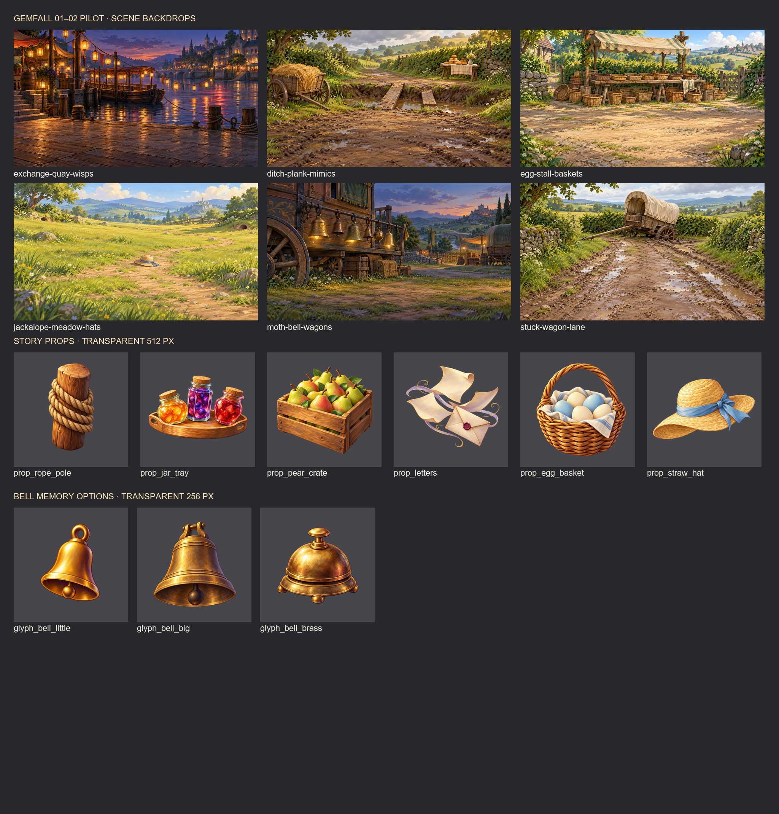
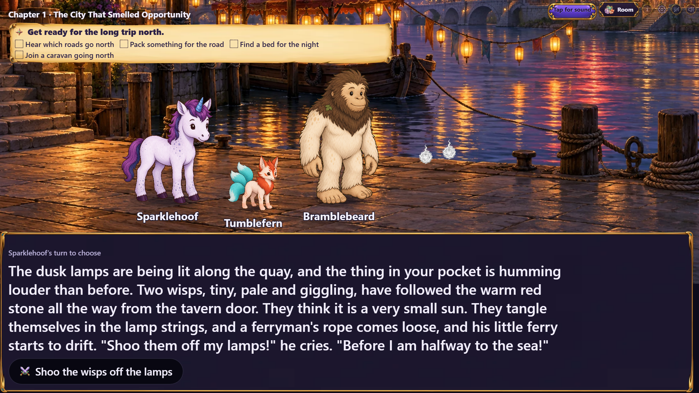
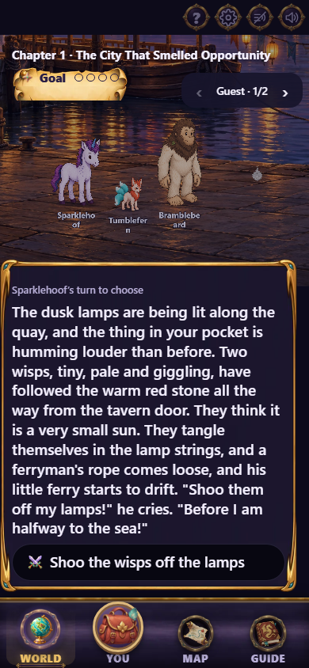

# Gemfall 01–02 pilot art review

Issue #497 pilot: new story art for Gemfall chapters 01 and 02. The image catalog below shows the six 1920×1080 scene paintings, six 512×512 transparent interaction props, and three 256×256 transparent bell option icons.

The chapter 01 fight scene was also photographed in the real story stage at TV
and phone sizes:

| TV, 1920×1080 | Phone, 390×844 |
|---|---|
|  |  |

## Scene coverage

| Asset | Chapter scenes |
|---|---|
| `exchange-quay-wisps` | 01: `scene_quay_wisps`, `scene_quay_wisps_shooed`, `scene_quay_wisps_scattered` |
| `ditch-plank-mimics` | 02: `scene_mimic_ditch`, `scene_mimic_gone`, `scene_mimic_squelched`, `scene_ditch_hay_home`, `scene_ditch_cake` |
| `egg-stall-baskets` | 02: `interaction_egg_baskets` |
| `jackalope-meadow-hats` | 02: `interaction_jackalope_hats` |
| `moth-bell-wagons` | 02: `interaction_moth_bells` |
| `stuck-wagon-lane` | 02: `interaction_stuck_wagon` |

All paintings are environment-only and leave the lower third open for stage figures. Encounters continue to use their existing combat maps and biome art. Chapter 01's existing interaction locations remain unchanged.

## Interaction assets

Chapter 01 props: `prop_rope_pole` for the lantern-pole scene, `prop_jar_tray` for Mrs. Tuft's tray, `prop_pear_crate` for the dock relay, and `prop_letters` for the canal timing scene. Chapter 02 uses `prop_egg_basket` for the egg relay, reuses `prop_rope_pole` for the stuck wagon, and uses three copies of `prop_straw_hat` to cover the tracking targets. The moth-bell memory choices use `glyph_bell_little`, `glyph_bell_big`, and `glyph_bell_brass`.

Presentation metadata is limited to `presentation.interactions`; there are no interaction schema or game-rule changes. Tracking covers conceal the target art.

## Source and packaging

Created with the built-in image generation tool on 2026-10-26. Scene prompts described painterly, full-bleed storybook environments without people, creatures, readable text, UI, or a frame. Prop prompts requested a single centered, alpha-transparent object; option-icon prompts distinguished a small hanging hand bell, a broad heavy bell, and a low counter-style brass bell. Final files are registered in `assets/manifest.json`.

Original generated PNGs remain in the local Codex image output directory. Production WebPs are stored in `assets/scenes/gemfall/`, `assets/story-props/`, and `packages/client/src/assets/painted/`. `assets.png` is a static contact sheet for art review; the two scene captures above show the rendered stage in the app.

## Verification

- `npm run art:inventory`: no outstanding assets.
- `npm run art:verify`: 1365 checks passed.
- `npm run content:validate`: 117 checks passed; chapter scene graphs remain valid.
- `npm run typecheck` and `npm run build`: passed.
- `npm run perf:bundle`: first paint 319/320 KB; total 1460/1460 KB.
