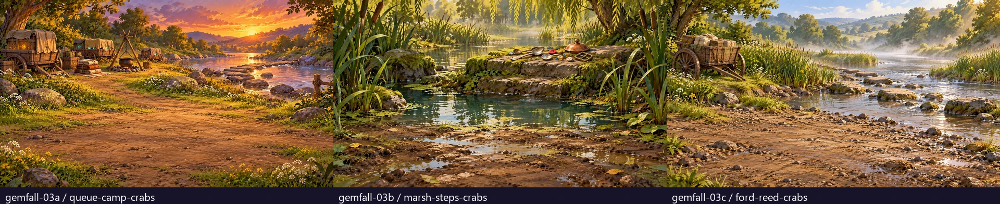
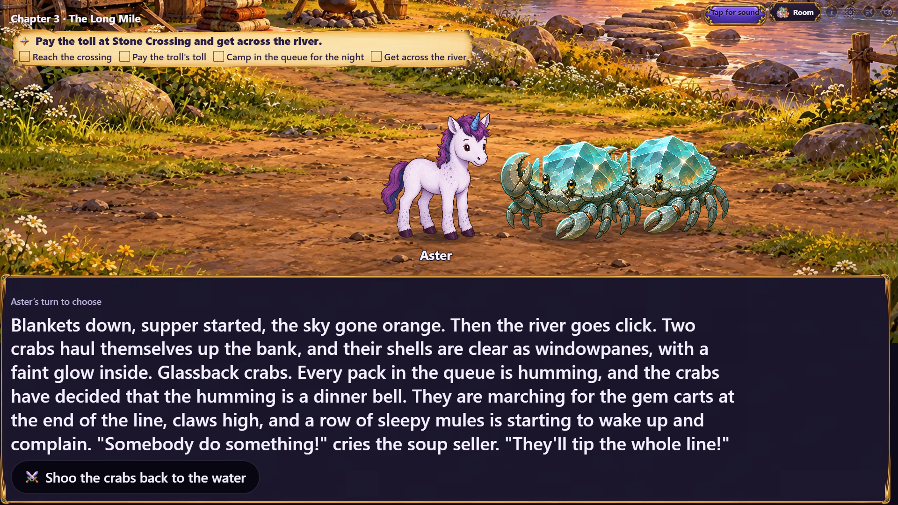
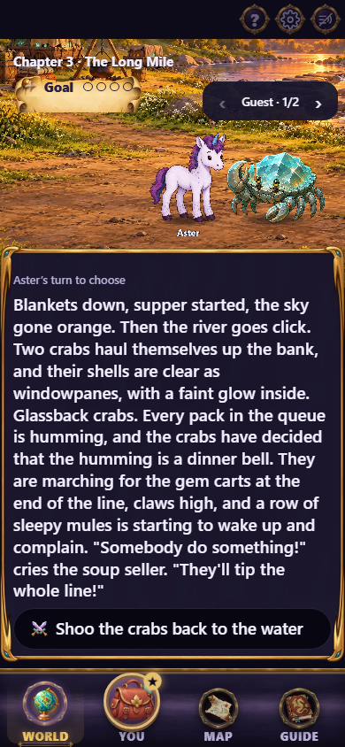
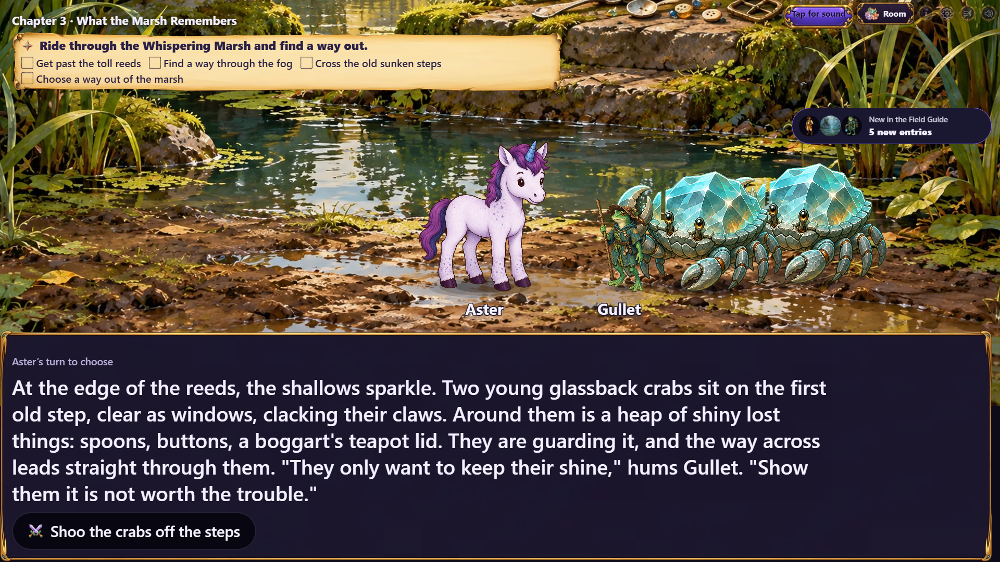
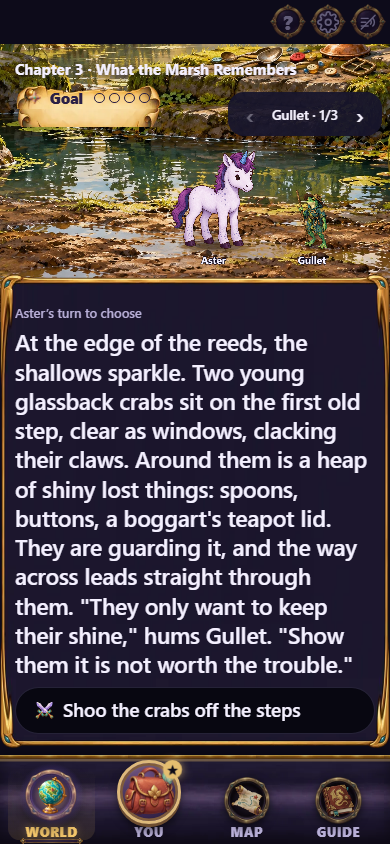
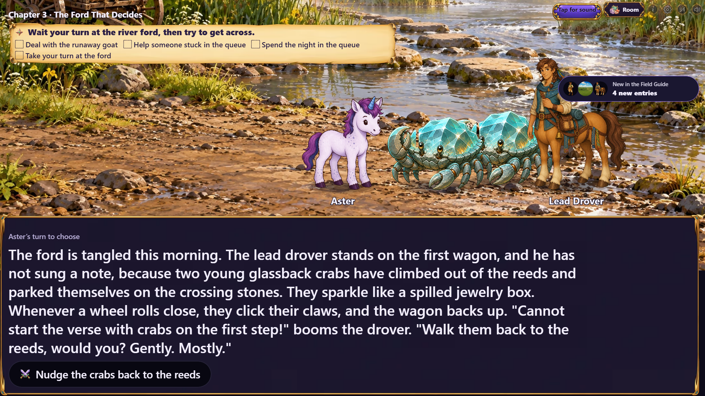
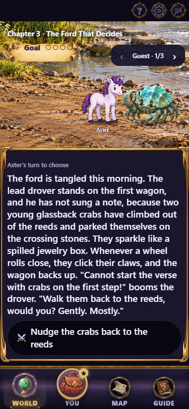
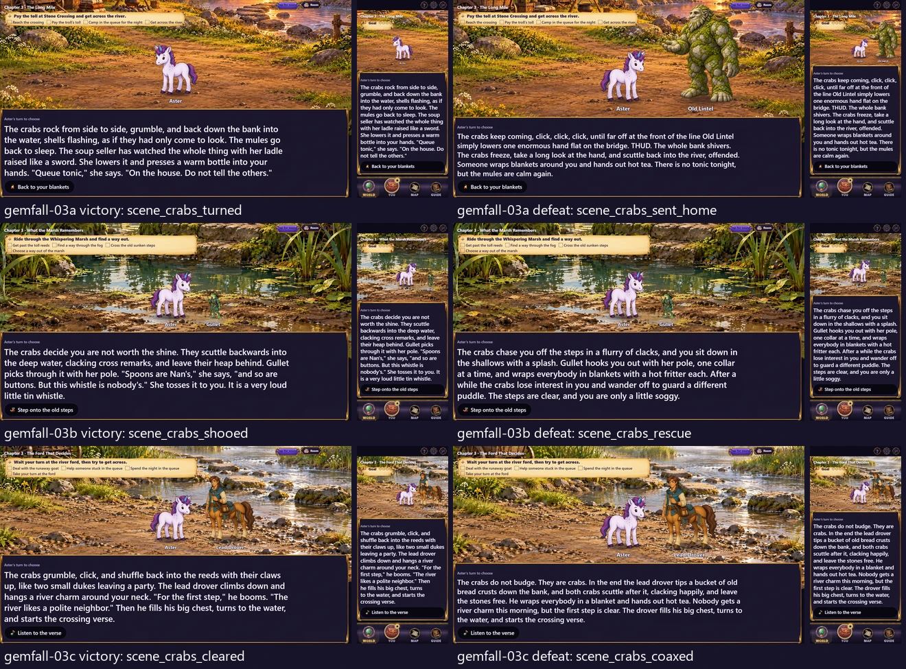

# Gemfall chapter 03 fight art

Second delivery for issue #497, following the merged chapter 01–02 pilot.
Three new environment paintings cover the three chapter 03 roads. Each is
1920×1080 WebP at quality 88 in `assets/scenes/gemfall/`. The paintings contain
no characters; existing glassback crabs and story cast stand in the open foreground.



| Chapter | Painting | Introduction, victory, defeat |
|---|---|---|
| 03a, The Long Mile | `queue-camp-crabs` | `scene_crab_dusk`, `scene_crabs_turned`, `scene_crabs_sent_home` |
| 03b, What the Marsh Remembers | `marsh-steps-crabs` | `scene_crab_shallows`, `scene_crabs_shooed`, `scene_crabs_rescue` |
| 03c, The Ford That Decides | `ford-reed-crabs` | `scene_reed_crabs`, `scene_crabs_cleared`, `scene_crabs_coaxed` |

## Actual story stage

The capture follows the real campaign from chapter 01 through chapter 02's road
choice, then jumps within the selected chapter using the development playtest
action. It waits for the scene's narration, decoded art, and the temporary recap
card to clear. Phone captures use the World tab at 390×844; TV captures are
1920×1080. No chapter response or cast is replaced for these captures.

| Path | TV | Phone |
|---|---|---|
| Queue camp |  |  |
| Marsh step |  |  |
| Reed ford |  |  |

All six outcome destinations were also captured on both devices. Left column:
victory destination. Right column: defeat destination. Each tile contains TV and
phone views of that destination. These are destination previews, rather than
claims of playing a fight to its result.



Regenerate with:

```sh
npx playwright test -c playwright.cast-review.config.ts e2e/gemfall-art-shot.spec.ts -g "chapter 03"
```

## Source and validation

Generated on 2026-10-26 with the built-in image generation tool. Exact prompts,
style reference, generated-source filenames and SHA-256 values, export settings,
production hashes, and scene mappings are preserved in
[the source record](../../../art/source/gemfall-03-fights.json).

Only nine `scene.art` fields change in chapter content. The chapter file hashes
are deliberately re-pinned; the existing ending, road, setback and resumed-save
gameplay digests are unchanged. Encounter maps, creature cutouts and all other
scene artwork retain their existing assignments.

Art inventory reports no outstanding registered assets, art verification passes
1368 checks, chapter validation passes 117 checks with two existing warnings,
and the 68 focused Gemfall compatibility, interaction, wiring and client
presentation/prefetch checks pass. Typechecking, the production build and the
TV/phone capture also pass.

The local Windows bundle gate reports 319/320 KB for first paint and
1461/1460 KB total (1,495,642 bytes). This batch changes no production client
code; CI's Linux build must confirm the payload gate before merge.

Issue #497 remains open: this batch brings its fight paintings to 5 of 16.
The remaining fight paintings, location groups and interaction sets continue in
the issue's staged delivery order.
