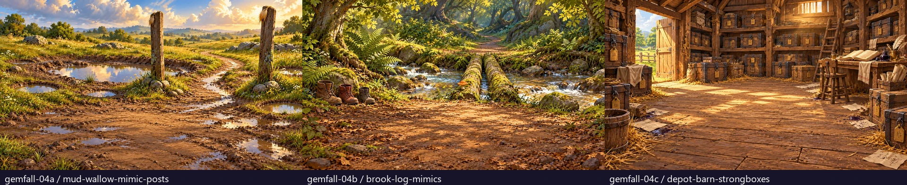
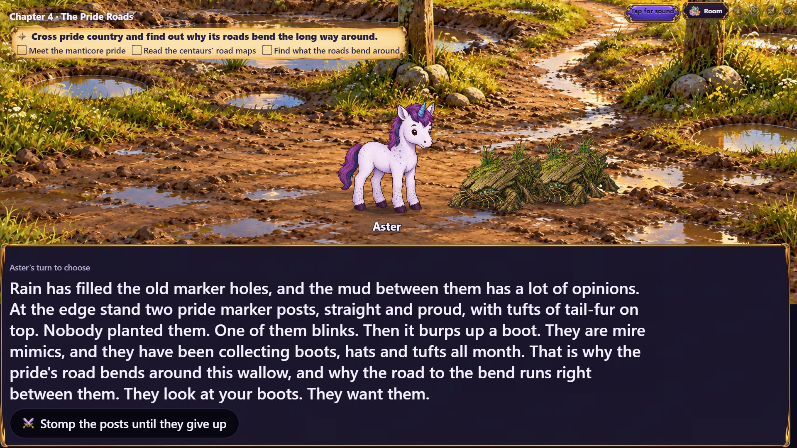
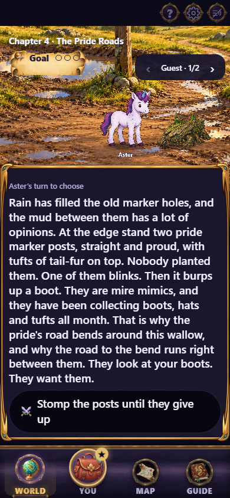
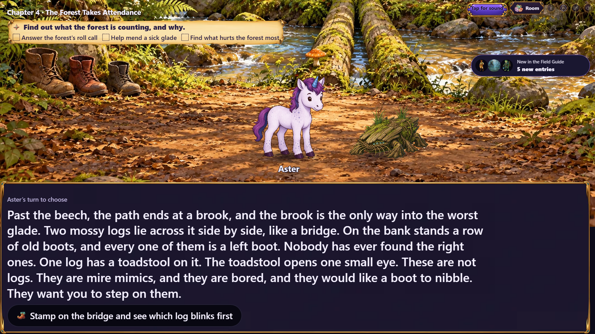
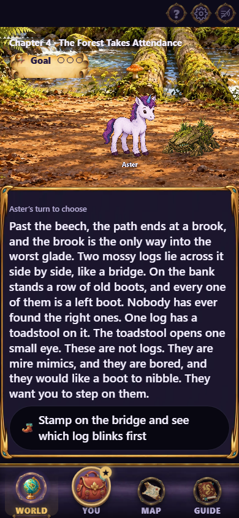
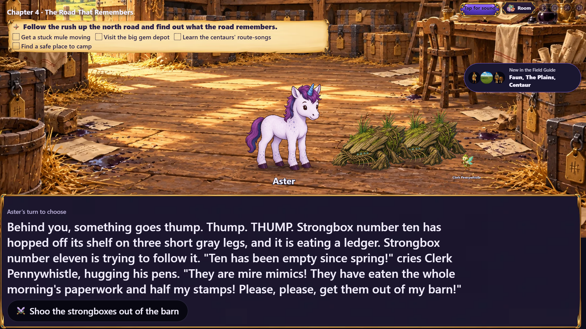
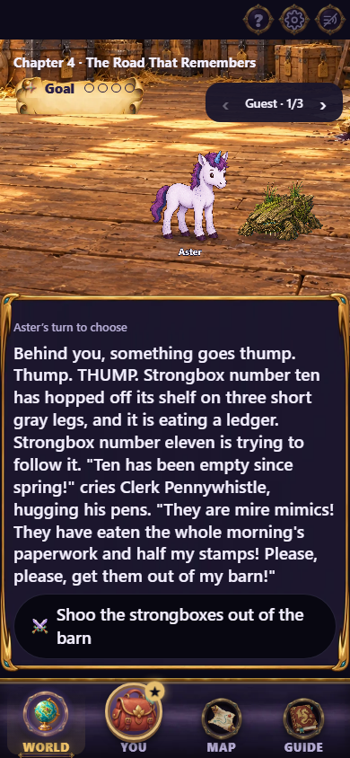
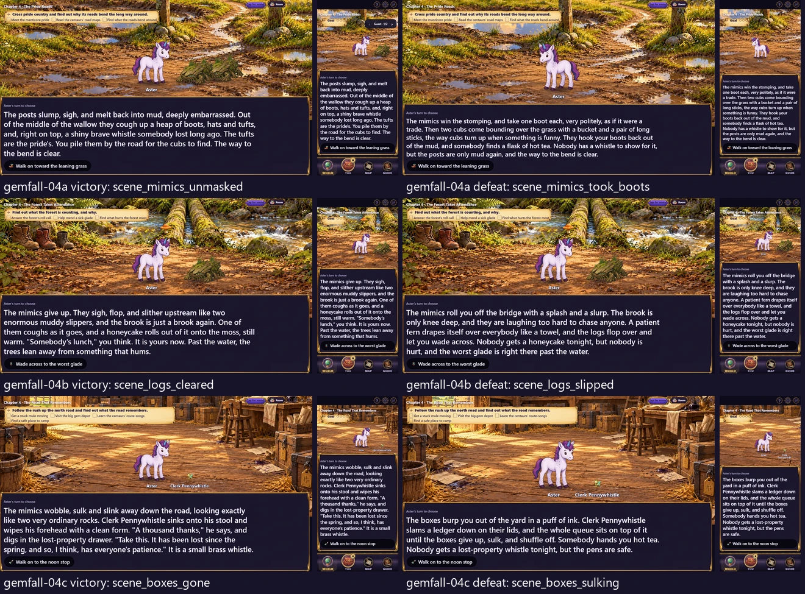

# Gemfall chapter 04 fight art

The next chapter group for issue #497, following the approved chapter 03 fight
paintings in PR #503. Three environment paintings cover the chapter 04 roads.
Each is 1920×1080 WebP at quality 88 in `assets/scenes/gemfall/`. Posts, logs and
strongboxes in the paintings are inanimate scenery; the existing mimic and
story-cast cutouts are rendered separately in the open foreground.



| Chapter | Painting | Introduction, victory, defeat |
|---|---|---|
| 04a, The Pride Roads | `mud-wallow-mimic-posts` | `scene_mud_posts`, `scene_mimics_unmasked`, `scene_mimics_took_boots` |
| 04b, The Forest Takes Attendance | `brook-log-mimics` | `scene_stepping_logs`, `scene_logs_cleared`, `scene_logs_slipped` |
| 04c, The Road That Remembers | `depot-barn-strongboxes` | `scene_box_ten`, `scene_boxes_gone`, `scene_boxes_sulking` |

## Actual story stage

The capture progresses through the real campaign: chapter 01, chapter 02's road
choice, and the corresponding chapter 03 ending, then continues to chapter 04.
Development playtest jumps preview the introduction and both outcome destinations
inside the selected chapter. No chapter response, cast or backdrop assignment is
replaced for these captures. These are destination previews, not claims of playing
each fight to its result.

The capture waits for narration, decoded artwork and the temporary recap card to
clear. Phone captures use the World tab at 390×844; TV captures are 1920×1080.
The mobile guest carousel shows one guest group at a time, as it does in play.

| Path | TV | Phone |
|---|---|---|
| Mud wallow |  |  |
| Brook crossing |  |  |
| Depot barn |  |  |

All six outcome destinations were also captured on both devices. Left column:
victory destination. Right column: defeat destination. Each tile contains TV
and phone views of that destination.



Regenerate with:

```sh
npx playwright test -c playwright.cast-review.config.ts e2e/gemfall-art-shot.spec.ts -g "chapter 04"
```

## Source and validation

Generated on 2026-10-26 with the built-in image generation tool. Exact prompts,
style reference, generated-source filenames and SHA-256 values, export settings,
production hashes, and scene mappings are preserved in
[the source record](../../../art/source/gemfall-04-fights.json).

Only nine chapter `scene.art` fields change. Direct comparisons confirm every
other chapter field is identical to the previous delivery. The three chapter
file hashes are deliberately re-pinned; the existing ending, road, setback and
resumed-save gameplay digests remain unchanged. Encounter maps, creature cutouts
and all other scene artwork keep their existing assignments.

Art inventory reports no outstanding registered assets, art verification passes
1371 checks, chapter validation passes 117 checks with two existing warnings,
and 68 focused Gemfall compatibility, interaction, wiring and client
presentation/prefetch checks pass. Typechecking, the production build and the
TV/phone capture also pass.

The local Windows payload gate reports 319/320 KB first paint and 1461/1460 KB
total, identical to the chapter 03 batch. This batch changes no production client
code. CI's Linux build must confirm its payload gate before merge; the approved
chapter 03 batch passed that gate at 319/320 KB and 1460/1460 KB respectively.

Issue #497 remains open. With this delivery, 8 of its 16 fight paintings are
painted and wired. Chapter 05's fight paintings are the next group; the remaining
location and interaction passes follow the issue's staged delivery order.
