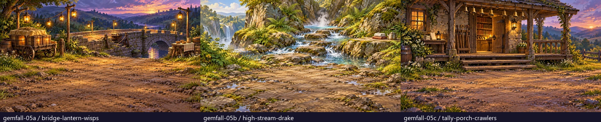
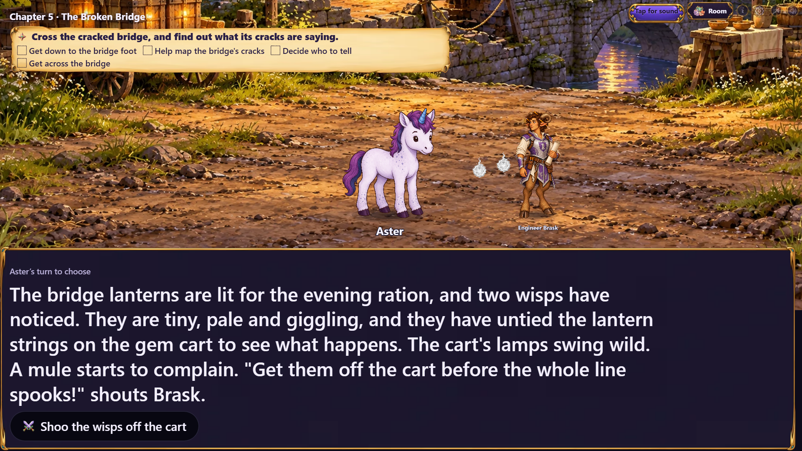
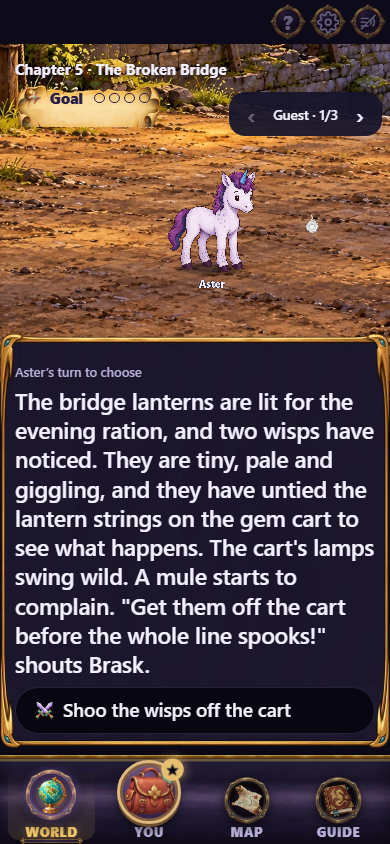
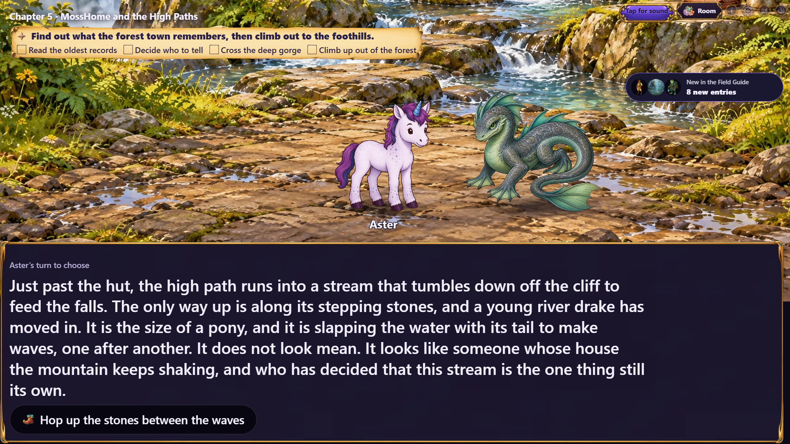
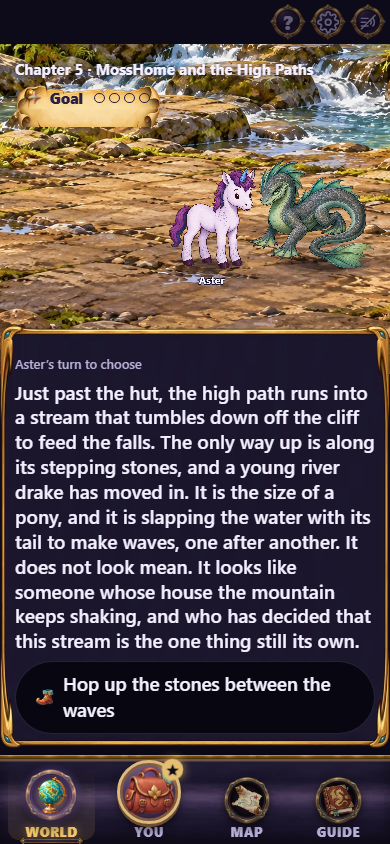
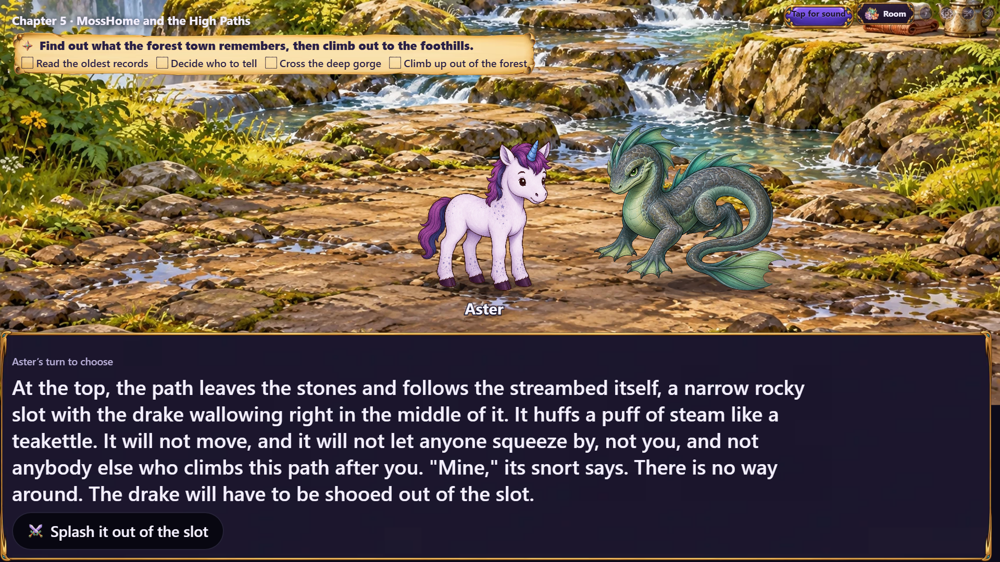
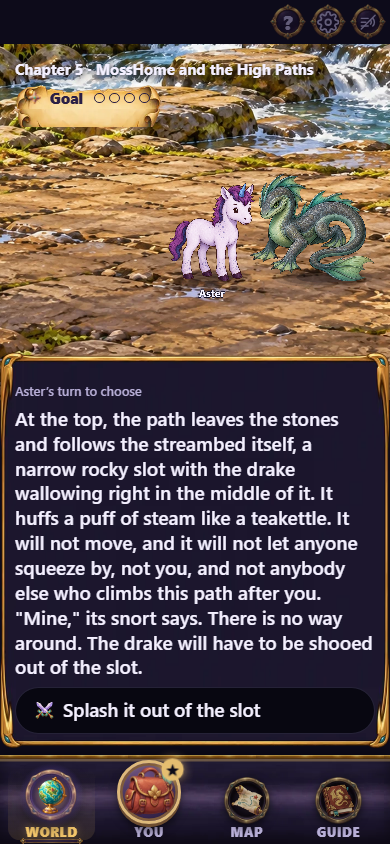
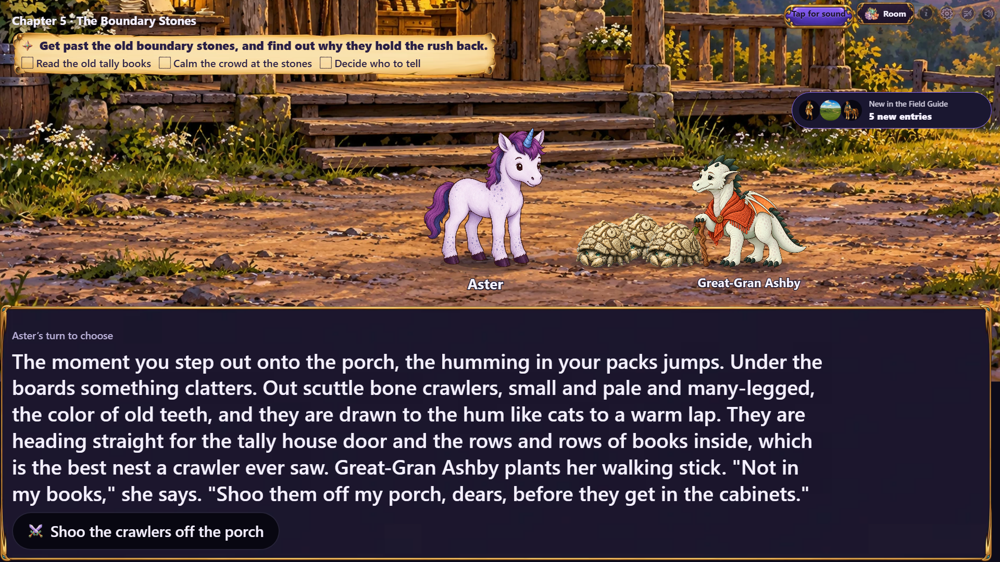
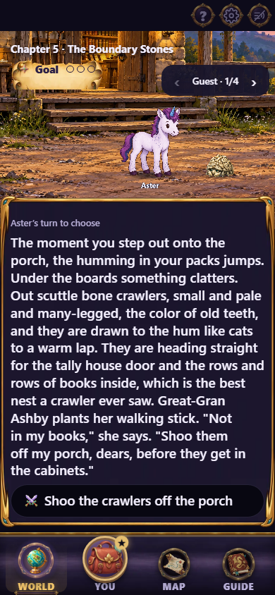
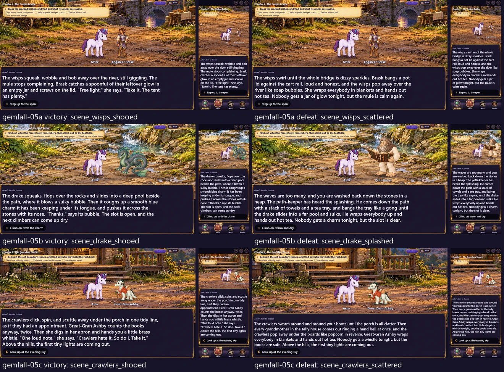

# Gemfall chapter 05 fight art

The next chapter group for issue #497, after merged PRs #503 and #504.
Three new environment paintings cover the chapter 05 roads. Each is
1920×1080 WebP at quality 88 in `assets/scenes/gemfall/`; the existing wisps,
drake, crawlers and story cast are rendered separately in the open foreground.



| Chapter | Painting | Introduction(s), victory, defeat |
|---|---|---|
| 05a, The Broken Bridge | `bridge-lantern-wisps` | `scene_lantern_wisps`; `scene_wisps_shooed`, `scene_wisps_scattered` |
| 05b, MossHome and the High Paths | `high-stream-drake` | `scene_drake_ford`, `scene_drake_bank`; `scene_drake_shooed`, `scene_drake_splashed` |
| 05c, The Boundary Stones | `tally-porch-crawlers` | `scene_crawlers_porch`; `scene_crawlers_shooed`, `scene_crawlers_scattered` |

The bridge has a tethering post and rope rather than a painted mule, following
the brief's rule that animals and other creatures stay in the separate sprite
layer. The drake's wallow is suggested by water and steam without a creature
shape. The porch has empty gaps beneath its boards rather than painted crawlers.

## Actual story stage

The capture follows the real campaign through chapter 02's road choice and the
corresponding chapter 03 and 04 endings, then continues to chapter 05. Development
playtest jumps preview the four introduction/approach scenes and six outcome
destinations. No chapter responses, cast or backdrop assignments are replaced.
These are destination previews, not claims of playing each fight to its result.

The capture waits for narration, decoded artwork and the temporary recap card to
clear. Phone captures use the World tab at 390×844; TV captures are 1920×1080.
The mobile guest carousel shows one guest group at a time, as it does in play.

| Scene | TV | Phone |
|---|---|---|
| Bridge lanterns |  |  |
| Drake stepping stones |  |  |
| Drake's rocky slot |  |  |
| Tally-house porch |  |  |

All six outcome destinations were also captured on both devices. Left column:
victory destination. Right column: defeat destination. Each tile contains TV
and phone views of that destination.



Regenerate with:

```sh
npx playwright test -c playwright.cast-review.config.ts e2e/gemfall-art-shot.spec.ts -g "chapter 05"
```

## Source and validation

Generated on 2026-10-26 with the built-in image generation tool. Exact prompts,
style reference, generated-source filenames and SHA-256 values, export settings,
production hashes, introduction lists and scene mappings are preserved in
[the source record](../../../art/source/gemfall-05-fights.json).

Only ten chapter `scene.art` fields change. Direct comparisons confirm every
other chapter field is identical to merged main. The three chapter file hashes
are deliberately re-pinned; the existing ending, road, setback and resumed-save
gameplay digests remain unchanged. Encounter maps, creature cutouts and all other
scene artwork keep their existing assignments.

Art inventory reports no outstanding registered assets; art verification passes
1374 checks and chapter validation passes 117 checks with two existing warnings.
The 68 focused Gemfall compatibility, interaction, wiring and client
presentation/prefetch checks, typecheck, production build and TV/phone capture
also pass.

The local Windows payload gate reports 319/320 KB first paint and 1461/1460 KB
total, as in the two preceding batches. This batch changes no production client
code. CI's Linux build must confirm its payload gate before merge; both preceding
batches passed at 319/320 KB and 1460/1460 KB respectively.

Issue #497 remains open. With this delivery, 11 of its 16 fight paintings are
painted and wired. Chapter 06 is next; the remaining location and interaction
passes follow the issue's staged delivery order.
