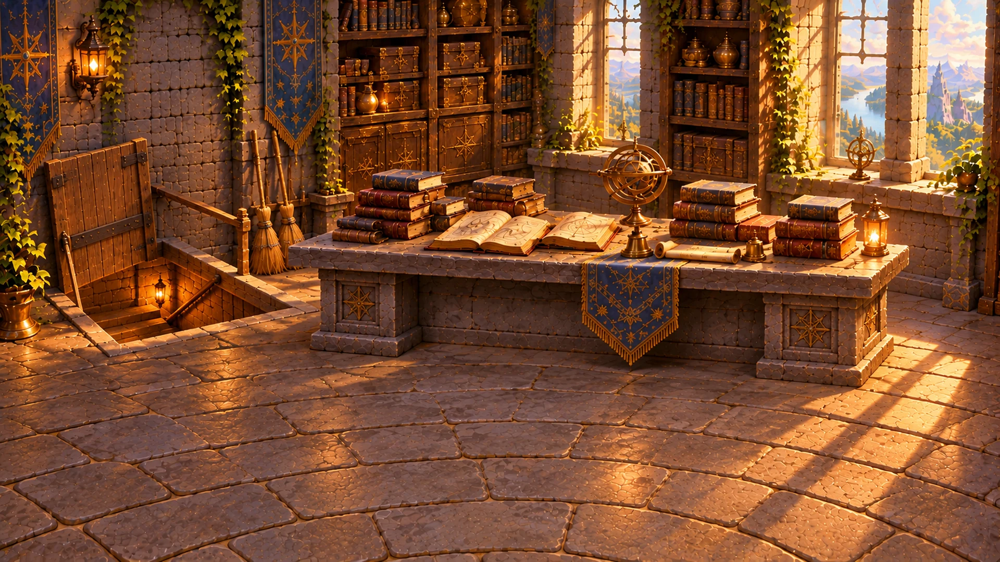
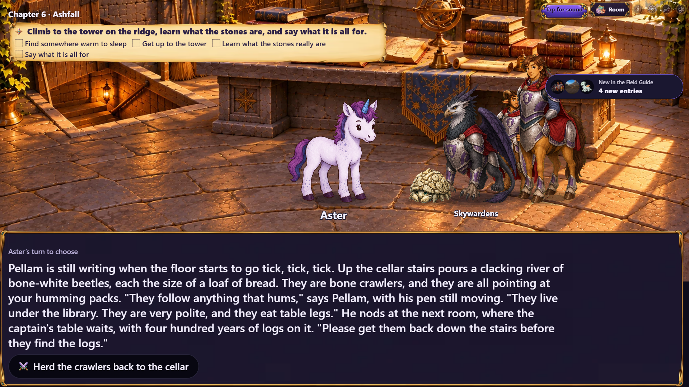
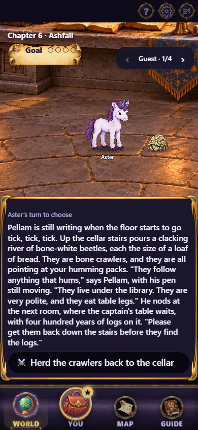
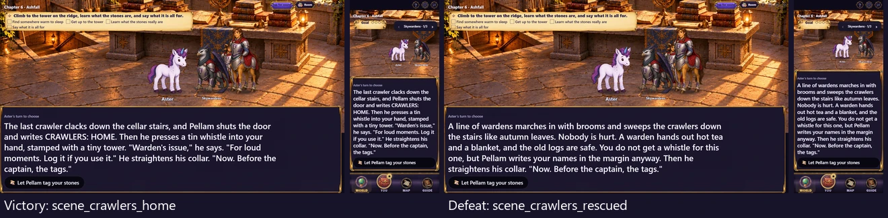

# Gemfall chapter 06 fight art

The next delivery for issue #497, following merged PR #505. Chapter 06's records
hall now has its own fight backdrop: `citadel-cellar-hall`, a 1920×1080 quality-88
WebP in `assets/scenes/gemfall/`.



The painting follows the established Redspire interior: a long rectangular
stone captain's table, old watch-logs, record cabinets, a descending cellar
stairwell, brooms and warm light. The floor stays open for separately rendered
crawlers and cast. There are no creatures or readable labels in the backdrop.

| Chapter | Painting | Introduction, victory, defeat |
|---|---|---|
| 06, Ashfall | `citadel-cellar-hall` | `scene_crawlers_hall`, `scene_crawlers_home`, `scene_crawlers_rescued` |

## Actual story stage

The capture follows the real River Road campaign through chapter 02's choice
and the corresponding chapter 03, 04 and 05 endings, then continues to chapter
06. Development playtest jumps preview the three fight destinations. No chapter
response, cast or backdrop assignment is replaced. These are destination
previews, not claims of playing the fight to its result.

The capture waits for narration, decoded artwork and the temporary recap card
to clear. Phone captures use the World tab at 390×844; TV captures are 1920×1080.
The mobile guest carousel shows one guest group at a time, as it does in play.

| TV | Phone |
|---|---|
|  |  |

Both outcome destinations were also captured on both devices. Left: victory
destination. Right: defeat destination. Each tile contains TV and phone views.



Regenerate with:

```sh
npx playwright test -c playwright.cast-review.config.ts e2e/gemfall-art-shot.spec.ts -g "chapter 06"
```

## Source and validation

Generated on 2026-10-26 with the built-in image generation tool, using the
existing `facet-table.webp` as the style and architecture reference. The stone
table follows chapter 06's text. Targeted revisions make the cellar stairwell
descend below the hall floor and place the books within the phone's central
crop. Exact generation and revision prompts, source and
production hashes, reference hash and export settings are recorded in
[the source record](../../../art/source/gemfall-06-fight.json).

Only three chapter `scene.art` fields change. Direct comparison confirms every
other chapter field is identical to merged main. The chapter file hash is
deliberately re-pinned; the existing ending, road, setback and resumed-save
gameplay digests remain unchanged. Encounter maps, creature cutouts and other
scene artwork keep their existing assignments.

Art inventory reports no outstanding registered assets; art verification passes
1375 checks and chapter validation passes 117 checks with two existing warnings.
The 68 focused Gemfall compatibility/interaction/wiring and client
presentation/prefetch checks, typecheck, production build and revised TV/phone
capture also pass. The local Windows payload gate reports 319/320 KB first paint
and 1461/1460 KB total, as in the preceding batches; CI's Linux build must confirm
its gate before merge. No production client code or payload cap changes are made.

Issue #497 remains open. This brings its fight paintings to 12 of 16 painted
and wired. Chapter 07's three pursuit fights are next, followed by chapter 08;
the location and interaction passes follow the issue's staged delivery order.
