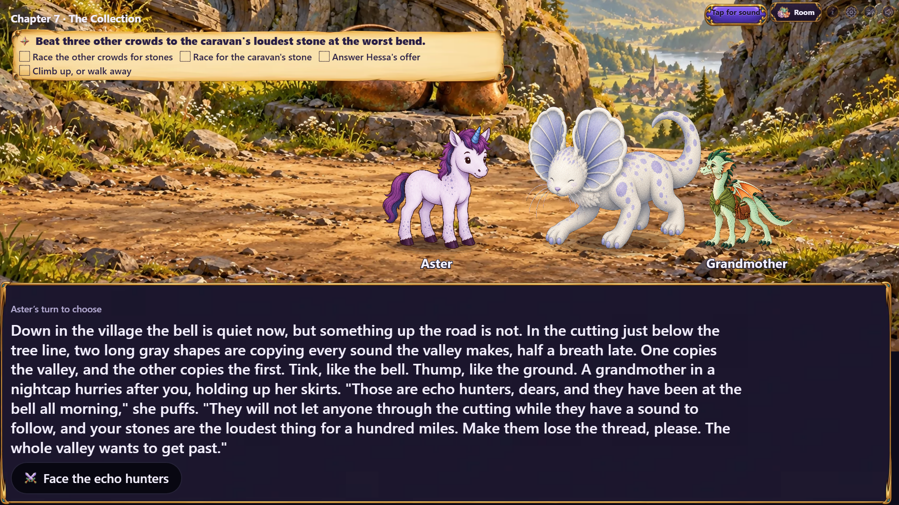
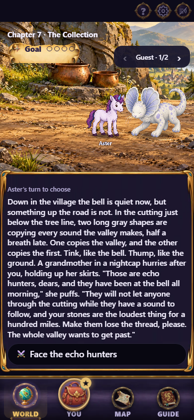
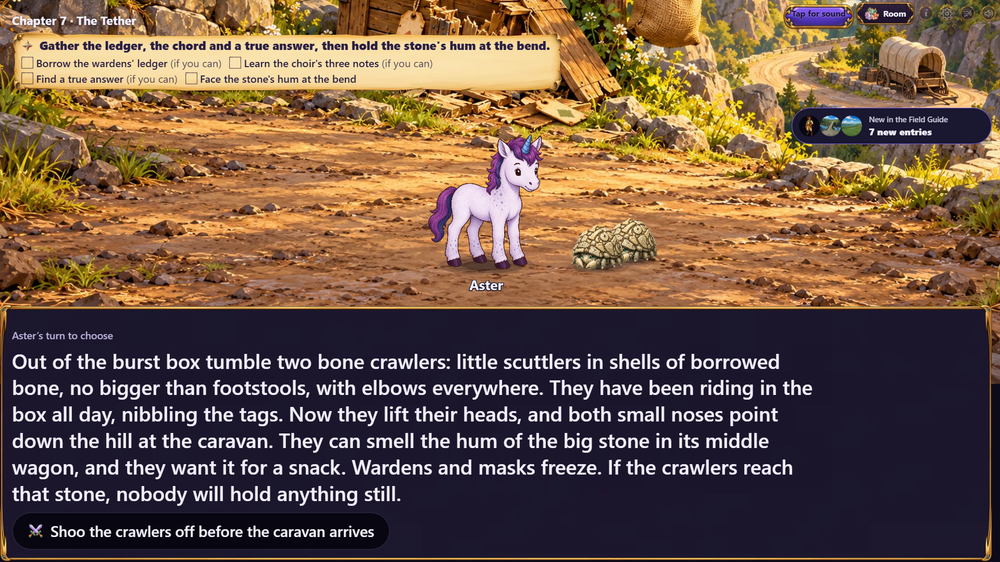
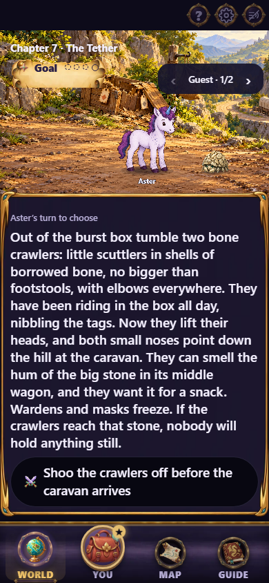
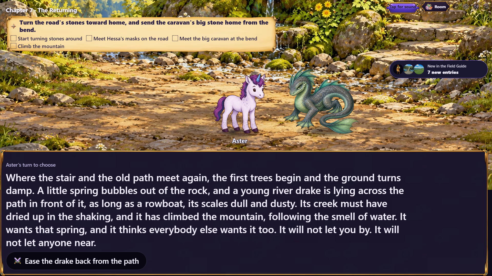
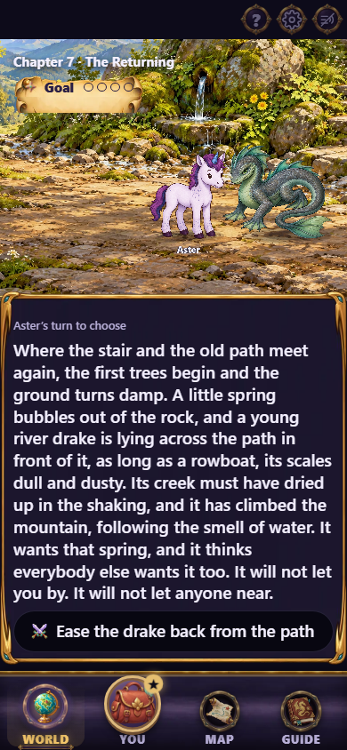
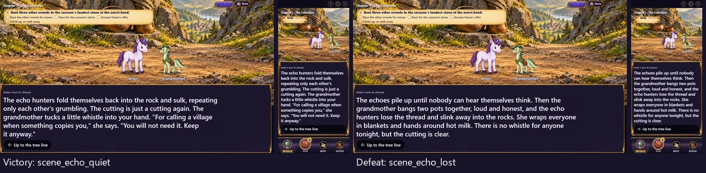
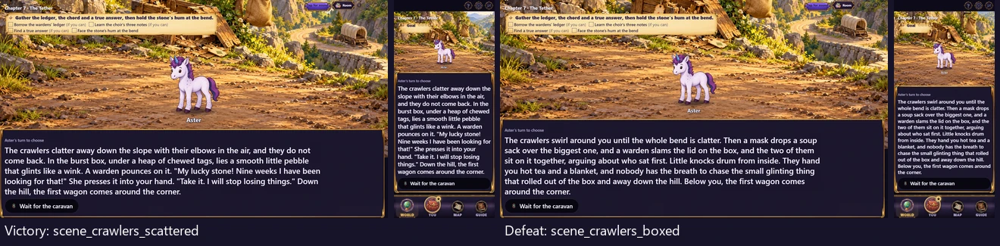
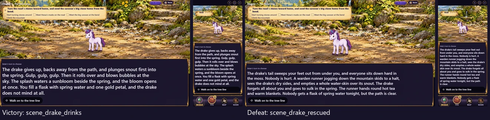

# Gemfall chapter 07 pursuit fight art

Three paintings for issue #497, following merged PR #506. Each is a
1920×1080 quality-88 WebP under `assets/scenes/gemfall/`, registered in
`sceneIllustrations`. Characters and creatures remain separate cutouts.

| Chapter | Painting | Introduction, victory, defeat |
|---|---|---|
| 07h, The Collection | `echo-cutting` | `scene_echo_cutting`, `scene_echo_quiet`, `scene_echo_lost` |
| 07l, The Tether | `pinch-box-crawlers` | `scene_box_crawlers`, `scene_crawlers_scattered`, `scene_crawlers_boxed` |
| 07r, The Returning | `spring-drake-ledge` | `scene_drake_ledge`, `scene_drake_drinks`, `scene_drake_rescued` |

The cutting has repeated rock seams, two copper pots and a village below.
The Pinch has a burst box, torn abstract inventory tags, a hanging sack and a
waiting wagon below the bend. The spring ledge has a rock basin, damp moss,
stone stairs and a sunbloom beside a mostly dry creek bed. No figures, creatures
or readable labels are painted into these environments.

## Actual stage captures

The capture seeds the real Gemfall campaign and follows River Road through
chapters 02–06. It chooses `hoard`, `leash` or `restore` at the captain's question
to reach the corresponding pursuit chapter. Development playtest jumps preview
each introduction and outcome destination. It does not replace chapter responses,
cast or art, and does not claim to play the fights to completion.

TV is 1920×1080; phone is 390×844 on the World tab. Captures wait for narration,
decoded art and recap dismissal. The phone guest carousel shows one group at a
time. Pots, box and spring remain recognizable in the central phone crop, with
usable character foreground; secondary landmarks at the edges are more visible
on TV. The upper controls overlap part of the scenery as in normal play.

| TV | Phone |
|---|---|
|  |  |
|  |  |
|  |  |

Each outcome sheet shows victory on the left and defeat on the right, with TV
and phone captures for each destination.





Regenerate with:

```sh
npx playwright test -c playwright.cast-review.config.ts e2e/gemfall-art-shot.spec.ts -g "chapter 07"
```

## Source and validation

Generated with the built-in image generation tool using `ditch-plank-mimics.webp`
as a style reference. The [source record](../../../art/source/gemfall-07-fights.json)
contains the exact three prompts, accepted generation filenames, reference/source/
production hashes, sizes and export settings. Only standard Lanczos resizing and
WebP encoding were applied after generation.

Direct comparison against merged main confirms exactly three `scene.art`
additions per chapter and no other chapter changes. The normalized chapter file
hashes are deliberately re-pinned; all existing gameplay digest constants remain
unchanged. The 68 focused compatibility, interaction, wiring, art-path,
presentation and prefetch tests pass, as do typecheck, production build and the
TV/phone capture. Content validation passes 117 checks with two existing warnings.
Art verification passes 1378 checks. Art inventory reports zero outstanding registered assets; this does not measure
completion of the issue's unregistered requests.

The local Windows bundle check reports 319/320 KB first paint and 1461/1460 KB
total, the same platform discrepancy as merged main. No production client code
or payload caps change; Linux CI's bundle gate remains required before merge.

This brings the requested fight paintings to 15 of 16. Chapter 08's crab field
is next, followed by the remaining location and interaction passes. Issue #497
remains open.
