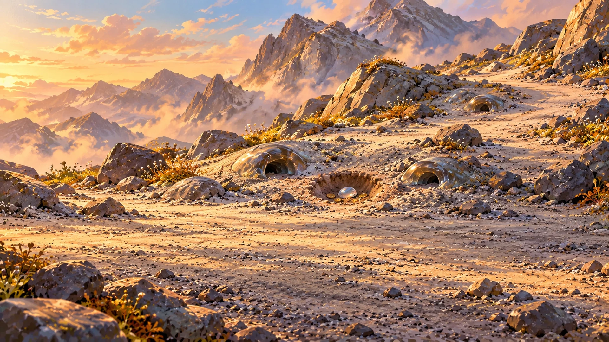
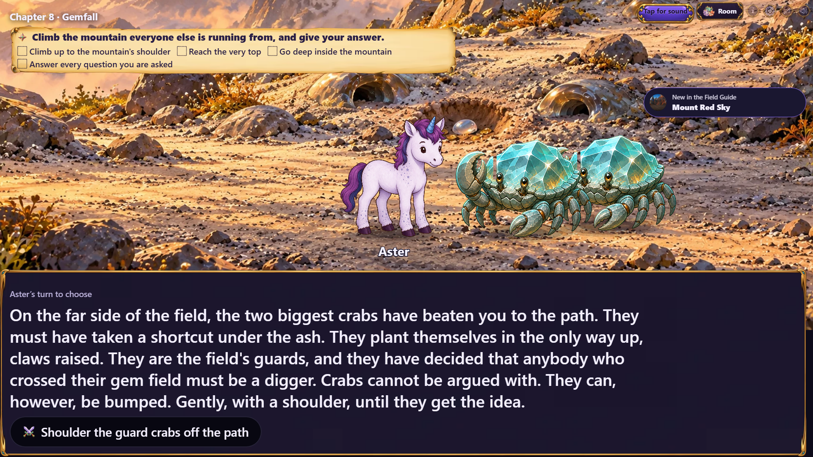
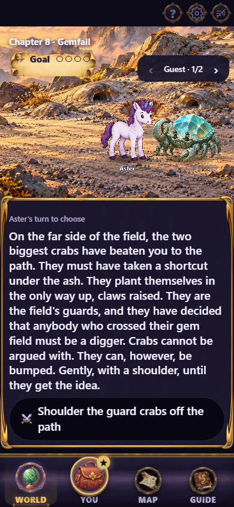
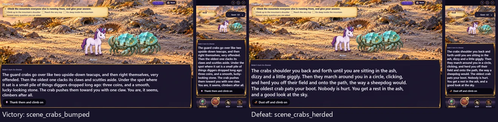

# Gemfall chapter 08 guard-crab fight art

The final fight-arc painting requested by issue #497: `crab-field-guards`, a
1920×1080 quality-88 WebP in `assets/scenes/gemfall/`, registered in
`sceneIllustrations` and used by `scene_crab_guards`, `scene_crabs_bumped` and
`scene_crabs_herded` in `gemfall-08`.



The painting shows the uphill edge of the ash field, warm patches, glassy burrow
mouths, an ascending path and a fresh hollow with a glint of dropped treasure.
The lower third stays open for the existing separate glassback-crab and hero
cutouts. No creatures or readable labels are painted into the environment.

## Actual stage captures

The capture follows the real River Road campaign through chapters 02–06, chooses
`restore` at the captain's question and continues through 07r's `rest_tree_line`
to chapter 08. Development playtest jumps then preview the three destinations;
these captures do not claim to play the fight to its result. No chapter
responses, cast or artwork assignments are replaced for the capture.

Captures wait for narration, decoded art and recap dismissal. TV is 1920×1080;
phone is 390×844 on the World tab. The phone carousel displays one guest at a
time. Burrow mouths and the ash path remain visible behind the cast on phone;
the wider TV view also shows the hollow and more of the mountain.

| TV | Phone |
|---|---|
|  |  |

Victory is on the left and defeat on the right, each with TV and phone captures.



Regenerate with:

```sh
npx playwright test -c playwright.cast-review.config.ts e2e/gemfall-art-shot.spec.ts -g "chapter 08"
```

## Source and validation

Generated using the built-in image generation tool, with chapter 07's
`echo-cutting.webp` as the house-style reference. Exact prompt, accepted source
filename, reference/source/production hashes and export settings are in the
[source record](../../../art/source/gemfall-08-fight.json). Only standard Lanczos
resizing and WebP encoding were applied after generation.

Direct chapter comparison confirms only three `scene.art` additions. All other
chapter fields are identical; the normalized file hash is deliberately re-pinned
and gameplay digest constants remain unchanged. All 68 focused compatibility,
interaction, wiring, art-path, presentation and prefetch tests pass. Art inventory
reports zero outstanding registered assets; art verification passes 1379 checks
and content validation passes 117 checks with two existing warnings.
Typecheck, production build and
the actual TV/phone capture pass. The Windows bundle check reports the same
319/320 KB first paint and 1461/1460 KB total discrepancy as the prior delivery.
No production client code or payload cap changes; Linux CI's gate is required.

Together with the preceding deliveries, all 16 requested fight-arc paintings
are now created and wired. Issue #497 remains open for its location backdrops,
interaction assets and final visual playthrough.
