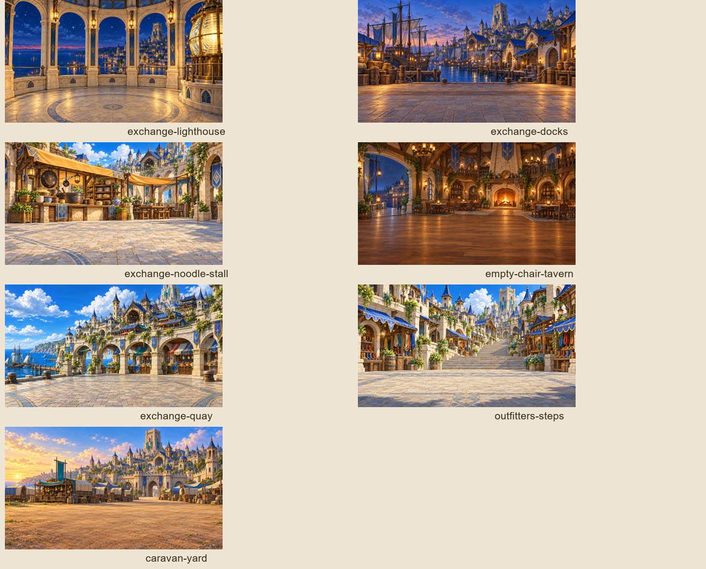

# Gemfall 1 location review

All seven new files pass explicit WebP/1920×1080/RGB and manifest/reference checks. Content validation: 55 passed. Existing Gemfall wiring and art-path tests: 37 passed. The shared art-verifier checks pass (725); that verifier does not inspect scene backdrops, so the separate file checks and captures are the evidence for these images. Semantic comparison confirms only 31 scene art fields changed. Before and after Playwright captures passed for all seven locations.

The outdoor scholar scenes, cupboard-under-stairs rest, market gutter/glint scenes, and moving northbound hired/turnip wagons retain biome art because the requested tavern/quay/yard backdrop would contradict their narration. The tavern interior therefore covers scene_tavern only. Prologue, city-wide views and the Sunward Fields camp also retain existing art.

The local capture setup follows the figure pilots: original Gemfall 1 scenes
exposed in a temporary single-chapter review campaign at index 1. Actors and
chapter text are unchanged by this PR. Captures use 1920×1080 TV and 390×844 phone.
The existing phone edge/label clipping remains a renderer issue.

## exchange-lighthouse

## exchange-docks

## exchange-noodle-stall

## empty-chair-tavern

## exchange-quay

## outfitters-steps

## caravan-yard

## Proposed next chapter groups

These are proposals to review before drawing each chapter, one PR per chapter.
Aerial views, combat and relocated endings keep biome art unless a separate view
is commissioned. All listed ids exist and are distinct non-encounter scenes.

### gemfall-03a

| Proposed location | Scenes |
|---|---|
| east-road-markers | `scene_east_road`, `check_markers`, `scene_courtesy`, `scene_fennick` |
| stone-crossing-queue | `scene_queue`, `check_rivals`, `scene_rivals_caught`, `rest_queue_camp` |
| lintel-toll-stone | `scene_troll`, `scene_troll_riddle_account`, `scene_troll_ask_riddle`, `scene_troll_tell_story`, `scene_troll_hum`, `scene_troll_hum_show_ember`, `scene_troll_hum_dont_know`, `scene_troll_hum_answer_honest` |
| drake-rock-shelf | `scene_drake_shelf`, `check_drake`, `scene_drake_deal` |
| drowned-crossing-bank | `scene_crossing_bank`, `scene_ossley_price`, `check_crossing`, `check_crossing_easy` |
| river-mouth-shore | `scene_mouth`, `scene_crawlers`, `check_crawlers`, `check_crawlers_leave` |
| eastern-shore-camp | `rest_wet_end`, `rest_setback` |

### gemfall-03c

| Proposed location | Scenes |
|---|---|
| caravan-road-ruts | `scene_parade`, `scene_parade_sniff_wagons`, `scene_parade_read_crowd`, `choice_tolls`, `check_unmire`, `check_markers`, `scene_markers_restored` |
| ford-queue-market | `scene_number_pebble`, `scene_number_pebble_buy_cake`, `scene_three_cards`, `check_expose`, `scene_exposed`, `scene_join_con` |
| wend-soup-tent | `scene_soup_line`, `scene_soup_line_ask_crystal`, `scene_soup_line_thank_wend` |
| bracken-cart | `scene_family`, `scene_family_fix_wheel`, `scene_family_share_cake`, `scene_family_give_pebble` |
| queue-dusk-camp | `scene_dusk_wolves`, `scene_wolves_fed`, `rest_witch_fire` |
| ford-witch-stall | `scene_witch_stall`, `scene_witch_stall_sore_feet`, `scene_tuned_charm`, `scene_tuned_charm_leave_it`, `scene_tuned_charm_take_it_home`, `check_answer` |
| west-branch-ford | `choice_ford`, `check_ford`, `check_ford_easy`, `scene_surge`, `check_drake_toll` |

### gemfall-04a

| Proposed location | Scenes |
|---|---|
| pride-marker-road | `scene_east_bank`, `scene_caravan_dry`, `scene_mouthlands_walk`, `scene_pride_road`, `scene_embermoths` |
| sefa-ridge-camp | `scene_pride_greeting`, `check_greeting`, `scene_hospitality`, `scene_pride_camp`, `scene_riddle_account`, `check_old_riddle` |
| centaur-sash-barn | `scene_waystation`, `check_sashes`, `scene_spiral`, `rest_waystation` |
| pride-stone-crater | `rest_waystation_with_escort`, `scene_widest_bend`, `scene_take_stone`, `scene_leave_stone` |
| abandoned-caravan-rest | `scene_wolves`, `check_wolves`, `rest_wolf_fire`, `rest_scattered` |
| pride-night-fire | `rest_pride_fire`, `scene_escort_answers` |

### gemfall-04c

| Proposed location | Scenes |
|---|---|
| north-rush-road | `scene_north_roads`, `scene_drovers_wagon`, `scene_out_of_marsh` |
| quiet-road-stretch | `scene_empty_stretch`, `check_jackalopes`, `scene_silence_follows` |
| downbound-wagon-auction | `scene_downbound`, `scene_downbound_work_crowd`, `check_relay`, `check_search`, `scene_tib_found` |
| downbound-soup-tents | `rest_soup_tents`, `scene_wend_pitch`, `scene_wend_pitch_say_later`, `scene_wend_pitch_say_no` |
| warden-supply-stop | `scene_warden_patrol`, `scene_warden_patrol_griffin_logs`, `scene_warden_patrol_pay`, `check_argue` |
| rush-depot | `scene_depot`, `check_forms`, `scene_strongbox` |
| relay-route-fire | `scene_relay_sing`, `check_sing`, `scene_spiral` |
| road-bend-grass | `scene_road_bend`, `check_sneak` |

### gemfall-05a

| Proposed location | Scenes |
|---|---|
| northern-bridge-foot | `scene_bridge`, `scene_clerk`, `check_carter`, `check_ledger`, `scene_clerk_stone`, `scene_who_to_tell`, `scene_told_gatherers`, `scene_kept_close`, `rest_setback` |
| hollis-soup-queue | `scene_soup_line`, `scene_soup_line_fix_barrow`, `scene_cult_pitch`, `scene_cult_pitch_finish_soup`, `scene_cult_pitch_drop_stone`, `scene_cult_pitch_say_no_kindly` |
| bridge-engineers-tent | `scene_engineers`, `check_outline`, `scene_outline`, `rest_tent`, `scene_told_wardens` |
| cracked-bridge-span | `scene_crossing`, `check_span` |
| bridge-pillar-shallows | `scene_under_bridge`, `check_wolves` |
