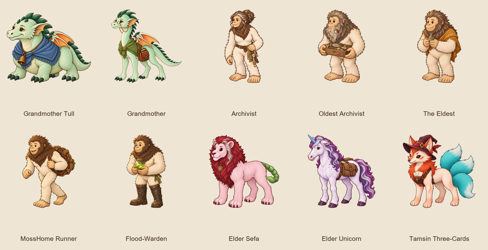

# Elders and adults — A1 review

Ten new figures complete the A1 group alongside approved Great-Gran Ashby. This review also includes four revisions requested after the first review: Tull and the gate-town grandmother now have distinct silhouettes and mint-green dragonling coats; the Elder Unicorn and Archivist have stronger visible age cues.
All match the species references and face left; anatomy was visually checked.
Production files are 1024×1024 RGBA, baseline y=900, minimum margin 77px.

Validation: art verifier **755 passed**; content validator **55 passed**.
Semantic scope check: **69 cast entries**, only figure and required size changed.
Six before and six after Playwright runs capture all ten selected scenes on
1920×1080 TV and 390×844 phone through the real app.

The local capture harness follows the pilot: a temporary content copy exposes
each original chapter as a single-chapter campaign at index 1 without its route
prerequisite. Scene narration, cast, and biome remain unchanged. Production
campaigns and code are unchanged. Phone edge/label cropping remains visible in
some scenes, particularly Tull and the gate-town grandmother; this renderer
limitation is documented in the pilot and is not an art-contract change.

Revised figures: Tull is short and broad; the gate-town grandmother is tall and long-necked. Both use the dragonling mint palette; Ashby remains deliberately pale and faded. The Elder Unicorn has a silver-white mane and forelock, a longer lined muzzle, and mature shoulders. The Archivist has a silver-streaked tied mane, visible face lines, and a slight alert stoop.

Design calls and full prompts are in [generation notes](../../campaigns/gemfall-illustrations.md#cast-figures--elders-and-adults-a1).

## Grandmother Tull

`grandmother_tull` · dragonling · medium · 1 cast entries

## Grandmother

`dragonling_grandmother` · dragonling · medium · 21 cast entries

## Archivist

`mosshome_archivist` · bigfoot · large · 12 cast entries

## Oldest Archivist

`oldest_archivist` · bigfoot · large · 3 cast entries

## The Eldest

`mosshome_eldest` · bigfoot · large · 4 cast entries

## MossHome Runner

`mosshome_runner` · bigfoot · medium_to_large · 8 cast entries

## Flood-Warden

`flood_warden` · bigfoot · large · 1 cast entries

## Elder Sefa

`elder_sefa` · manticore · large · 9 cast entries

## Elder Unicorn

`elder_unicorn` · unicorn · large · 6 cast entries

## Tamsin Three-Cards

`tamsin` · kitsune · medium · 4 cast entries

