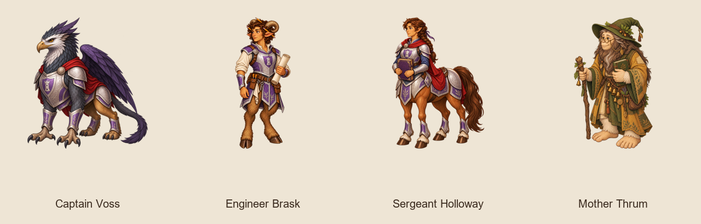

# Individual order members (A3) review

The finale capture shows Voss clearly on TV but off the right edge on the phone beside the much larger Seal-Keeper. This is a concrete renderer follow-up before phone approval. Brask’s corrected female face was checked and recaptured separately.



Voss is a griffin, Brask a female faun, Holloway a centaur, and Mother Thrum a bigfoot: all are already represented in their order reference images. Voss has the direct beaked silhouette; Brask's ears and curls carry her three pencils; Holloway keeps the uniform and tidy ledger on a caravan-ready centaur; Mother Thrum's elder bigfoot body and bell charms suit a steady ford witch. Skywarden bases use actual species because the faction is absent from manifest entities, as in the approved Pellam pilot. Mother Thrum uses witch_order, which is a valid manifest entity. Group casts remain unchanged.

Art verifier targeting the 4 new ids: **737 passed**, no failures. Content validator: **55 passed**. Semantic comparison: **28 cast replacements**, with only figure and required size fields changed. Before and after capture runs pass for all selected scenes.

Captures use the real app at 1920×1080 TV and 390×844 phone. A temporary content
copy exposes each original chapter as a single-chapter review campaign at index 1
with its route prerequisite removed; scene text, cast, and biome are unchanged.
Production campaigns and renderer code are unchanged. Phone edge/label cropping
from the pilot renderer remains visible; captures are for visual review, not a claim
that every composition is approved.

## Captain Voss

`captain_voss` · griffin · medium · 1 cast entries

| TV before | TV after |
|---|---|
|  |  |

| PHONE before | PHONE after |
|---|---|
|  |  |

## Engineer Brask

`brask` · faun · medium · 6 cast entries

| TV before | TV after |
|---|---|
|  |  |

| PHONE before | PHONE after |
|---|---|
|  |  |

## Sergeant Holloway

`holloway` · centaur · medium · 5 cast entries

| TV before | TV after |
|---|---|
|  |  |

| PHONE before | PHONE after |
|---|---|
|  |  |

## Mother Thrum

`mother_thrum` · witch_order · medium · 16 cast entries

| TV before | TV after |
|---|---|
|  |  |

| PHONE before | PHONE after |
|---|---|
|  |  |
