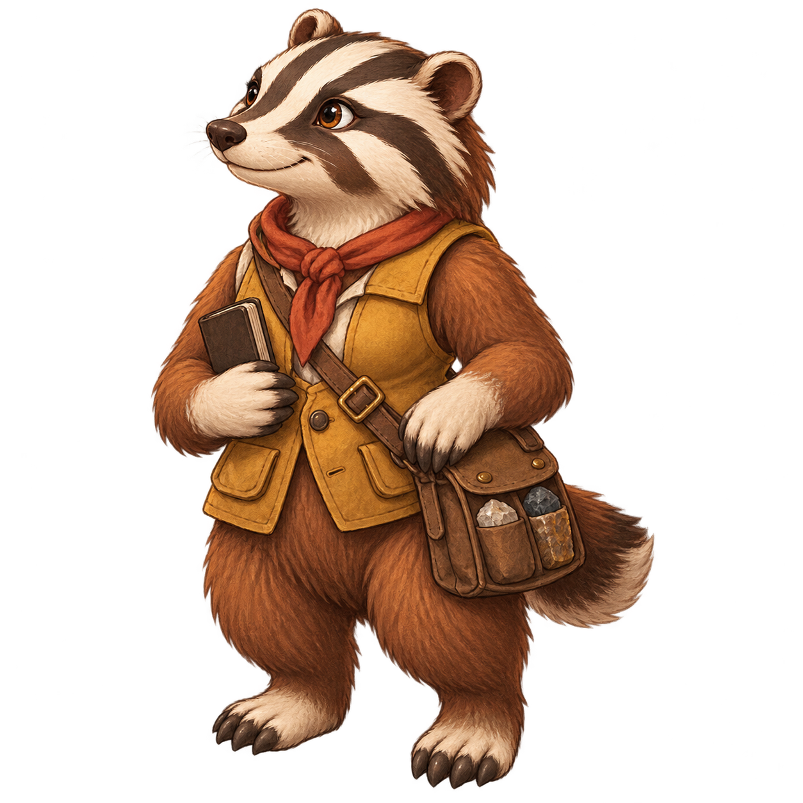
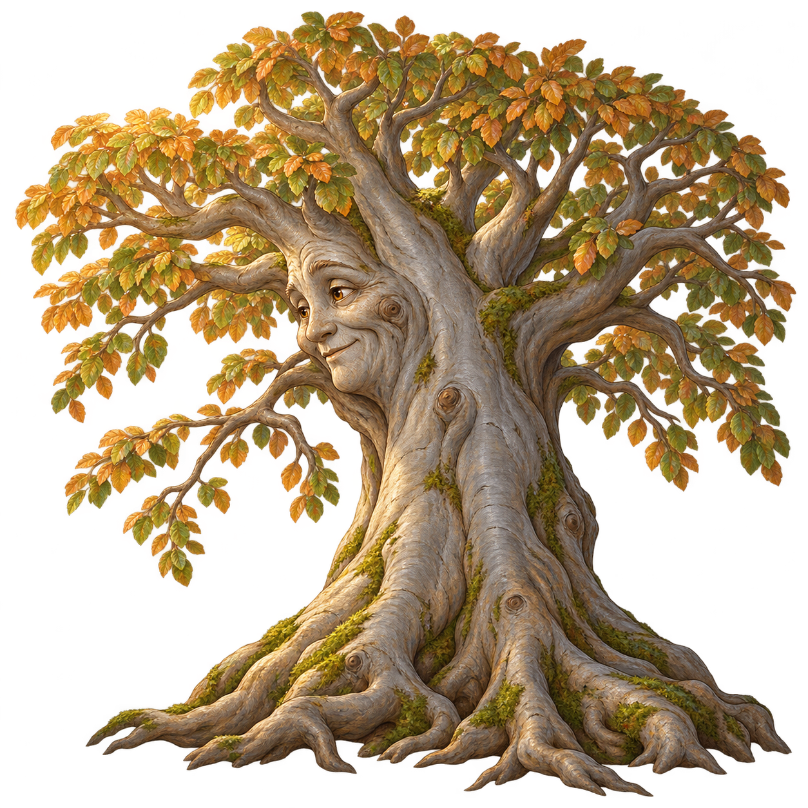
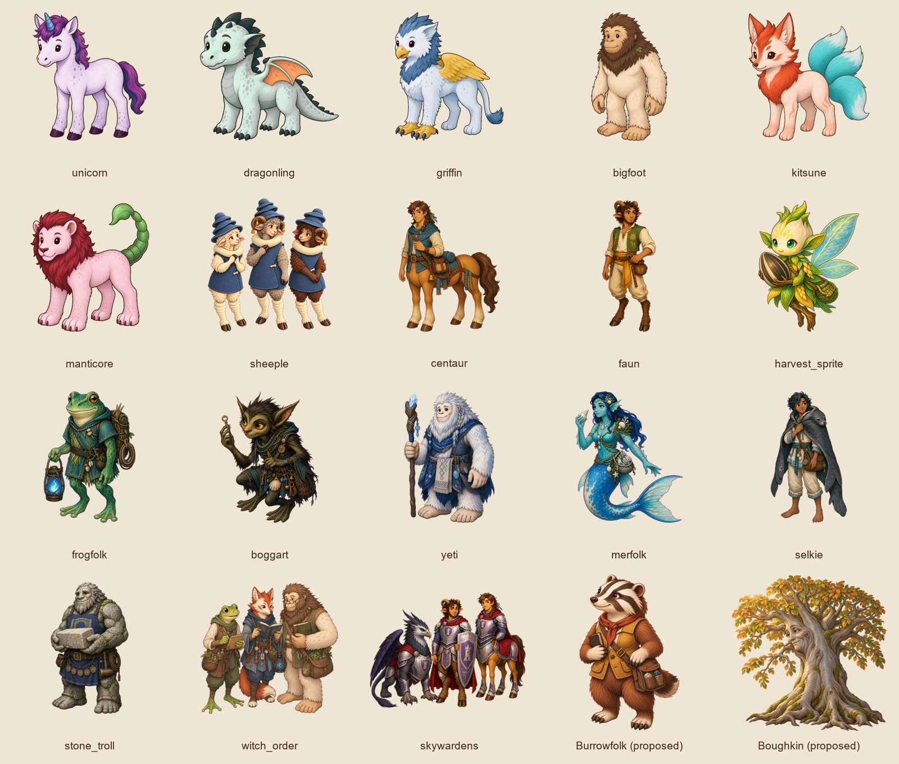

# Missing story peoples: lore proposal

Status: **proposal for review**, not live canon or production art. Part C of the
[story-cast brief](../../briefs/story-cast-art.md#6-part-c-the-missing-peoples-lore-and-figures)
requires this decision review before one implementation PR per approved people.

Two new peoples are proposed: **Burrowfolk**, compact badger-like stone-record
travelers from the Sunward Fields, and **Boughkin**, rare speaking beeches of the
Enchanted Woods. Existing peoples cover the remaining speakers. The Deep Hollow
Cult stays a faction of several peoples, identified by masks, crystals and soup
trappings; no species is inherently a villain and no humans are introduced.

Burrowfolk fill the repeated prospector gap without reducing everyone to a
mining occupation. Their broad wedge head, small ears and high-contrast face bands
differ from bigfoot, kitsune, boggart and sheeple. Mustard and clay-red work clothes
leave them distinct from the green marsh peoples and violet unicorns. Boughkin fill
the speaking-tree gap while protecting ordinary trees and the mountain mystery: they
know their own places and visitor reports, not an omniscient root network.

Draft complete entries for eventual additions to `canon/npcs.yaml`, plus the two
`people_ids`, are in [draft-npcs.yaml](draft-npcs.yaml). They include every field of
the existing people entries, with culture, homelands, speech, behavior and lore.
Existing peoples and relationships are not rewritten. Ordinary donkey, mule and
pony figures will be creature assets, not new sapient peoples. The unseen crown
borrower and the passing drover remain off-stage.

## Concepts

Concepts were generated with the built-in image tool, not approved production
cutouts. Entity/cast figures, portraits, manifest entries, `ENTITY_SIZES`, scene
cast/discovery wiring and generated field-guide updates follow after lore approval.
No canon, runtime content or game code changes are in this proposal.

## Every appendix gap

| Character / group | Chapter | Assignment | Reason |
|---|---|---|---|
| Rush-caravan drover | gemfall-02 | centaur | Caravan work matches established plains travel culture; she remains an individual grumpy traveler. |
| Boy on a ladder | gemfall-01 | faun | A visiting faun apprentice at a rope shop; farm and craft travelers already live in the Exchange. |
| Two stone trolls bouncers | gemfall-01 | stone_troll | Already specified by narration; keep off-stage in this fleeting carry-out, as the appendix recommends. |
| Door voice (crown borrower) | bramblewood-01 | unrevealed | Keep unseen and uncasteable; do not reveal a protected identity merely to populate a stage. |
| Brassbuckle Expedition | gemfall-03a | mixed: two fauns, two burrowfolk, one boggart, one centaur | Matching brass hats identify an expedition, not a species or moral category; their queue tricks belong to these six. |
| Wend | gemfall-03c | frogfolk | An established marsh people can travel with soup tents on the ford roads; generosity is Wend’s own trait. |
| Wend | gemfall-04c | frogfolk | An established marsh people can travel with soup tents on the ford roads; generosity is Wend’s own trait. |
| Lead Drover | gemfall-03c | centaur | A plains caravan leader whose route song fits existing centaur travel traditions. |
| Cart driver and his donkey | gemfall-04a | burrowfolk driver; ordinary donkey | Stone-survey trade brings the driver through Stone Crossing. The donkey is a non-sapient working animal, not a new people. |
| Talking beech tree | gemfall-04b | boughkin | The existing roster has no speaking tree people; rare sapient beeches explain this witness without making all trees omniscient. |
| Prospectors with bulging pockets | gemfall-04b | mixed: burrowfolk, faun, boggart | A gold rush draws several peoples; a crowd’s haste is not a species trait. |
| Lead drover | gemfall-04c | centaur | Same caravan culture as other drovers, with an individual booming register. |
| Ma Ruddle | gemfall-04c | burrowfolk | Her failed prospecting journey fits the new stone-record people without equating them with greed or mining. |
| Tib | gemfall-04c | burrowfolk child; ordinary pony | The orange hat and serious conversation define Tib; he speaks to an animal as a child may, without establishing pony civilization. |
| Clerk Pennywhistle | gemfall-04c | harvest_sprite | A small meticulous record clerk suits an established small people; stamp-and-form props distinguish the individual. |
| Hollis | gemfall-05a | bigfoot | An adult bigfoot’s sturdy silhouette suits the large soup pot; cult allegiance remains learned, not inherited. |
| Muddy prospector with broken wheelbarrow | gemfall-05a | burrowfolk | A muddy traveler who can share a lucky pebble; no cast change implies innate generosity. |
| Tired carter with gem 4117 | gemfall-05a | faun carter; ordinary mule | A road-working faun can value a song while the mule remains an ordinary animal. |
| Soup woman (Deep Hollow Cult) | gemfall-05b | selkie | A traveling selkie adds a coastal people to the mixed soup cell; mask and apron identify allegiance. |
| Rush prospector with pry bar | gemfall-05c | burrowfolk | Stone-record upbringing does not prevent an individual from being stubborn or reckless. |
| Hessa Wren | gemfall-06 | harvest_sprite | Small practical traveling folk make the apron and bark mask distinctive. Her sincere faction choices remain personal. |
| Dunmore | gemfall-06 | burrowfolk | An embarrassed, well-meaning prospector; the pick is an occupational prop, not a people’s mandatory role. |
| Prospectors / man digging up doorstep / man with moth in soup | gemfall-06 | mixed: burrowfolk, faun, boggart | Treat “man” as an adult role in narration, not a human species. Depict only physically present speakers. |
| Drovers | gemfall-06 | mixed: centaurs and fauns | Caravan traffic draws both guides and field workers; do not paint forty background wagons’ crews into one figure. |
| Hessa | gemfall-07h | harvest_sprite | Same Hessa Wren as the soup tent; reuse her named figure rather than recasting across routes. |
| Hessa and the Deep Hollow choir | gemfall-07l | Hessa harvest_sprite; mixed frogfolk, bigfoot, selkie, burrowfolk choir | Masks and crystals unite allegiance while bodies visibly retain different peoples. No cult species. |
| Caravan Master | gemfall-07h | centaur | An exhausted practical caravan leader fits established plains route culture; use one recurring figure where narration confirms the same individual. |
| Caravan Master | gemfall-07l | centaur | An exhausted practical caravan leader fits established plains route culture; use one recurring figure where narration confirms the same individual. |
| Drover | gemfall-07h | centaur | Background passerby remains uncasteable/off-stage as recommended in the appendix. |
| Hessa Wren (and her masked Deep Hollow cell) | gemfall-07r | Hessa harvest_sprite; mixed frogfolk, bigfoot, selkie, burrowfolk cell | Keep the same Hessa identity and visually mixed membership. |
| Deep Hollow choir / Hessa | gemfall-08 | Hessa harvest_sprite; mixed choir as above | Carry the reviewed choir composition into the finale without revealing the titan. |
| Caravan master | gemfall-07r | centaur; ordinary mules | A caravan leader is a centaur individual; cotton in mules’ ears is a working-animal prop, not a new people. |
| Crying gem-buyer | gemfall-07r | merfolk | A visiting merfolk merchant distinct from Fenn; an expensive hat carries the story cue, not a new people. |

All 33 rows of the missing-cast appendix are covered. The [appendix](../../briefs/story-cast-missing.md) retains the exact scene lists.

## Implementation order after review

1. Burrowfolk canon, generic entity/portrait and manifest size; then Ma Ruddle, Tib, Dunmore and specific prospectors, with first-meeting discoveries.
2. Boughkin canon, beech entity/portrait and the two talking-tree scenes.
3. Existing-people named figures for Hessa, Wend, Hollis, the soup woman and Pennywhistle, plus a visibly mixed choir and Brassbuckle group.
4. Remaining existing-people caravan speakers and ordinary working-animal assets; keep background/unseen rows off-stage.

Each production PR follows the Part C checks and before/after captures. Individual
figures use the Part A contract; order membership never substitutes for species.

## Concept prompts

### Burrowfolk

Use case illustration-story. Create ONE concept figure of a NEW sapient non-human fantasy people for Kids & Dragons. Burrowfolk: compact upright BADGER-like hill people, waist-high on a hero, broad wedge-shaped snout, clear bold charcoal-and-cream paired face stripes, small round ears, warm russet brown coat on body, pale muzzle and paws, short sturdy TWO legs, broad digging forepaws as TWO hands, short brush tail. Friendly adult female surveyor in practical muted mustard canvas waistcoat and clay-red neck scarf, small stone sample satchel and one closed blank pocket notebook; no weapon. The face stripes and wedge head are unmistakable at120px, distinct from bigfoot shaggy mane, boggart pointed ears, kitsune large ears and tails, sheeple sheep faces. Crafted warm hand-painted storybook illustration, tapered brown outlines, controlled soft shading, upper-left light, solid dark expressive eyes one highlight, family friendly age8, calm thoughtful and welcoming. Full single figure three-quarter LEFT, no human skin, exactly two arms two legs. 1024x1024 square actual transparent background, clear margins, feet near y900, no ground shadow, no floor, no lettering or UI. Concept art for a new people originating in the Sunward Fields, whose stone-record culture brings some members north during a gold rush.

### Boughkin

Use case illustration-story. Create ONE concept figure of a NEW sapient non-human fantasy people for Kids & Dragons. Boughkin: a living mature BEECH TREE who speaks, a broad smooth silver-grey trunk with a subtle warm kind face suggested by knots and bark folds, thick spreading branching crown with restrained copper-gold and moss-green rounded beech leaves, a few living fine branches lowered as a gentle listening gesture, wide buttress ROOTS at base. Entire person is a TREE, not humanoid, no human torso or hands, no bigfoot furry body. Clear tree silhouette entirely within square canvas, rooted stance, ancient rain-loving listener, mysterious but welcoming to children age8. Palette silver-grey bark, copper-gold leaves and moss green, sparse leaf texture readable small. Crafted warm hand-painted storybook illustration, tapered warm brown outlines, dimensional restrained shading, upper-left light. Face turns gently toward image LEFT in three-quarter view. 1024x1024 true transparent background, clear40px margins, root bottom near y900, no surrounding forest, ground shadow, scenery, text or UI. Homeland enchanted woods, a distinct talking-tree people, not all ordinary trees are sapient. One complete tree figure.
