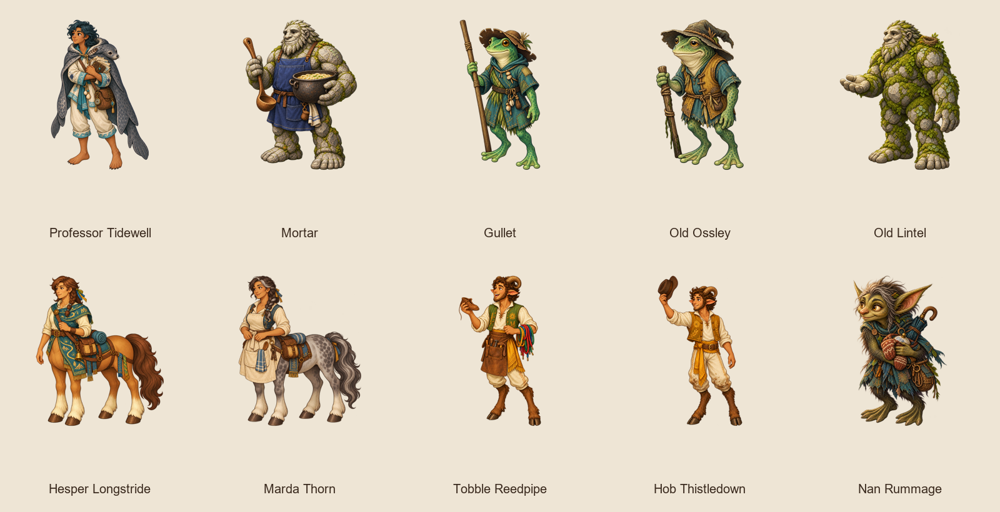

# Recurring individuals (A2) review

Existing peoples are retained. Hesper's embroidered road sash and Marda's grey-dappled coat and apron distinguish the centaur hosts. Gullet has the notched ferry hat and long pole; Ossley has an old floppy hat and short pole. Tidewell keeps her seal-skin cloak with an owl-feather clasp and ink-stained notes. Mortar has a pot and ladle; Lintel has moss, a nest and an open palm. Tobble sings with laces and a shoe; Hob waves his hat. Nan holds mittens, a teapot lid and a folded umbrella.

Art verifier targeting the 10 new ids: **755 passed**, no failures. Content validator: **55 passed**. Semantic comparison: **76 cast replacements**, with only figure and required size fields changed. Before and after capture runs pass for all selected scenes.

Captures use the real app at 1920×1080 TV and 390×844 phone. A temporary content
copy exposes each original chapter as a single-chapter review campaign at index 1
with its route prerequisite removed; scene text, cast, and biome are unchanged.
Production campaigns and renderer code are unchanged. Phone edge/label cropping
from the pilot renderer remains visible; captures are for visual review, not a claim
that every composition is approved.

## Professor Tidewell

`tidewell` · selkie · medium · 3 cast entries

## Mortar

`mortar` · stone_troll · very_large · 7 cast entries

## Gullet

`gullet` · frogfolk · small_to_medium · 18 cast entries

## Old Ossley

`old_ossley` · frogfolk · small_to_medium · 9 cast entries

## Old Lintel

`old_lintel` · stone_troll · very_large · 8 cast entries

## Hesper Longstride

`hesper` · centaur · large · 8 cast entries

## Marda Thorn

`marda_thorn` · centaur · large · 7 cast entries

## Tobble Reedpipe

`tobble` · faun · medium · 7 cast entries

## Hob Thistledown

`hob` · faun · medium · 6 cast entries

## Nan Rummage

`nan_rummage` · boggart · small · 3 cast entries

