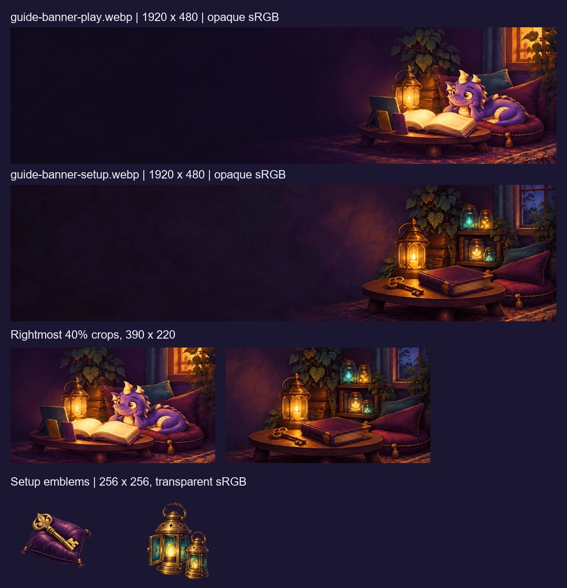

# Guide art delivery review

Issue: https://github.com/allenheltondev/kids-and-dragons/issues/573

Reviewed the exact exported WebPs, including rightmost-40% crops at 390 × 220. Both mobile scenes retain their key objects. Transparent emblems have clear margins and read against the night background. Four selected PNG masters are retained in `art/source/guide-573/`; prompts and rebuild instructions are in the guide asset README.

## Validation

All exports use the required canvas, WebP mode, and embedded sRGB profile. Banners are opaque; emblems have nonempty transparency and clear edges. The manifest, inventory, and art verifier include all four assets.

Minimum contrast over every pixel of the desktop left 55%, measured on the decoded delivered WebPs:

| Banner | Title #f4f1ff | Paragraph #b7b0d8 |
| --- | --- | --- |
| Play | 15.04:1 | 8.14:1 |
| Setup | 14.49:1 | 7.84:1 |

These exceed 4.5:1 in that text region. `validation.json` records dimensions, modes, byte sizes, profile presence, and measurements. Page integration is outside this art delivery: actual typography, mobile overlays, responsive positioning, print, high-contrast behavior, and loading must be checked when the guide is wired. The bright mobile scene itself is not a safe unrestricted text backdrop.

Checks: full art verifier (1,620 passed), seven guide verifier regression cases, complete art inventory. Rebuild with `python art/source/guide-573/package.py`.
