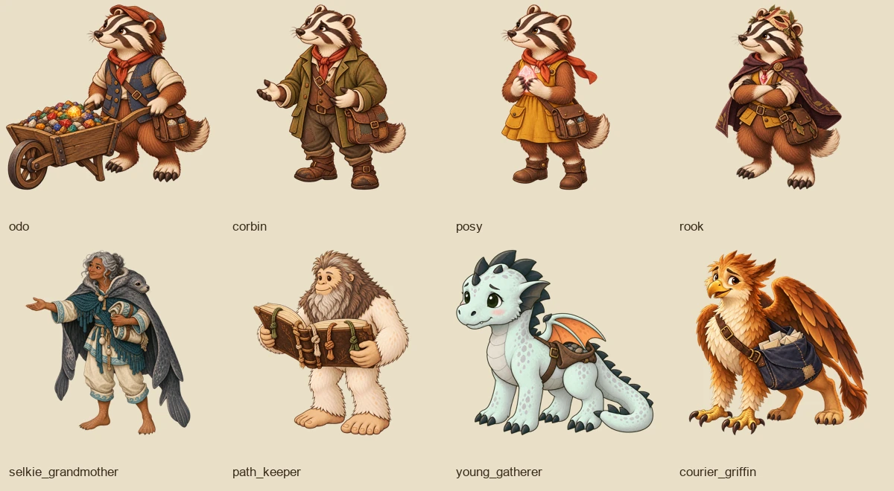

# Issue 170: Gemfall expansion cast review

Nine left-facing transparent figure assets for eight characters, declared in `assets/manifest.json` and wired into five Gemfall chapters. The [brief audit](../../briefs/story-cast-art.md#9-gemfall-expansion-cast-audit--issue-170) lists every named stand-in found, the visual briefs, existing expansion deliveries and the remaining occupational/group figures. [Prompts and references](../../campaigns/gemfall-illustrations.md#issue-170--remaining-expansion-speakers-2026-10-15) record the built-in image-generation calls.

## Figures

| Figure | Basis | Scale | Cast entries |
|---|---|---|---|
| Odo | burrowfolk | medium | 5 |
| Corbin (on foot) | burrowfolk | medium | 1 |
| Posy (on foot) | burrowfolk | small | 1 |
| Corbin carrying Posy | burrowfolk | very_large (combined height) | 4 |
| Rook | burrowfolk | medium | 5 |
| Selkie Grandmother | selkie | medium | 5 |
| Path-Keeper | bigfoot | large | 3 |
| Young Gatherer | dragonling | small | 4 |
| Courier Griffin | griffin | medium | 4 |

The boulder claimants gain ten cast entries across five scenes: a Burrowfolk Claimant and a Faun Claimant using distinct existing species figures. Linnet is restored to the scouts' fib scene. Total: 43 entries added or replaced. Odo's barrow, the path-keeper's book, and the courier's sack belong to their cutouts; no existing species art was replaced. Posy rides on Corbin’s shoulders in all four introduction scenes; their separate figures are used for the later downhill reunion on foot.

## Before and after

Each comparison puts **before on the left, after on the right**, with a 1920x1080 TV capture above a 390x844 Travel Mode phone capture. Original PNG captures remain in local `art/review/`; these committed WebP sheets keep the review portable.

Captured twice with the existing `e2e/cast-shot.spec.ts` against the real dev stack and three player contexts. For convenient visual review, a temporary content tree copied the six later-chapter scenes into chapter 1, preserving their narration and cast and replacing their outgoing choices with a review Continue. Consequently those six captures show chapter 1's heading and default Exchange backdrop; they verify the figures, standing line, labels and phone/TV framing, not the later chapters' environments or playthrough. The two chapter-1 scenes use their authored backgrounds. This fixture and its temporary Playwright config are not production changes.

| Scene | Characters | Comparison |
|---|---|---|
| `gemfall-01:scene_newcomers` | Selkie Grandmother | [TV + phone](scene_newcomers.webp) |
| `gemfall-01:scene_griffin_post_feed` | Courier Griffin | [TV + phone](scene_griffin_post_feed.webp) |
| `gemfall-05b:scene_halfway_hut` | Path-Keeper | [TV + phone](scene_halfway_hut.webp) |
| `gemfall-05b:scene_cloud_gatherer` | Young Gatherer | [TV + phone](scene_cloud_gatherer.webp) |
| `gemfall-06:scene_claim_boulder` | Both claimants | [TV + phone](scene_claim_boulder.webp) |
| `gemfall-07r:scene_glitter_barrow` | Odo | [TV + phone](scene_glitter_barrow.webp) |
| `gemfall-07r:scene_posy` | Corbin and Posy | [TV + phone](scene_posy.webp) |
| `gemfall-07l:scene_two_scouts` | Linnet and Rook | [TV + phone](scene_two_scouts.webp) |

## Validation

- `npm run art:verify -- odo corbin posy rook selkie_grandmother path_keeper young_gatherer courier_griffin`: **749 passed**, including shared effects and gear. Each new figure passes basis, RGBA canvas, alpha/margin and feet at y=900.
- `npm run content:validate`: **55 passed**, including figure-file resolution.
- `npm test -- packages/client/src/world/cast.test.ts packages/client/src/world/art-paths.test.ts`: **31 passed**.
- `npx playwright test -c cast-review.local.ts`: **1 passed before, 1 passed after**, eight scenes each, TV and phone screenshots.
- Semantic comparison with the original chapter JSON: every scene field except `cast` is identical.
- `git diff --check`: clean.

Allen approved the original character designs; the shoulder-riding variant addresses the subsequent continuity feedback. Remaining generic role figures are explicitly catalogued in the brief; this delivery completes the named recurring expansion speakers requested in #170.

## Continuity follow-up and main update

Merged main at `8c1d771b` without conflicts. The updated PR includes every commit from that main revision. The introduction now uses `cast/corbin_carrying_posy` in all four scenes; the downhill reunion still has separate figures. No narration or mechanics changed.

[Shoulder-pose correction, previous versus corrected TV + phone](posy-shoulders.webp). The introduction comparison above is refreshed with the corrected pose. [The downhill reunion remains on foot](posy-on-foot.webp). These captures use the same review-only chapter-1 fixture described above, with an additional pause for the phone's entrance animation.

Validation after merging main and adding the pose:

- `npm run art:verify -- corbin_carrying_posy`: **728 passed**, including shared effects and gear.
- `npm run content:validate`: **55 passed**.
- `npm run typecheck`: passed.
- Full unit suite: **2665 passed, 1 skipped**, with one existing Windows CRLF-sensitive authoring-guide test failure. Neither that test nor its guide differs from main. Normalizing the guide's local line endings made its six tests pass; the guide normalization is not part of this PR. The targeted rerun of that file plus cast/art-path tests passed **37 tests**.
- TV and phone review captures passed for both the introduction and the downhill reunion.
