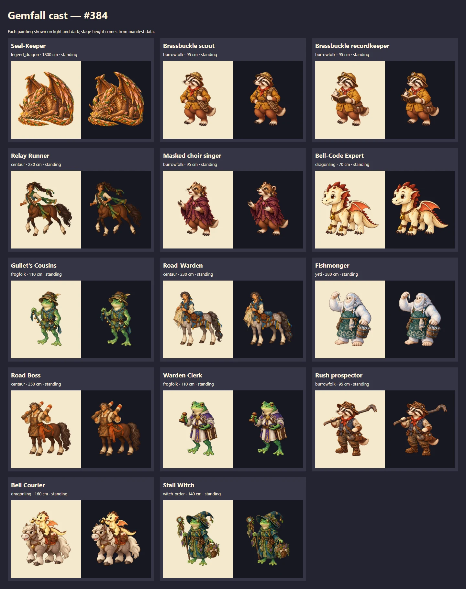
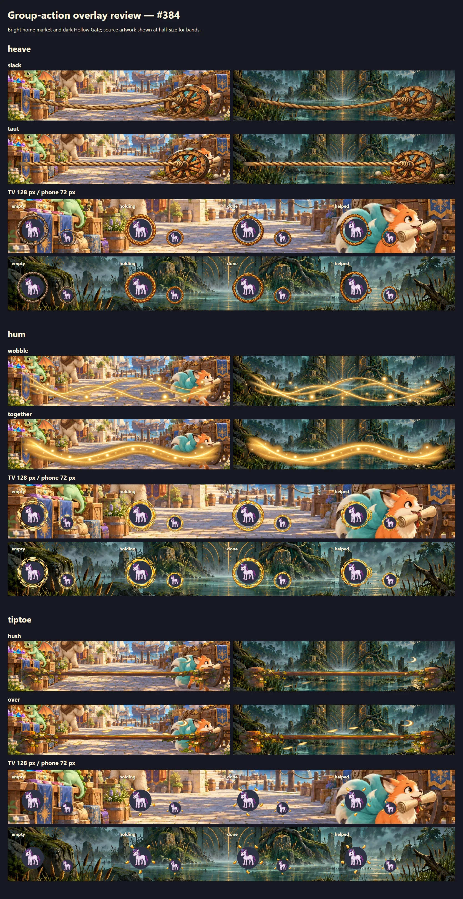
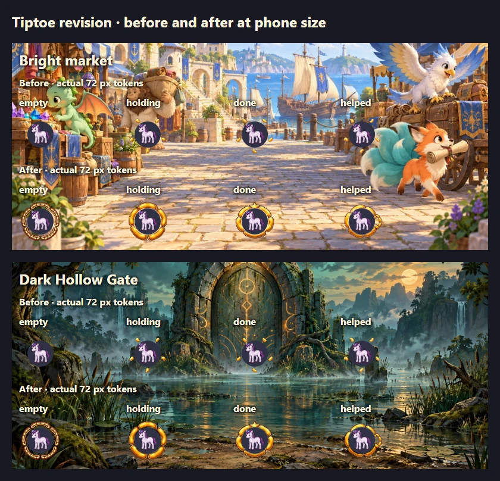

# Issue 384: remaining Gemfall cast and group-action overlays

Delivered 14 transparent cast figures and 18 overlay PNGs using built-in `image_gen`.
Final game assets live under `assets/cast/<id>/assembled.png` and `assets/together/<move>/`.
The [prompt record](prompts.json) includes the accepted generation filenames, prompts,
corrections and final asset paths. Raw generation copies and temporary export/review
tooling are omitted from the delivery.

## Cast decisions and wiring

All figures have `heightCm` and `standing` stance in the manifest. Adult Burrowfolk use
`small_to_medium` because 95 cm is above the `small` band's 75 cm ceiling. The Bell Courier's
160 cm includes her pony, and the Stall Witch's 140 cm includes her hat. The Seal-Keeper is
1800 cm with explicit top overflow and a low resting head so the eyes and embermoths remain
visible. Its whole body is painted, including the wings that overflow the stage.

The masked singer is a Burrowfolk, adding a third people beside the existing bigfoot and
frogfolk choir figures; those figures remain in their scenes. The Warden Clerk is a
frogfolk with a stamp, distinct from Pellam's faun silhouette and quill. The Stall Witch
is also frogfolk, with the Witch Order's hat, herbs, bottles and bell charms, distinct from
Mother Thrum's bigfoot figure. The Brassbuckle colleagues share hats and expedition colors,
but differ in build, expression, spectacles and props. The runner is dark bay with a tied
braid and chest bandolier, distinct from Bracken's chestnut coat and saddle satchel.

170 cast entries across 15 Gemfall chapter files now use these figures. No narration,
choices, flags, checks or encounter data changed. Obsolete `size` overrides were removed
from the replaced figures. File hashes were re-taken with an explanatory comment in
`gemfall-compat.test.ts`; gameplay digests are unchanged.

## Stage review

The existing cast-shot harness was adapted temporarily to preview before/after pairs in
14 chapter-1 scenes on the real dev stack with three player contexts. This tests the stage,
true heights, framing and portrait paging; the chapter-1 narration and backgrounds are
review fixtures, not a playthrough of the characters' authored scenes. Browser ownership
now requires the TV to share the room opener's browser context. The temporary test was
removed after the successful run.

The retained [Brassbuckle TV comparison](brassbuckle_scout-tv.webp) and
[phone capture](brassbuckle_scout-phone-after.webp) show framing at both sizes. The
Seal-Keeper's [before](seal_keeper-phone-before.webp) and
[after](seal_keeper-phone-after.webp) phone pages show its visible face at colossal size.
The contact sheet above covers all 14 paintings. The full capture set remains local in
ignored `art/review/issue-384/`; representative captures keep this record compact.

| Figure | Entries | Height |
|---|---:|---:|
| Seal-Keeper | 54 | 1800 cm |
| Brassbuckle scout | 17 | 95 cm |
| Brassbuckle recordkeeper | 17 | 95 cm |
| Relay Runner | 12 | 230 cm |
| Masked choir singer | 13 | 95 cm |
| Bell-Code Expert | 8 | 70 cm |
| Gullet's Cousins (foreman) | 8 | 110 cm |
| Road-Warden | 7 | 230 cm |
| Fishmonger | 5 | 280 cm |
| Road Boss | 5 | 250 cm |
| Warden Clerk | 5 | 110 cm |
| Rush/Muddy/Burrowfolk prospector | 11 | 95 cm |
| Bell Courier and pony | 4 | 160 cm |
| Stall Witch | 4 | 140 cm |

Counts reflect this checkout after the later Gemfall rewrites, rather than the issue's older audit.

## Overlays

Each move has two 1600×360 bands and four 192×192 tokens, declared under
`togetherOverlays` exactly with the dimensions and state names from brief §7.3.
Bands have a clear top 90 rows and fading sides; tokens have a clear 62 px radius centre
and 8 px edge. Tokens use shape changes, no hands or feet, and no painted text. The revised tiptoe tokens use five thick curved bean shapes with cream and brown rims.
A prominent star and a secondary helper loop distinguish the final two states. All four
states were reviewed at actual 72 px size over bright market and dark Hollow Gate scenes.
The empty token now has 9,396 visible pixels, compared with 256 before revision.

The largest band is 221,112 bytes; the largest token is 23,490 bytes.

**Implementation status:** the approved group-action design from #360 merged in
[PR #361](https://github.com/allenheltondev/kids-and-dragons/pull/361), which changed the
design brief only. This branch includes that merge and main at `79c06b21`. The
runtime, schema/types, `content:validate` gate and automatic contact-sheet support
described by the brief still need implementation. The overlay art checks now run in
`tools/art/verify.py`, through the normal art gate and CI, with Vitest regression coverage.
This delivery does not enable group actions or opt gameplay checks in. Issue #384 remains
open for the outstanding runtime and content-gate acceptance work; #360 is complete.

## Validation

- `python tools/art/verify.py`: **685 checks passed**, including all 18 overlays: dimensions,
  RGBA, byte caps, clear regions, fades, nonblank/distinct states and centroid registration.
- Overlay gate regressions: **11 tests passed**, including malformed and missing PNGs,
  undeclared files, opaque/blank/duplicate states, clear regions and misplaced tokens.
- Focused Vitest: overlay gate, figure sizes and Gemfall compatibility: **29 tests passed**.
- `npm run content:validate`: **62 checks passed**.
- `npm run art:figures`: regenerated the committed height/stance table.
- Adapted Playwright cast-shot review: **1 passed**, all 14 figure comparisons, TV and phone.
- Full `npm test` after review fixes: **5064 passed, 10 skipped, 3 failed** in unchanged tests:
  authoring-guide fenced-block parsing (CRLF sensitivity), `PlayerProfile` source parsing
  (CRLF-sensitive interface terminator), and Riftlight preview Ctrl-C process cleanup
  (20 s timeout on Windows). The content validation suite also hit its 10 s cleanup-hook
  timeout. Direct content validation passed. These tests and their input sources were not edited.
- Typecheck: passed.
- Semantic comparison to `origin/main`: every non-cast field in all 15 changed chapters is unchanged.
- `git diff --check`: clean.

Sources and prompts were made with built-in `image_gen`; no API/CLI fallback was used.
Review PNGs and HTML remain in ignored local `art/review/issue-384/`; the seven retained WebP
images here are portable.
