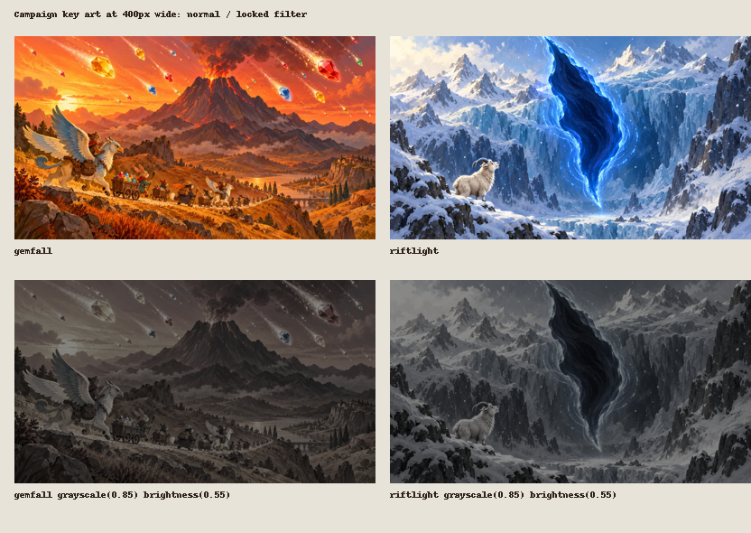

# Campaign key art review (#404)

The two commissioned paintings are `assets/campaigns/gemfall.webp` and
`assets/campaigns/riftlight.webp`: opaque RGB WebP, 1600 x 900. Generation used
the built-in image generator; exact prompts and encoding settings are recorded
in [campaign-key-art-prompts.json](../../campaign-key-art-prompts.json).

This is an image review sheet, not a lobby screenshot. Each painting is shown
at 400 px wide. The lower row applies `grayscale(0.85) brightness(0.55)`.
Gemfall's mountain and falling gems remain distinct; Riftlight's dark folded
opening and small goat remain readable against the snow in the locked version.

Validation:

- Art verifier: 687 checks passed, no failures. See [art-verify.txt](art-verify.txt).
- Inventory: Campaign key art 2/2 complete. See [art-inventory.txt](art-inventory.txt).
- Campaign art, campaign copy and lobby content suites: 40 tests passed.
- `npm run typecheck`: passed.

Outstanding acceptance item: capture the actual lobby at TV and phone sizes,
with both cards present and Riftlight locked. This session could not start
Chromium (exit code 3221225506); both in-app browser attempts timed out attaching
their webview. The review sheet above does not substitute for those captures.

The implementation builds on `ccr-e14b45d1-wsxm6k`, the lobby-card branch named
in the issue. Riftlight is still a draft; its local preview now borrows the
finished campaign painting while retaining its Gemfall prerequisite.
