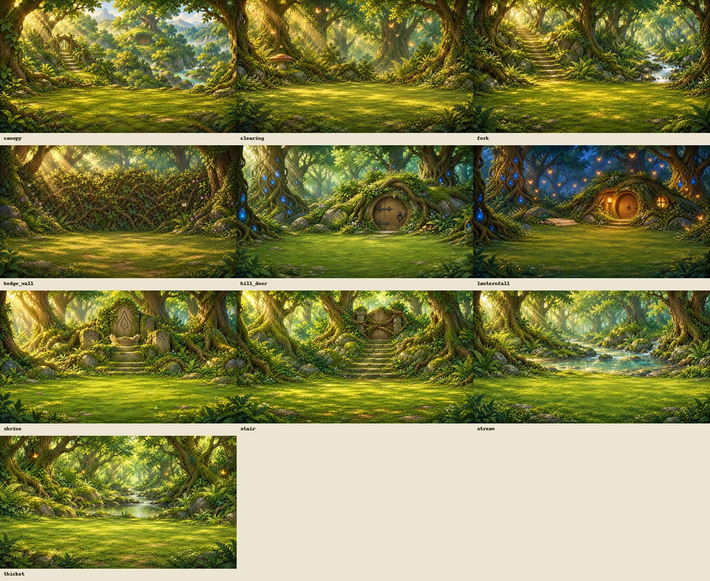
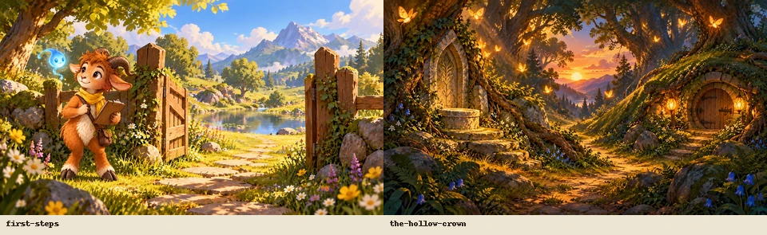
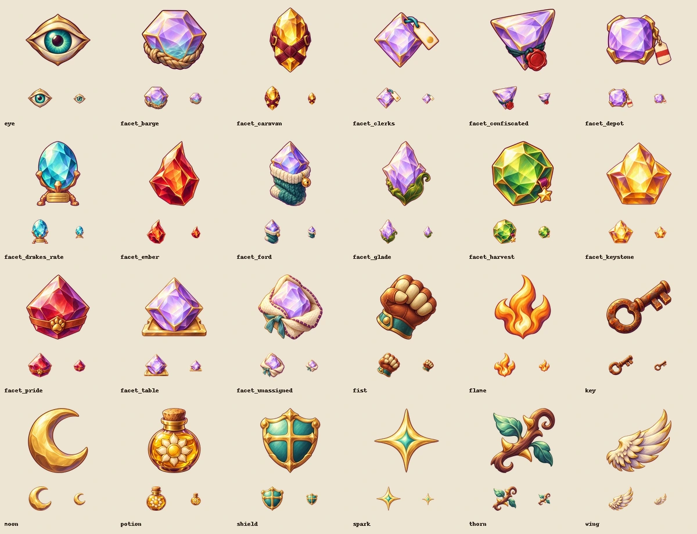
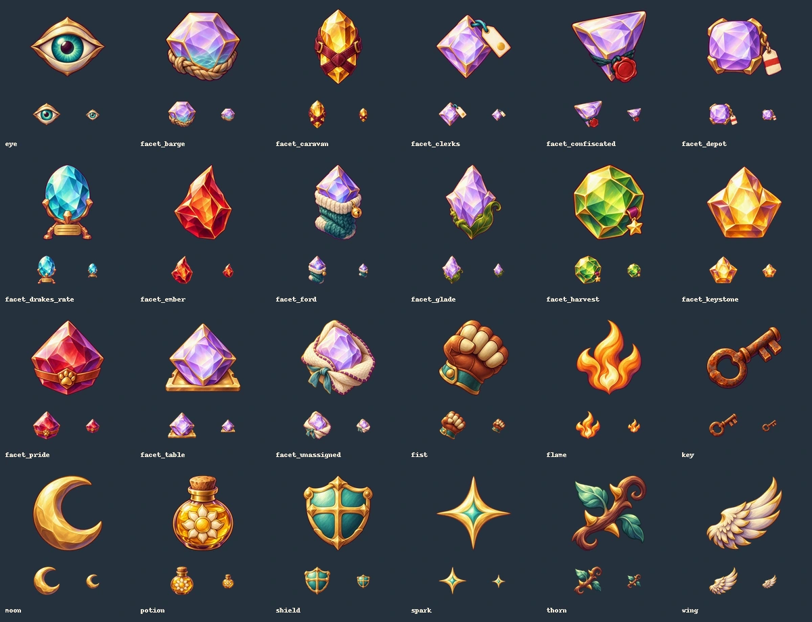

# Remaining artwork for #421

Delivered 2026-10-22 with the built-in imagegen tool: **36 paintings** covering
all remaining optional/conditional artwork named in the issue. The ten Mythic
class figures are a separate delivery in PR #424, already artistically approved.
This batch is ready for its own artistic review.

## Deliveries and wiring

| Delivery | Count | Runtime destination |
| --- | ---: | --- |
| Hollow Crown backdrops | 10 | `assets/scenes/bramblewood/<scene>.webp` |
| First Steps and Hollow Crown covers | 2 | `assets/campaigns/<campaign>.webp` |
| Ability/choice icons | 8 | `packages/client/src/assets/painted/<icon>.webp` |
| Distinct facets, rusted key and Sunbloom potion | 16 | same painted-icon directory |

All ten backgrounds are 1920×1080 opaque WebP. The 19 chapter art references,
including the encounter's unused story-art reference, now use supported
`scenes/bramblewood/...` paths instead of the old unresolved `bg/...` prefix.
The renderer continues to use combat terrain during encounters. Only art
references changed in this reference chapter; narration, choices and mechanics
are unchanged. The shrubbery, stream, shrine and hill door follow its descriptions;
the missing crown and hidden occupant are not revealed in the paintings.

Both campaign covers are declared, opaque 1600×900 WebP. The existing campaign
card component finds them without a new UI path.

The 24 icons are 256×256 WebP with real generated alpha and at least 16px of
transparent margin. `shield`, `wing`, `spark`, `fist`, `eye`, `moon`, `thorn` and
`flame` are now direct paintings; the old aliases no longer hide them. `key` and
`potion` also select their own art, distinct from generic quest/consumable icons.

Fourteen facet icons differ in cut and attached carrying details as well as color.
The red Ember Facet, green-gold Harvest Stone with medal, wool-wrapped Ford Stone,
tagged stones and large Keystone use their authored descriptions. Unspecified
cuts and carrying details are illustration choices, not new mechanics or prose.
The client decorates the loaded display catalog once with those icon names, so
inventory, help, trades and offers all use them. The authored catalog, pinned
Gemfall chapters and server item behavior are unchanged.

`manifest.paintedIcons` declares the additional 24 icons for inventory and pixel
verification. The verifier now also checks all declared scene illustrations.

## Provenance and review

[prompts.json](prompts.json) retains the exact 36 prompts, reference roles/paths,
original output locations, source/output SHA-256 hashes and dimensions.
[package.py](package.py) exports retained originals without repainting or deriving
alpha from a background color. Source images remain in the original imagegen
directory; final assets are committed at their runtime paths.

Inspected the scene and campaign contact sheets for subject, composition,
continuity and missing-crown spoilers. Inspected all icons at 128px, 48px and
24px on light/dark backgrounds for silhouette, palette, transparency and distinct
shapes. These are static reviews, not live gameplay captures or owner approval.

## Validation

- Strict art verification: **862 passed**, no failures or warnings.
- Focused renderer paths, screens/icons, campaign art, loaded item icons and
  Gemfall compatibility: **70 tests passed** across five files.
- Content validation: **116 passed**, two existing warnings about Corvane's
  undeclared creature in Riftlight, no failures.
- Repository typechecking and the production client build: passed.
- Bundle budgets: first paint 312KB/315KB, total 1321KB/1400KB; passed.
- Inventory: **104/104 scenes, 4/4 campaign covers, 24/24 additional icons**.
  The ten Mythic figures remain listed on this independent branch until #424 merges.

Validation exposed an existing Windows portability bug in graph-proof checker
fingerprints: CRLF source and backslash paths hashed differently from Linux.
The validator now normalizes both; the committed Riftlight proof is unchanged.
