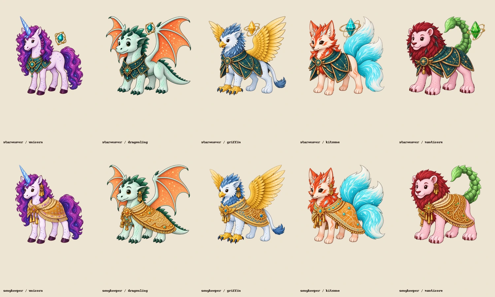
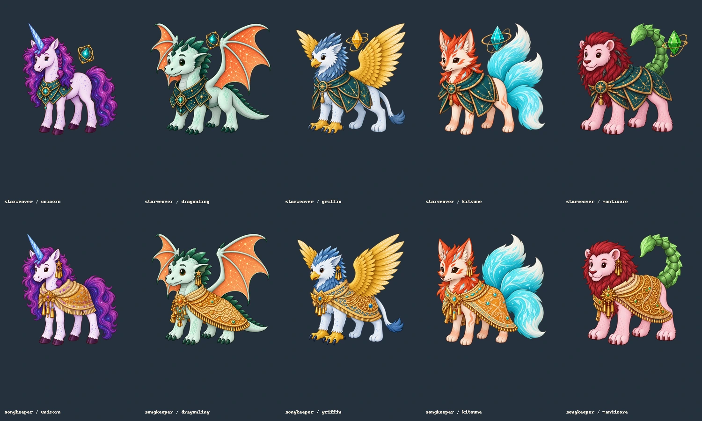
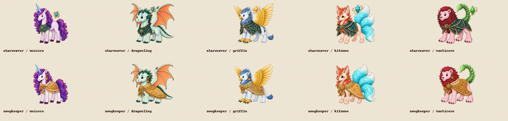
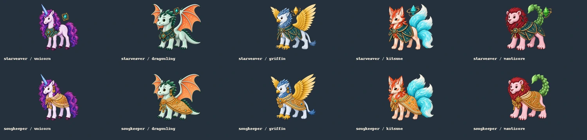

# Mythic class figures (#421)

Delivered 2026-10-22: the five missing Mythic Starweavers and five missing Mythic
Songkeepers (unicorn, dragonling, griffin, kitsune and manticore). Existing Bigfoot
figures are unchanged. All 72 class figures are now present, declared in
`assets/manifest.json` and selected by `packages/client/src/world/art-paths.ts`.

## Art and provenance

Generated with built-in `image_gen`, one call per figure. Each prompt conditions
on three approved references: the species' fledgling identity, its Mythic body,
and its exact class/tier gear portrait. [prompts.json](prompts.json) records the
exact prompts, reference roles/paths, original output locations, source/output
SHA-256 hashes and final file properties. [references.jpg](references.jpg) shows
those approved inputs together.

The ten final files live at
`assets/character-rigs/{starweaver,songkeeper}/mythic/<species>/assembled.png`.
They are 1024×1024 RGBA, with real generated transparency preserved, complete
silhouettes inside the canvas, and their lowest visible row registered to y=900.
No split parts or baked-in aura are supplied. Starweaver focus gems belong to the
approved gear; species auras remain separate runtime effects.

[package.py](package.py) reproduces export and review sheets from the retained
originals. It only crops, resizes and registers the generated alpha; it does not
repaint the figures or derive transparency from a background color.

## Visual review

Inspected all ten figures for approved species palette and identity, costume,
facing, visible feet, complete horns/wings/tails, clean transparent contours and
readable silhouettes. Large and actual 120px-height sheets were inspected on both
light and dark. These are static-art reviews, not a live gameplay capture or an
owner's artistic approval.

## Validation

- `npm run art:inventory`: 72/72 class figures, zero declared deliverables outstanding.
- `python tools/art/verify.py --strict`: 752 checks passed, no failures or warnings.
- `npx vitest run packages/client/src/world/art-paths.test.ts`: 13 tests passed;
  this includes every species/class/tier combination against the manifest.
- `npm run typecheck`: passed across shared, canon, server, client and tools.
- `git diff --check`: passed.

## Scope remaining in #421

The conditional Hollow Crown backdrops and optional campaign, ability and item
icons were not commissioned in this change. Their working fallbacks remain, and
they are explicitly recorded in the refreshed [asset inventory](../../asset-inventory.md).
The core missing-figure work is complete; this delivery does not claim those
optional paintings exist.
