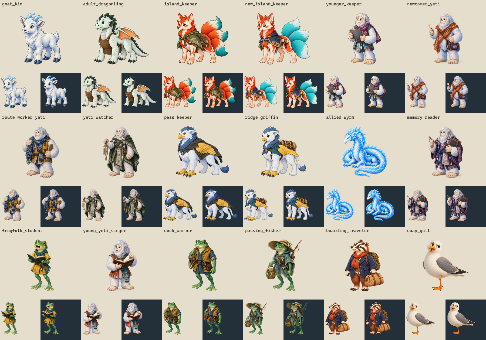
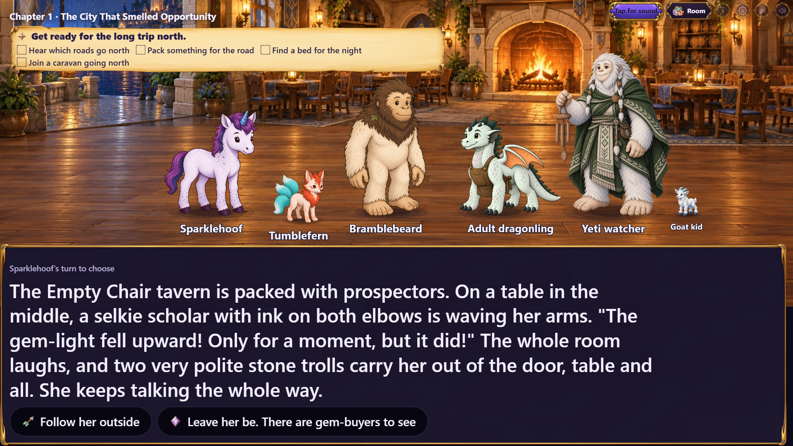
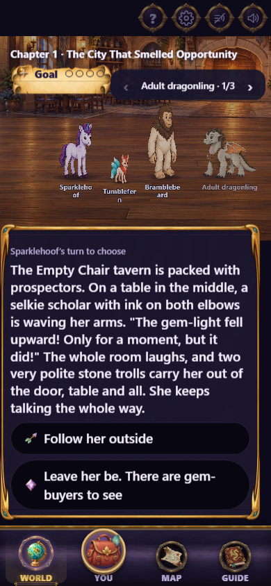
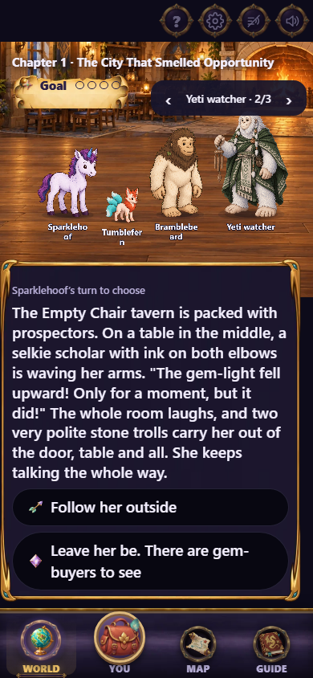
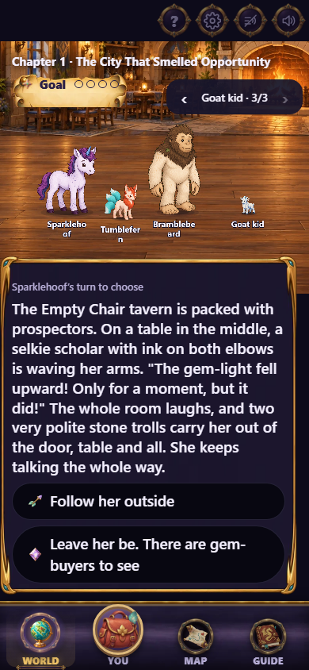

# Riftlight character art (#433)

18 new transparent figures: 17 commissioned cast members and one ordinary gull
registered as a stage figure. Prepared on main after PR #431 merged, in the
separate `codex/issue-433-cast-art` worktree. The #429 work in the original checkout is
preserved separately.

Sources, exact final generation prompts, height records and repeatable
packaging/install commands are in `art/source/riftlight-433/`. Generation used
the built-in image tool and the existing figures as species/style references.
The traveler was corrected to remove scenery; the allied wyrm was corrected
to face the party with a complete, uncropped silhouette.

The new art replaces stand-ins and fills the newly drawable roles across 16
Riftlight chapters. Existing nameplates are preserved. All chapter fields
outside `cast` are unchanged, including narration, choices, flags and graphs.

## Decisions and remaining constraints

- The Stuttering Flats goat stays an adult: `glimpse` explicitly distinguishes
  it from the rescued kid. The new kid is used in Exchange, glacier survival
  and the finale loss epilogue.
- The other two finale epilogues already have three cast members. The goat
  figure is ready, but showing it there still requires an authored scene split
  or a change to the cap. No fourth entry is added for the renderer to drop.
- Convergence's seven requested rift-opening scenes already use the dedicated
  `rift` stage effect, so no character PNG is added for the opening.
- Dock workers and the fisher are frogfolk; travelers are burrowfolk. Memory
  readers are yetis. These visual choices do not extend the creature canon.
- The gull uses `stageFigures`/`entities/quay_gull`, like ordinary donkeys and
  ponies. It is not assigned an incorrect creature basis.

## Verification

- Content validation, continuity and graph proofs pass. Proof files unchanged.
- 253 tests pass across the cast/scale and Riftlight content suites (24 files).
- Art verification passes; all 18 outputs independently pass 1024px RGBA,
  transparent-margin and y=900 registration checks.
- The real TV/phone screenshot review passes. The review tool now supplies
  the creating device's binding when opening its second display surface,
  satisfying the existing room-watch access rule without copying a player seat.

These screenshots temporarily inject three representative figures into the
Gemfall tavern to check height, layout and phone guest paging. Gemfall files
are unchanged. This is an art/layout check, not the outstanding full Riftlight
visual playthrough tracked in #429.

| Adult dragonling | Watcher | Goat kid |
|---|---|---|
|  |  |  |
