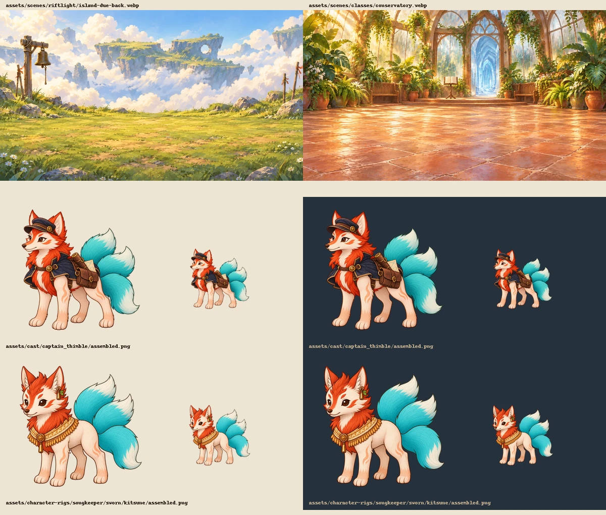

# Riftlight artwork: first batch for #397–400

**The full artwork set is now delivered. See [the complete delivery and review](delivery.md).**
The notes below retain the first batch's history and validation.

Started 2026-10-21 using built-in `image_gen`. This is a first batch, not completion
of the four issues. Exact prompts, reference roles, generation filenames, output
paths and SHA-256 hashes are in [prompts.json](prompts.json). The export script
registers figures without repainting them and converts backdrops to WebP.

| Issue | Delivered | Wiring |
| --- | --- | --- |
| #397 | `scenes/riftlight/island-due-back.webp` | All 106 scenes in The Island Due Back |
| #398 | `scenes/classes/conservatory.webp` | `conservatory` and `conservatory_sing` in Glacier Survival |
| #399 | `cast/captain_thimble/assembled.png` | `ship`, `ship_help`, `ship_cold` in Snow on the Quay |
| #400 | `character-rigs/songkeeper/sworn/kitsune/assembled.png` | Manifest and runtime class-figure lookup |

Backdrops are 1920×1080, with open standing space and landmarks above the foreground.
Figures are transparent 1024² with their lowest visible row at y=900. Thimble is
an adult kitsune, 115 cm, medium, standing: a practical captain's cap, short navy
cape and a route-chart satchel distinguish her from Tamsin and the temple keeper.
The Sworn Songkeeper keeps the base hero's species palette and three tails, adding
the delivered Songkeeper set's woven gold wrap, clasp and bells.

The author chose **a separate flock cutout** for the Rookery. Its future backdrop
must therefore contain no painted crows. No crow is named or singled out.
The Academy should show sky above the tower without a snow- or marsh-specific view.

The conditional Thimble callback in `island_rest` is not wired: cast currently has
no condition, and painting her there unconditionally would introduce her even
when the callback does not fire. Her dedicated figure is ready for that follow-up.

## Checks

- `npm run typecheck`: passed on the isolated PR branch.
- `npm run art:verify`: 591 checks passed on the isolated PR branch.
- `npm run content:validate`: 62 checks passed.
- Existing staged Riftlight content-gate test: passed, including the draft's art paths.
- Focused renderer, figure-size and class-room tests: 47 passed on the isolated PR branch.
- Both WebP dimensions and PNG mode/dimensions checked directly; light/dark review above.
- Semantic comparison of the three changed chapters: only `art` and `cast` differ.
- `npm run art:figures` regenerated the stage height table.
- Inventory now lists 24 missing class figures: 14 within #400, plus 10 Mythic figures outside it.

Real-stage capture: **1 passed**, two backgrounds on TV, watcher phone and host
phone. [Island TV](island-tv.webp), [island phone](island-phone.webp),
[Conservatory TV](conservatory-tv.webp), [Conservatory phone](conservatory-phone.webp).
These use unchanged Gemfall review narration and Thimble on both backgrounds to
inspect composition; they are not an authored Riftlight playthrough. The initial
capture failed because the existing helper creates an unauthenticated TV context.
A temporary copy reused the host's authenticated context and passed; that copy
was removed. The hero variant has light/dark sheet review, not a live Sworn-party capture.

The original checkout's uncommitted Starweaver Radiant unicorn and unrelated #384
artwork work were excluded from this branch. The unicorn remains undeclared and
is still counted by inventory. The earlier combined checkout passed 690 art
checks and 48 focused tests; this PR's smaller baseline passes 591 and 47 respectively.

## Remaining commissions after the first batch (historical)

- **#397:** wrong-valley, convergence-ledge, wyrm-nest, bone-yard-ruins,
  singing-hall, singing-hall-camp; then the issue's existing-art wiring pass.
- **#398:** Dojo, Academy and Rookery backdrops; Master Dunnick, Professor Nettle,
  Aunt Bellow and the separate crow flock; teacher and room wiring.
- **#399:** the younger outdoorsy yeti herder and its scene replacements.
- **#400:** five Starweaver Radiant figures (review the existing unicorn work first),
  four remaining Songkeeper Sworn species and all five Songkeeper Radiant species.

No issues are closed by this batch. Human artistic approval and the remaining
commissions are still outstanding.
