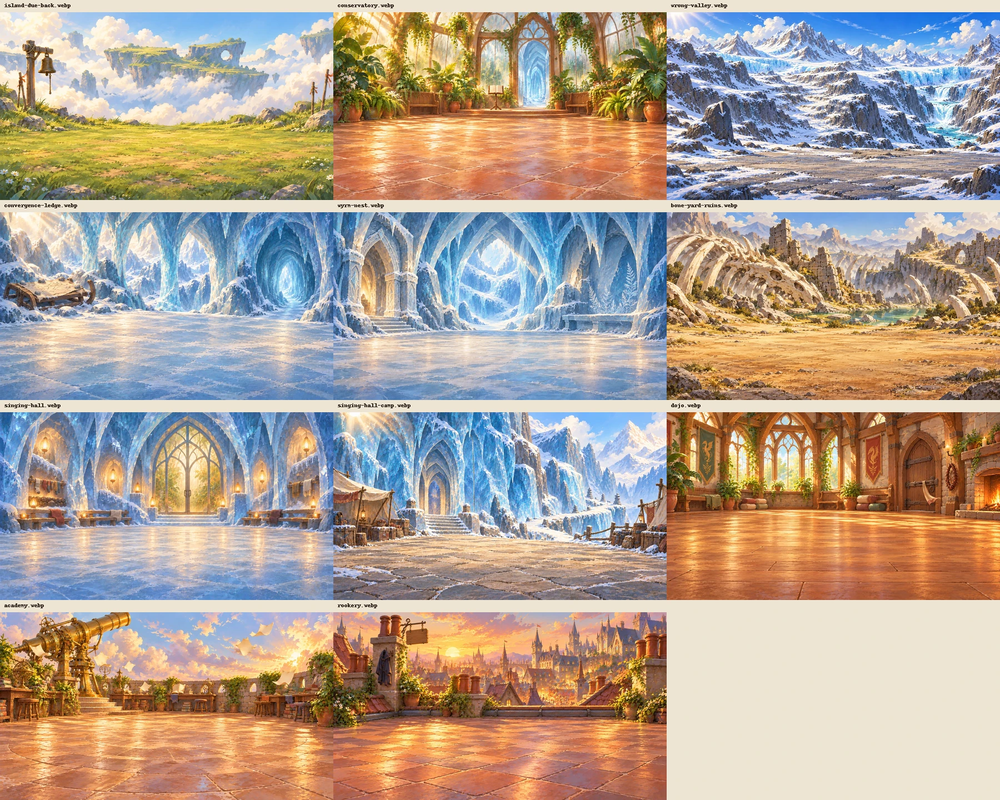
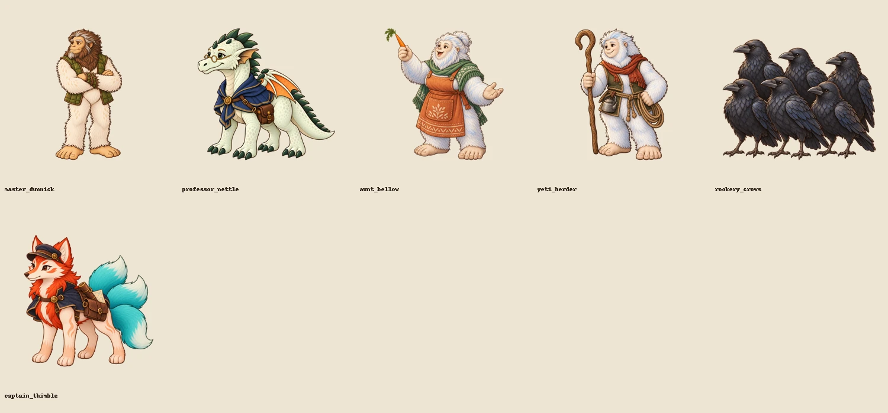
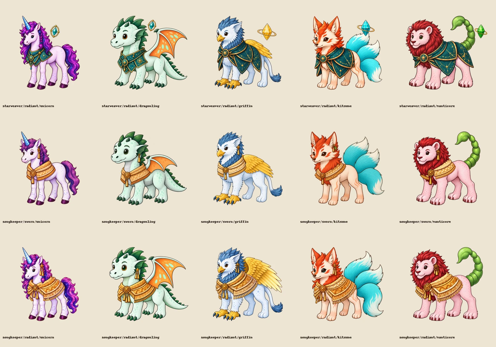

# Riftlight artwork for #397–400

All 32 paintings are delivered: 11 backdrops, five named cast figures, the separate
six-crow flock requested by the owner, and 15 hero variants. The four approved
first-batch assets are unchanged. Built-in `image_gen` made every new painting;
no API/CLI fallback was used.

## Delivery

| Issue | Artwork and wiring |
| --- | --- |
| #397 | Seven Riftlight backdrops: island-due-back, wrong-valley, convergence-ledge, wyrm-nest, bone-yard-ruins, singing-hall and singing-hall-camp. Chapters point at the new paintings. The existing-art wiring pass also covers the quay, river, boundary stones, Cairnstep and ferry bridge. |
| #398 | Campaign-neutral Dojo, Academy, Conservatory and Rookery backdrops; Master Dunnick, Professor Nettle and Aunt Bellow figures. All room and lesson scenes use them. The Rookery has a blank sign and no painted birds; its separately composited flock teaches as a group. |
| #399 | Captain Thimble and the younger outdoorsy yeti herder. Thimble appears throughout her quay conversation. The herder replaces the borrowed elder and remains on stage through the crossing and hall sequence. |
| #400 | Starweaver Radiant ×5, Songkeeper Sworn ×5 and Songkeeper Radiant ×5. Manifest and runtime lookup select all 15 variants. Only the ten out-of-scope Mythic variants remain in inventory. |

Backdrops are 1920×1080 WebP. Every cutout is 1024² RGBA, with the lowest visible
row at y=900. There are no painted rifts, people or lettering in the backdrops.
The Academy shows open sky without a snow- or marsh-specific view. The hall's
drying stones and the camp's sealed wall seam remain ordinary scenery.

[Dark-background cast review](cast-dark.webp).

Master Dunnick is an old 270 cm bigfoot with a thorn bracer. Professor Nettle is a
165 cm adult dragonling with spectacles and a practical academic cape. Aunt Bellow
is a 265 cm yeti with a topknot, green scarf, orange apron and carrot baton. The
250 cm herder has a rust scarf, olive vest, crook, rope and kettle, distinct from
the blue-clothed reading-room elder. Each has standing stance and a height within
its manifest scale band. Thimble remains 115 cm.

The six equal crows are ordinary wildlife rather than a newly invented canonical
people. They use `assets/entities/rookery_crows/assembled.png` and the existing
`stageFigures` contract, like the working animals. The flock's complete pose is
80 cm tall (about 48 cm per front-row bird); no individual is named or singled out. The generated height table
includes the flock and all five named figures.

[Dark-background hero review](heroes-dark.webp). Rows are Starweaver Radiant,
Songkeeper Sworn and Songkeeper Radiant; columns are unicorn, dragonling, griffin,
kitsune and manticore. Sworn uses the simpler wrap and single central bell;
Radiant uses a broader layered wrap and multiple bells. Starweavers preserve
their astral mantle and floating focus stone.

## Validation and limits

- Art verifier: **631 checks passed**. Additional production format/origin checks cover the crow flock.
- All 32 new files have verified dimensions; all 21 cutouts have real alpha, clear margins and registered feet.
- Inventory: **only ten Mythic variants outstanding**, meeting #400's acceptance target.
- Shipped content: **62 checks passed**. The staged Riftlight content gate passed too.
- Renderer, figure sizes and class rooms: **47 tests passed**; repository typecheck passed.
- Semantic comparison to main: every non-art/non-cast field in all 24 chapters is unchanged.
- [Live stage review](stage-review.md) records TV/phone before-and-after captures and their fixture context.

Thimble's sky-island callback lives in conditional variant narration. The current
cast contract cannot conditionally add her to that scene, so it remains unwired;
adding her unconditionally would show her when the callback does not happen. Her
dedicated artwork is complete. No game engine or conditional-cast feature was
introduced in this artwork delivery.

The unfinished local Starweaver unicorn and unrelated #384 work remain untouched
in the original checkout. This branch starts from main and contains its own
complete Radiant unicorn, with all four hooves intact. The owner approved all paintings on 2026-10-21.

## Sources and reproducibility

[First four prompts](prompts.json), [remaining 28 prompts, corrections, sources,
references and SHA-256 hashes](remaining-prompts.json). Final asset paths are
listed in those records. Original generations remain local; exported runtime
assets and portable review sheets are committed.

`package.py <source-directory>` exports the first four. `package_remaining.py
<source-directory>` exports the remaining 28. Both preserve generated alpha and
register whole figures without rigging, repainting or body-part extraction.
