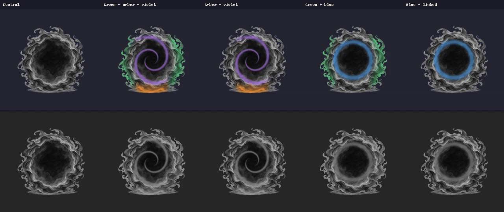
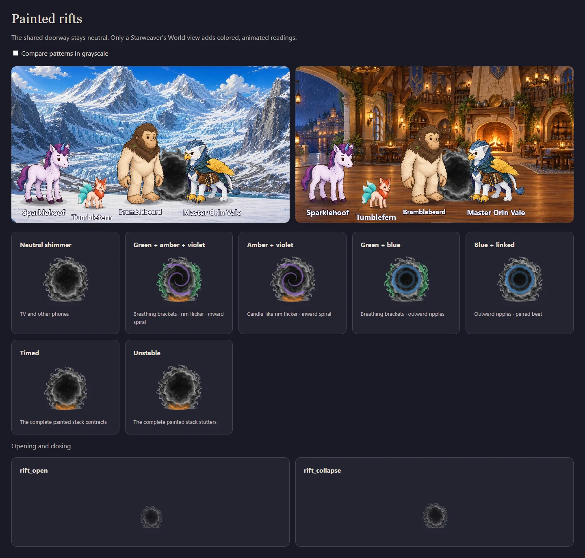

# Painted, animated rifts

Rifts now use the same illustrated doorway in story scenes and the World view.
The procedural hole, orbital dashes, dots, and CSS glow have been replaced with
registered painted animation layers. Each sheet is 24 frames at 12fps, with all
eleven runtime sheets totaling approximately 1.4MB.

The existing palette and its private-information boundary are preserved:
green breathes in outer brackets, amber flickers at the lower rim, blue ripples
outward, and violet travels inward. Only a Starweaver's World-view phone shows
these layers. Every shared story scene stays neutral. Amber's final version is
an attached lower-rim glint with one brief dim-and-catch flicker per cycle,
replacing the earlier swelling teardrop after visual review.

## Animation and grayscale

Color above, grayscale below. The columns show neutral; green + amber + violet;
amber + violet; green + blue; and blue + linked.



## Actual stage and glyphs

This review uses the real Pixi stage and React RiftGlyph, including three heroes
and a guest, against bright glacier and dark tavern backgrounds.



## Reproduce

```
python art/source/painted-rifts/build.py
python art/source/painted-rifts/test_build.py
node tools/art/painted-rifts-review.mjs
```

The browser review asserts phone and TV rendering, reduced motion, valid CSS
frame endpoints, and the stage's opening → neutral loop → closing → gone
lifecycle. Its local screenshots go to `art/review/painted-rifts/`.
The older room-based `cast-shot` harness redirected its TV to the join screen
before reaching the scene, so the direct-renderer review is used here.

Source artwork, exact generation prompt, palette values, and packaging details
are in [art/source/painted-rifts](../../../art/source/painted-rifts/README.md).
