# A grown-up's guide to running a game

Kids & Dragons is a story game for kids about eight. You read the story off a big screen, and each kid plays a hero from a phone or tablet. You need no account and no setup. This guide takes about ten minutes to read. The first part is all you need tonight.

Words in bold are exactly what the buttons and screens say.

<!-- The quick start is the first page when printed. Keep it to one page. -->

## Quick start

1. Open the game on the big screen: a TV with a browser, a laptop, or a tablet.
2. Tap **Want to host? Set up a game**. Keep **Party Mode** picked, and tap **Open the lobby here**.
3. The big screen shows four letters and a square code to scan.
4. Each kid scans the square code with a phone or tablet. They can also open the game, type the four letters, and tap **Join a game**.
5. Each kid makes a hero: what they are, how they fight, what they are best at, and a name. Then they tap **Ready to play** and **I'm ready!**
6. When everyone is ready, any kid taps **Begin the adventure**.
7. Read the story out loud from the big screen. The kids tap their choices on their phones. When it is a kid's turn, their phone says so.
8. A chapter takes 30 to 45 minutes. To stop early, find a rest and tap **Stop here for today**. Next time, open a room the same way and tap **Keep going**.

No TV? Pick **Phone Mode** instead. Everyone plays on phones, and each phone shows the story too.

Without an account, heroes are kept for a week after you last play. To keep them for good, a grown-up taps **Sign in or create an account** on the start screen. There is no password, only a code by email.

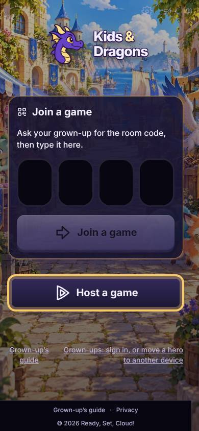

## Party Mode or Phone Mode

There are two ways to play. You pick one when you start a game.

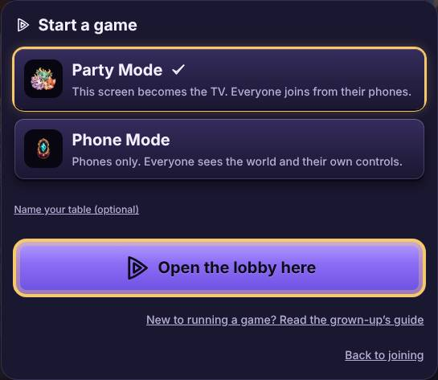

- **Party Mode**: "This screen becomes the TV. Everyone joins from their phones." The big screen shows the story, the map and the fights. It belongs to nobody, so it needs no name. Each phone shows only that kid's own choices.
- **Phone Mode**: "Phones only. Everyone sees the world and their own controls." The phone that starts the game is a player too, so it asks for **Your adventurer name**. Use a nickname, never a real name. At the bottom of each phone, **World** shows the story and **You** shows that kid's turn. A phone jumps to **You** by itself when it is that kid's turn.

You can switch partway. On a phone, open **Room settings** and tap **Play on phones instead** or **Use a TV for the world**.

## Starting a room and seating the kids

In Party Mode, the big screen shows **Room code** with four letters, and a square code. Scan the square code with a phone camera, and it opens the game with the code already typed in. You can also type the four letters under **Join a game**.

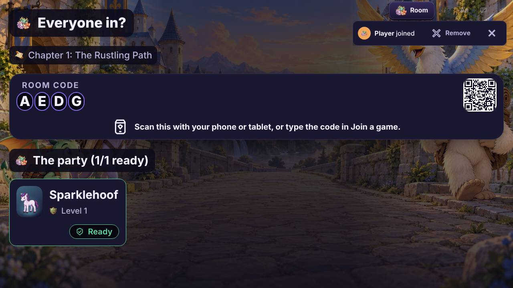

A kid who has played on this phone before sees "Welcome back! Who are you bringing?" They tap a hero, then **Play as** and its name. Or they tap **Make someone new**.

A new kid makes a hero in four steps: "Who are you?", "How do you fight?", "What are you best at?" and "What's your name?" The name step has **Surprise me** for a kid who cannot choose.

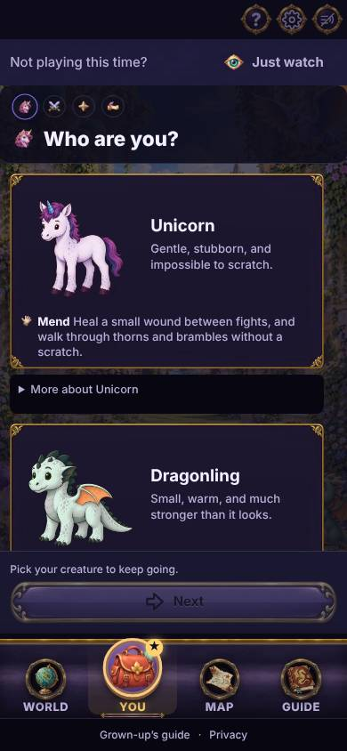

Then they tap **Ready to play**, and **I'm ready!** The big screen shows who is ready. Once everyone here is ready, every phone shows **Begin the adventure**, and any kid can tap it. Later chapters say **Play chapter** and its number instead.

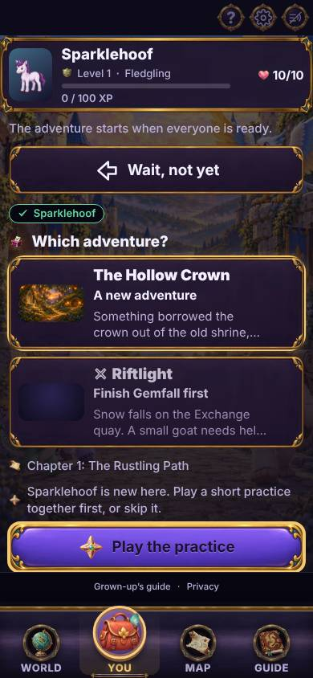

### Reading the story

Read the words on the big screen out loud, in your best voice. The kids answer on their phones. Sometimes everyone votes. Sometimes one hero has the story turn, and their name glows. A roll asks a kid to tap **Roll!** A small number never ends the game; the story goes somewhere else.

In a fight, a kid taps a gold square to walk, or a card to act, then **End my turn**. Nobody dies. A hero who is knocked down gets helped up by a friend standing next to them.

## Running the room

Whoever opened the room runs it. In Party Mode that is the big screen: tap **Room** on it. In Phone Mode it is the phone that started the game: open **Running this room**.

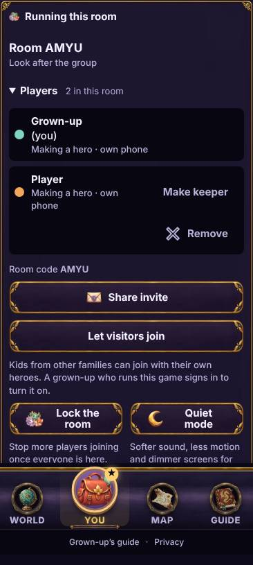

- **Who is in this room** lists everyone, with **Here**, **Away**, **Making a hero** or **Taken out**.
- **Remove** takes a phone out of the game. That phone sees "The person running this game took this phone out of it." When a phone you do not know joins, the big screen says so, with **Remove** beside it.
- **Lock the room**: "Lock it once everyone is in, and nobody else can join with the code." Kids already here can still come back. **Let new players join again** undoes it.
- **Quiet mode**: "For a sleeping sibling or a car ride: softer, calmer and dimmer on every device." It turns on for every phone in the room at once. **Turn quiet mode off** ends it.
- **Stop for today** saves the game. There is more on stopping below.
- **Close the room** ends it for everyone, after one more tap on **Close it**. "Heroes and what they earned are kept."

## When a kid leaves or arrives partway

Phones die and kids wander off. The game keeps going.

When a phone goes quiet, the big screen says "Rosie stepped away." (with the kid's own name), and their hero fades on the board. Nobody has to wait for them:

- In a vote, a phone shows **Decide without** and the names of who is missing.
- Before a fight, a phone shows **Start without** and those names.
- On a missing kid's turn in a fight, any phone can tap **Pass** for their turn. Their hero waits right where they were.

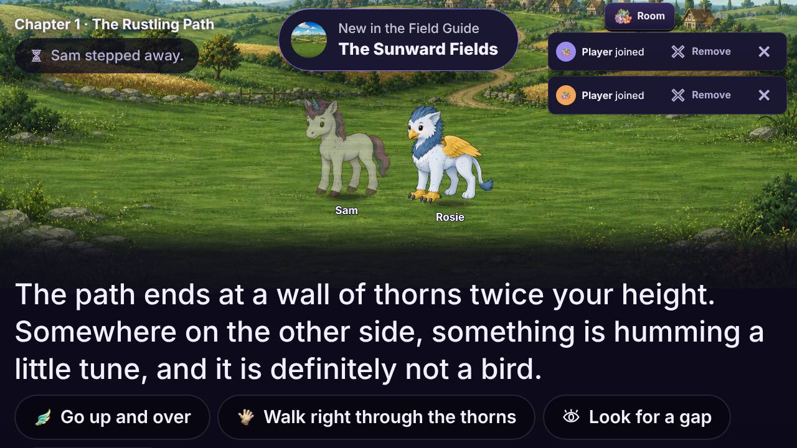

To come back, the kid opens the game on the same phone. It takes them straight back in, with a note that says what is happening, like "Welcome back, Sam!" and "The party is voting on what to do next." They tap **Got it**.

A kid who arrives late joins the same way as everyone else and makes a hero. Their phone says "Welcome, Pip!" (with their own name) and what the party is up to, and they play from there.

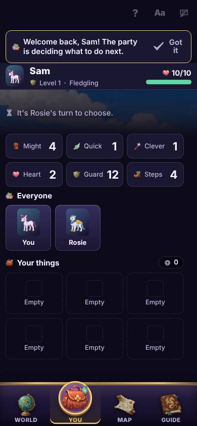

## Stopping and coming back

A chapter is one sitting, but bedtime wins. You can stop in two ways.

- At a rest, the grown-up running the room sees "This is a cozy place to stop for today. Your adventure will wait for you." Tap **Stop here for today**, or **Keep playing**.
- Anywhere in a chapter, open the room controls and tap **Stop for today**, then **Save and stop**.

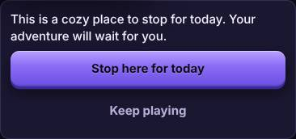

Every screen then says "Your game is saved. Next time, tap Keep going and you will be right back here."

Next time, start a room the usual way. Each kid joins and picks their hero, then taps **Play as** their hero's name. The phones say "You stopped partway through" and the chapter's name. Any kid taps **Keep going**, and you are back where you stopped.

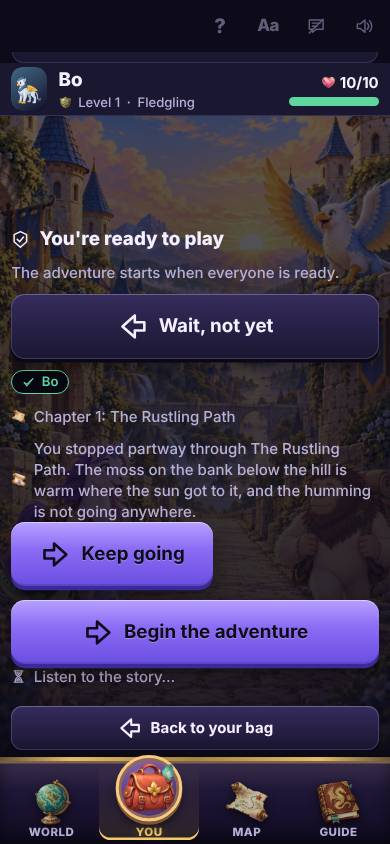

A hero in a saved game is held by that game. If a kid will not be back, the grown-up who ran the room can tap **Let a hero go** on the saved screen. "What they gained in this adventure goes away, and they are free to join any game."

## Making it easier to play

Each screen has a row of small buttons in its corner. They change only that screen.

- **?** is help, on a kid's phone in a game. It says what this screen is for, out loud too. **Hear it again** repeats it. Press and hold anything on the screen, like a card, to hear what it is.
- **Aa** is **Display settings**: **Text size**, **One-handed play** (buttons move to the thumb), **High contrast** and **Less movement**. "Saved on this device."
- The speech bubble turns read-aloud on. On the big screen, it reads the story out loud. On a kid's phone, each choice gets a speaker button to hear it first. Hearing a choice never picks it.
- The speaker turns the sound on or off.

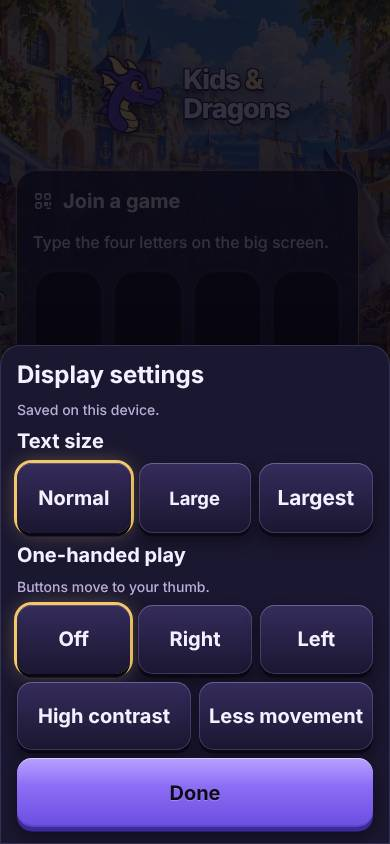

## Keeping heroes: signing in

You can play forever without an account. Without one, heroes "fade after a week away". Each game you play resets the week.

To keep them for good, a grown-up taps **Sign in or create an account** on the start screen. Type an email and tap **Send the code**. Type the eight digits from the email. There is no password. New here? That makes your account. Played before? It signs you back in.

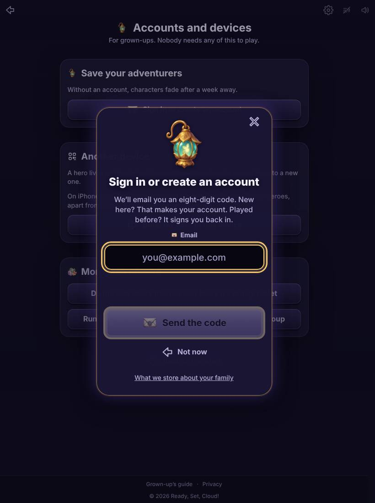

At the end of a chapter, the phone that started the game also offers to keep the party, with a button that says **Keep** and the heroes' names.

Kids never sign in. They are nicknames that a grown-up keeps.

## A tablet the kids share

A family tablet asks who is playing each time, instead of being one kid's. On it, a grown-up taps **Do the kids share this device? Make it a family tablet** and signs in. Nobody stays signed in on it, you included.

After that, it opens on **Who's playing?** with a face for each kid. A kid taps their face, or **Someone new**, then types the four letters and taps **Join a game**. When a game ends, it asks again.

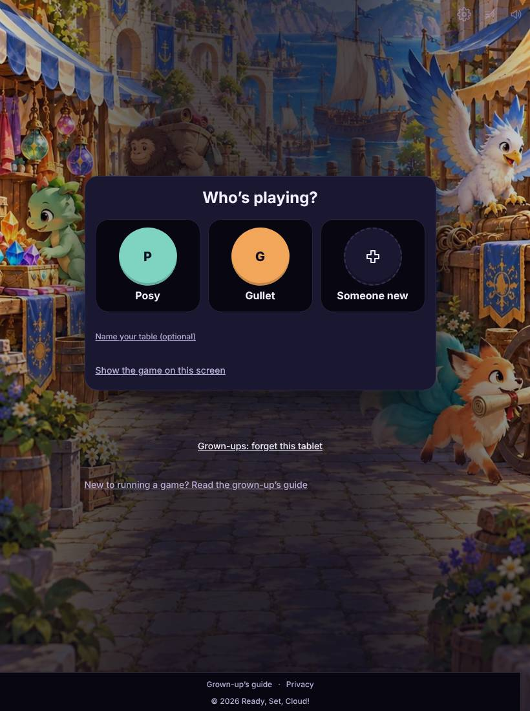

The tablet can also be the big screen. Tap **Show the game on this screen**, and it opens a Party Mode room.

To stop a tablet being the family's, tap **Grown-ups: forget this tablet**. Everyone's heroes stay safe. They were never on the tablet.

## Visitors from another family

A kid from another family plays with their own hero, and everything they earn goes home with them. They cannot join with the four letters. The game tells them their phone belongs to a different household.

To let them in, open the room controls and tap **Let visitors join**. It asks you to sign in as a grown-up who runs this game. The room then has a six-letter code, and the big screen says **Room code (visitors welcome)**. Visitors type those six letters. **Stop new visitors** closes it again, and visitors who are already here stay.

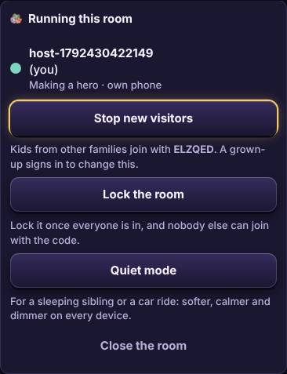

## Running a group

A club, a class, the cousins: a group is for kids from more than one family. Tap **Running games for kids from other families? Run a group** and sign in.

- **Start a new group**, give it a name, and tap **Start it**.
- **Add a kid** with a nickname, and tap **Add**. Kids can also tap **Someone new** on the group's tablet.
- **Invite another grown-up** makes a code for a second grown-up. They sign in, tap **Run a group**, and type it under **Have an organizer code?** It works once, for three days.
- **Take off** hides a kid who stopped coming. **Bring back** returns them, heroes and all.

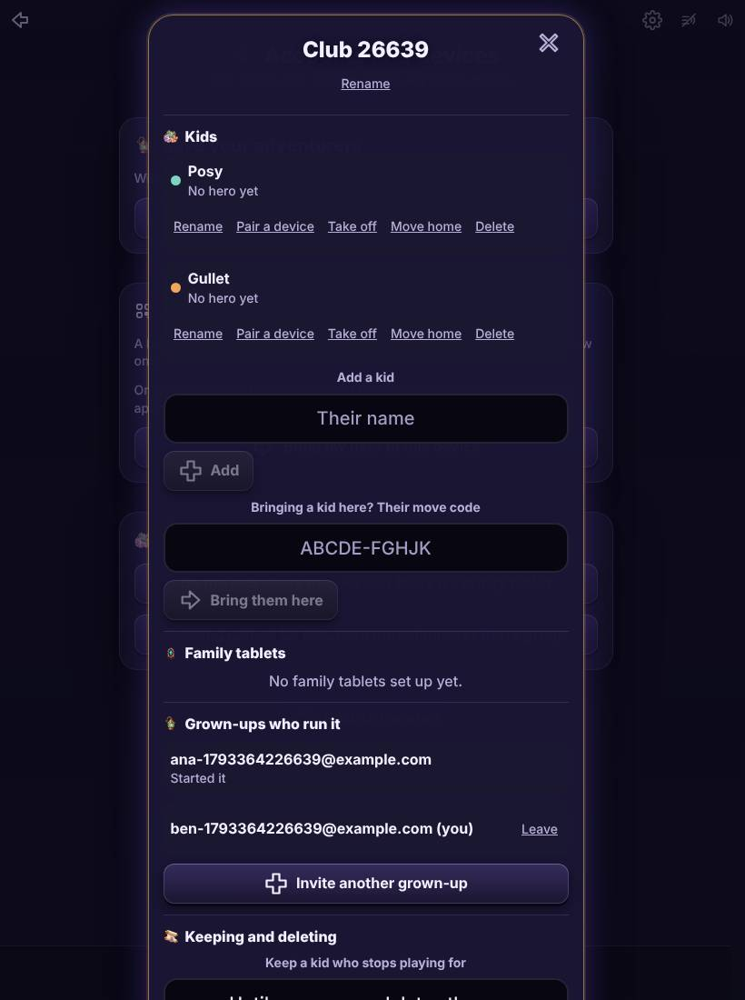

The same screen lists **Family tablets**, with **Forget** for each one.

## A kid on a new device

A kid who plays on their own phone can carry on from another device, like a hospital tablet or a borrowed phone.

1. On the phone they already play on, tap **Play as me on another device**. It shows a code and a square to scan. "It works one time, for 10 minutes."
2. On the new device, tap **I play here already**, type the code, and tap **That's me**.

A grown-up can make the same code from **Run a group**: tap **Pair a device** beside the kid.

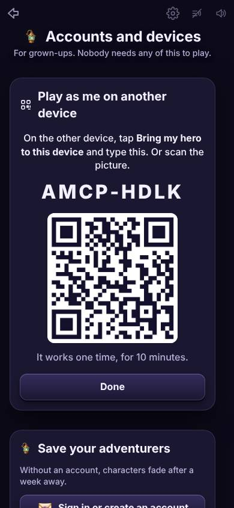

## Moving a hero home

When a kid leaves a group, like at the end of a club's term, their heroes can go home with them.

1. In **Run a group**, tap **Move home** beside the kid. It shows a code for the grown-up taking them home. It works once, for a day.
2. That grown-up signs in, taps **Run a group**, types the code under **Taking a kid home? Their move code**, and taps **Bring them home**.

The kid's heroes, their finds and their own phone go with them. Saved games stay with the group, because a saved game is the group's story.

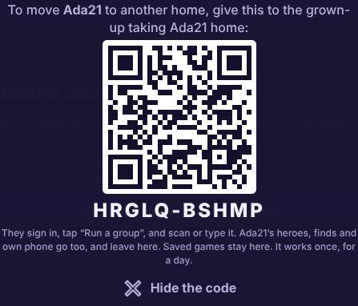

## Deleting

Everything is in **Run a group**, for a signed-in grown-up.

- **Delete** beside a kid removes the kid and all their heroes, everywhere they played. It asks once more first. "This can't be undone."
- **Keep a kid who stops playing for** lets you pick how long a kid who stops playing is kept: from a month to a year without playing, or **Until a grown-up deletes them**.
- At the bottom is a button to delete the whole group and everything in it.
- **What we store, and for how long** lists everything the game keeps, and for how long.

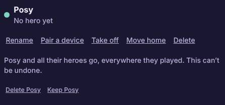

A household nobody signed in to keep is deleted by itself, a week after it last played.
