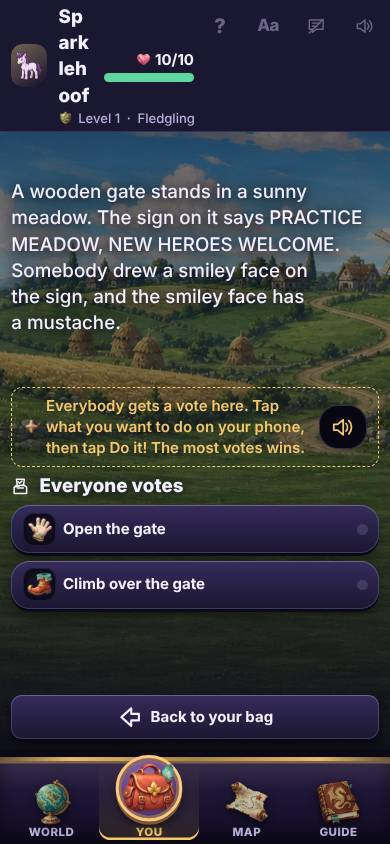

# A grown-up's guide to running a game

Kids & Dragons is a story game for kids about eight. You read the story off a big screen, and each kid plays a hero from a phone or tablet. You need no account and no setup. This guide takes about ten minutes to read. The first part is all you need tonight.

> Words in bold are exactly what the buttons and screens say.

<!-- The quick start is the first page when printed. Keep it to one page. -->

## Quick start

1. Open the game on the big screen: a TV with a browser, a laptop, or a tablet.
2. Tap **Host a game**. Keep **Party Mode** picked, and tap **Open the lobby here**.
3. The big screen shows four letters and a square code to scan.
4. Each kid scans the square code with a phone or tablet. They can also open the game, type the four letters, and tap **Join a game**.
5. Each kid makes a hero: what they are, how they fight, what they are best at, and a name. Then they tap **Ready to play** and **I'm ready!**
6. When everyone is ready, a kid taps **Begin the adventure**. If a hero is new, the phones first offer a short practice: tap **Play the practice**, or the button that skips it.
7. Read the story out loud from the big screen. The kids tap their choices on their phones. When it is a kid's turn, their phone says so.
8. A chapter takes 30 to 45 minutes. To stop early, find a rest and tap **Stop here for today**. Next time, open a room the same way and tap **Keep going**.

> No TV? Pick **Phone Mode** instead. Everyone plays on phones, and each phone shows the story too.

> Without an account, heroes are kept for a week after you last play. To keep them for good, a grown-up taps **Grown-ups: sign in, or move a hero to another device** at the bottom of the start screen, then **Sign in or create an account**. There is no password, only a code by email.
>
> That same link is where every grown-up errand lives: signing in, a tablet the kids share, a group, and moving a hero to a new device. Nobody needs it to play.

## Party Mode or Phone Mode

There are two ways to play. You pick one when you start a game.

- **Party Mode**: "This screen becomes the TV. Everyone joins from their phones." The big screen shows the story, the map and the fights. Each phone shows only that kid's own choices.
- **Phone Mode**: "Phones only. Everyone sees the world and their own controls." The phone that starts the game is a player too, so it asks for **Your adventurer name**. Use a nickname, never a real name. At the bottom of each phone, **World** shows the story and **You** shows that kid's turn. A phone jumps to **You** by itself when it is that kid's turn.

> You can switch partway. On a phone, open **Room settings** and tap **Play on phones instead** or **Use a TV for the world**.

## Starting a room and seating the kids

In Party Mode, the big screen shows **Room code** with four letters, and a square code. Scanning the square with a phone camera opens the game with the code typed in. You can also type the four letters under **Join a game**. In Phone Mode, the code and the square are on the **World** screen of the phone that started the game.

A kid who has played on this phone before sees "Welcome back! Who are you bringing?" They tap a hero, then **Play as** and its name. Or they tap **Make someone new**.

A new kid makes a hero in four short steps, starting with "Who are you?" and ending with a name. **Help me choose** suggests where to put the points, and **Surprise me** picks a name for a kid who cannot choose. A line above the buttons says what to do next. When the hero is made, the phone says "Meet Sam!" for a moment.

Then they tap **Ready to play**, and **I'm ready!** The big screen shows who is ready. Once everyone here is ready, the big screen says "Everyone is ready! Start the adventure on a phone." and every phone shows **Begin the adventure**. Any kid can tap it. Later chapters say **Play chapter** and its number instead.

### The practice, for new heroes

When a hero is brand new, the phones say so: "Play a short practice together first, or skip it." **Play the practice** plays a short chapter, about 15 minutes, where everyone learns by doing, one step at a time. Each step has a hint on the phone, and **Hear the hint** reads it out. Nothing in the practice costs anything, and nothing is lost.

The other button skips the practice and begins the adventure. Kids who have played before never see the offer unless someone new is sitting with them. When the practice ends, the next **Begin the adventure** starts the real one.

### Reading the story

Read the words on the big screen out loud, in your best voice. The kids answer on their phones. Sometimes everyone votes. Sometimes it is one hero's turn to choose, and the others wait. A roll asks a kid to tap **Roll!** A small number never ends the game; the story goes somewhere else.

In a fight, a kid taps a gold square to walk, or a card to act, then **End my turn**. Nobody dies. A hero who is knocked down gets back up when a friend stands next to them and plays **Help Up**.

## Running the room

Whoever opened the room runs it. In Party Mode that is the big screen: tap **Room** on it. In Phone Mode it is the phone that started the game: open **Running this room**.

Tap **Players** to open the list of everyone in the room, as the picture shows it. Each is marked **Here**, **Away**, **Making a hero** or **Taken out**.

- **Remove**: Takes a phone out of the game. That phone sees "The person running this game took this phone out of it." Each time a phone joins, the big screen says who joined, with **Remove** beside it, so a stranger is one tap from gone.
- **Lock the room**: "Stop more players joining once everyone is here." Kids already here can still come back. **Let new players join again** undoes it.
- **Quiet mode**: "Softer sound, less motion and dimmer screens for everyone." It turns on for every phone in the room at once. **Turn quiet mode off** ends it.
- **Make keeper**: Picks which phone is offered to keep the heroes. See the accounts and devices guide.
- **Stop for today**: Saves the game for next time.
- **Crews**: Open it, then tap **New players? Start a new crew** to start separate saves. Phones stay connected for new heroes. Existing heroes and adventures stay saved. Tap **Change crew** on the lobby screen to go straight there. To go back to another crew, tap **Play as** and its name: each crew keeps its place in its own adventure. Tap **Rename this crew** to pick a different name from the list.
- **Close the room**: Ends it for everyone, after one more tap on **Close it**. "Heroes and what they earned are kept."

## When a kid leaves or arrives partway

Phones die and kids wander off. The game keeps going.

When a phone goes quiet, the big screen says "Rosie stepped away." (with the kid's own name), and their hero fades on the board. Nobody has to wait for them:

- In a vote, a phone shows **Decide without** and the names of who is missing.
- Before a fight, a phone shows **Start without** and those names.
- On a missing kid's turn in a fight, any phone can tap **Pass** for their turn. Their hero waits right where they were.

To come back, the kid opens the game on the same phone. They are straight back in, with a note like "Welcome back, Sam!" and "The party is voting on what to do next." They tap **Got it**.

A kid who arrives late joins the same way as everyone else and makes a hero. Their phone says "Welcome, Pip!" (with their own name) and what the party is up to, and they play from there.

## Stopping and coming back

A chapter is one sitting, but bedtime wins. You can stop in two ways.

- At a rest, the grown-up running the room sees "This is a cozy place to stop for today. Your adventure will wait for you." Tap **Stop here for today**, or **Keep playing**.
- Anywhere in a chapter, open the room controls and tap **Stop for today**, then **Save and stop**.

Every screen then says "Your game is saved. Next time, tap Keep going and you will be right back here."

Next time, start a room the usual way. Each kid joins and picks their hero, then taps **Play as** their hero's name. The phones say "You stopped partway through" and the chapter's name. Any kid taps **Keep going**, and you are back where you stopped.

A hero in a saved game is held by that game. If a kid will not be back, the grown-up who ran the room can tap **Let a hero go** on the saved screen. "What they gained in this adventure goes away, and they are free to join any game."

## Making it easier to play

Each screen has a row of small buttons in its corner. They change only that screen.

- **?** is help, on a kid's phone in a game. It says what this screen is for, out loud too. **Hear it again** repeats it, and **How to play** opens a few short cards a kid can tap to hear. Press and hold anything on the screen, like a card, to hear what it is.
- **Aa** is **Display settings**: **Text size**, **One-handed play** (buttons move to the thumb), **TV focus**, **High contrast** and **Less movement**. "Saved on this device."
- **TV focus** is for a kid who gets lost in the phone. With a TV in the room, the phone stops repeating the story and shows only what to tap, right when it is that kid's turn. While someone else is choosing, it shows one card that says **Look at the TV**, with **Look in my bag** a tap away. The tray keeps only **You** (a Starweaver keeps **World** too, for the Riftlight). It does nothing in Travel Mode, where the phone is the only screen.
- The speech bubble turns read-aloud on. On the big screen, it reads the story out loud. On a kid's phone, each choice gets a speaker button to hear it first. Hearing a choice never picks it.
- The speaker turns the sound on or off.

